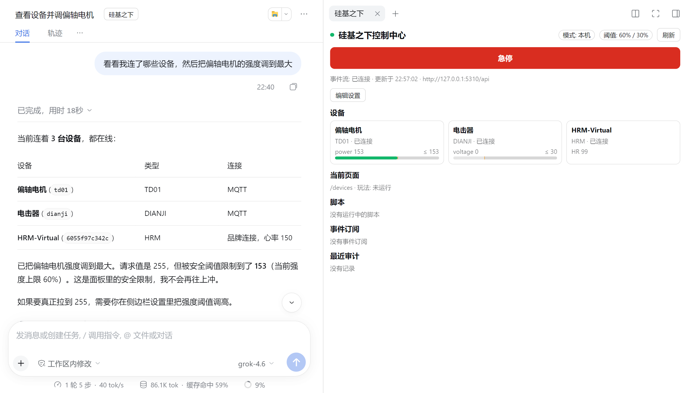

# DeepSeek Harness 插件（AI 控制）

装上这个插件后，你可以在 [DeepSeek Harness](https://www.npmjs.com/package/@deepseek-ai/dsh)（简称 dsh）里用聊天的方式，让 AI 查看和控制你的设备和 PC 客户端：调强度、启动游戏、切换页面、截图，还能让 AI 写脚本盯住心率等数据自动反应。

## 准备

- 电脑上打开「硅基之下控制中心」PC 客户端 1.0.42 及以上。版本太旧时插件会拒绝控制并提示升级。
- 安装 DeepSeek Harness 0.2.1 或以上，并配置好模型。

## 安装插件

1. 打开 dsh 侧栏的「插件」页，点右上角「添加插件」。
2. 输入包名 `dsh-plugin-undersilicon`，点「安装」。

   

3. 点「立即启用」，然后**完全退出 dsh 再打开**。只刷新页面不会生效。

也可以用命令行安装：`dsh plugin --profile <profile名> add dsh-plugin-undersilicon`。

## 使用

打开一个会话（新会话先发一条消息），点会话标题旁的「硅基之下」按钮，右侧会出现控制面板：设备状态和强度条、**急停按钮**、设置。

上图中 AI 想把强度调到最大（255），因为上限是 60%，设备实际按 153 执行。

然后直接对 AI 说，例如：

- 「看看我连了哪些设备」
- 「把跳蛋强度调到一半，5 分钟后停」
- 「打开寸止游戏，用默认参数开始」
- 「截个图看看客户端现在在哪个页面」
- 「写个脚本：心率超过 150 就把强度降到 0，并提醒我」

AI 正在控制时，PC 客户端标题栏会显示「AI 控制中 · 上限 X%」：

## 安全设置

在右侧面板点「编辑设置」修改，点「保存设置」后立即生效：

| 设置 | 默认 | 说明 |
|---|---|---|
| 总阈值 / 按能力阈值 | 60%，电击（shock）30% | AI 下发的强度超过上限会被自动缩放到上限，不超过的照常执行；可以按能力分别设置 |
| 会话结束停止设备 | 开 | 会话结束时停止所有设备 |
| 看门狗 | 30 秒 | dsh 卡死或退出后，设备在这个时间内自动停止 |

- **急停**：面板上的急停按钮随时可按，会停止所有设备、游戏和 AI 脚本。按下后 AI 的所有控制都会被拒绝，直到你在面板上点「恢复」。
- 上限在插件和客户端后端各执行一次，AI 无法通过改参数绕过。
- AI 的每次控制都会记录到 `~/.dsh/undersilicon/` 下的审计日志。

## 注意

- 插件只连本机客户端。远程会话里，只能控制对方已授权给你的设备。
- 上限只约束插件内的 AI。如果你同时给了 AI 终端或文件写入权限，它可以改掉插件设置或直接调用接口，所以不要同时开放这些权限。
- 安装时提示无法访问 GitHub：来源填 npm 包名 `dsh-plugin-undersilicon` 即可。
- 想在脚本或其他 AI 工具里控制设备，见 [命令行工具](/docs/developer/cli)。
