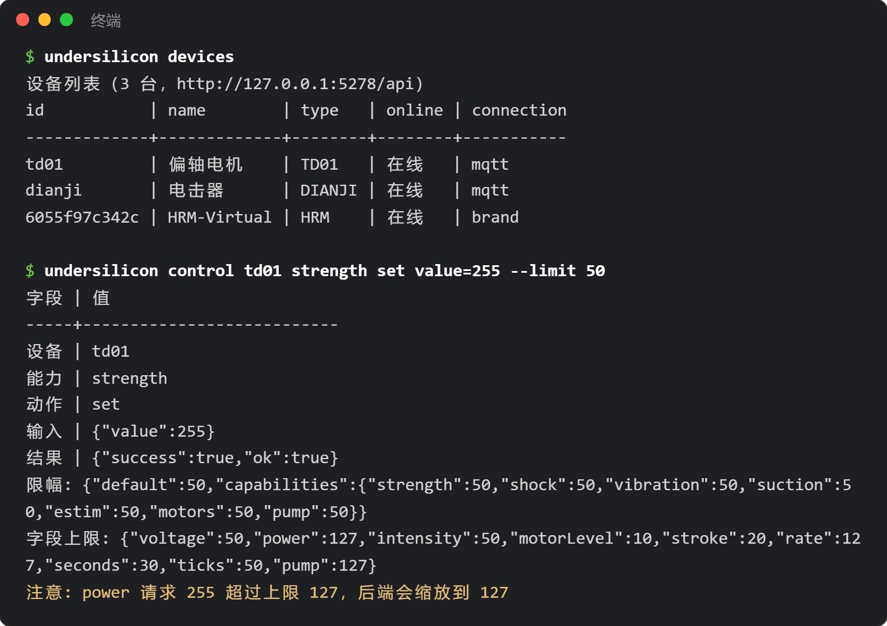

# 命令行工具（CLI）

`undersilicon` 是控制「硅基之下控制中心」PC 客户端的命令行工具：查设备、调强度、启动游戏、截图、监听事件。适合写脚本做自动化，也适合交给 Claude Code、Codex 这类 AI 编程助手调用。



## 安装

需要先装 [Node.js](https://nodejs.org/) 18 或以上。

```bash
npm i -g undersilicon-cli
undersilicon status
```

不想全局安装，也可以直接 `npx undersilicon-cli status`。

使用前先打开 PC 客户端。CLI 默认连接本机 `http://127.0.0.1:5278/api`。

:::info 客户端版本
窗口、截图、事件、限幅等功能需要客户端 1.0.42 及以上。更旧的版本只能用设备、急停和游戏启停命令，其余命令会提示升级。
:::

## 常用命令

```bash
undersilicon devices                                 # 设备列表
undersilicon device dev01                            # 设备详情、能力和参数范围
undersilicon control dev01 strength set value=120    # 按能力控制
undersilicon op dev01 stop                           # 预置操作
undersilicon stop                                    # 急停：停所有设备和当前游戏

undersilicon games                                   # 游戏列表
undersilicon game:start surge-edging --device motor=dev01 --device punish=dev02
undersilicon game:status
undersilicon game:stop

undersilicon window show                             # 显示窗口，也可 hide/minimize 等
undersilicon routes                                  # 可以打开的页面
undersilicon open plays                              # 打开游戏库页面（/plays）
undersilicon screenshot shot.png                     # 截图

undersilicon events --types device,game --count 20   # 实时事件，一行一条
```

每条命令都可以加 `--help` 查看用法，`undersilicon help` 列出全部命令。

- `game:start` 的设备角色名（如 motor、punish）在 `undersilicon games` 的列表里能看到。
- 在 Windows 的 Git Bash 里，`open /plays` 会被终端改写，写成 `open plays` 即可。

## 通用参数

| 参数 | 作用 |
|---|---|
| `--json` | 输出 JSON，方便脚本和 AI 解析 |
| `--api <地址>` | 换后端地址，也可设环境变量 `UNDERSILICON_API` |
| `--limit <0-100>` | 开启强度上限（见下节） |

成功时退出码为 0，运行失败为 1，参数写错为 2。

## 强度上限（可选）

默认不限幅，CLI 的操作和你在客户端里手动操作一样。加上 `--limit` 后，后端会把超过上限的强度自动缩放到上限，不超过的照常执行：

```bash
undersilicon control dev01 strength set value=255 --limit 50          # 实际按 127 执行
undersilicon control dev01 shock start voltage=80 --limit 60 --cap-limit shock=30
```

- `--limit`：所有强度的上限百分比。`--cap-limit` 按能力单独设置，能力有 strength、shock、vibration、suction、estim、motors、pump。
- 也可以用环境变量 `UNDERSILICON_LIMIT`、`UNDERSILICON_CAP_LIMIT` 设置，省得每条命令都写。
- 限幅期间客户端标题栏会显示「AI 控制中 · 上限 X%」：

  

- 限幅有效期 10 分钟（`--lease-ttl` 可改，最长 600 秒），每执行一条带限幅的命令会重新计时。到期后，在限幅下启动的游戏会自动停止。
- `undersilicon lease:release` 立即结束限幅，并停止这些游戏。
- 客户端版本太旧、不支持限幅时，命令会直接报错，不会在不限幅的情况下执行。

:::warning 给 AI 用时
限幅只对带了这个参数的命令生效。如果 AI 能自由执行终端命令，它也能去掉参数。真正需要防护时，用 [DeepSeek Harness 插件](/docs/developer/dsh-plugin)，或者只让 AI 运行你写好的脚本。急停 `undersilicon stop` 任何时候都可以用。
:::
