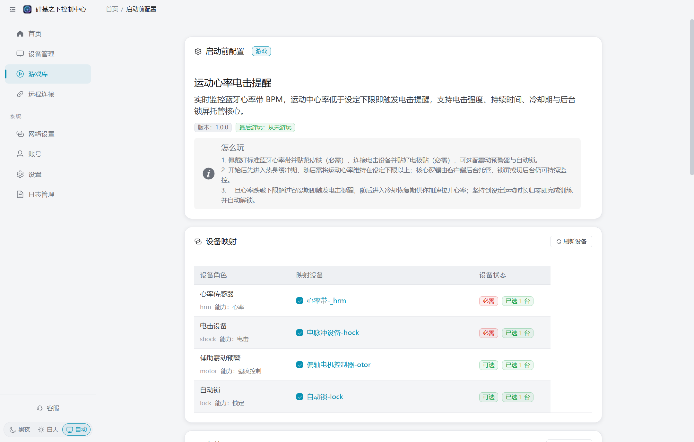
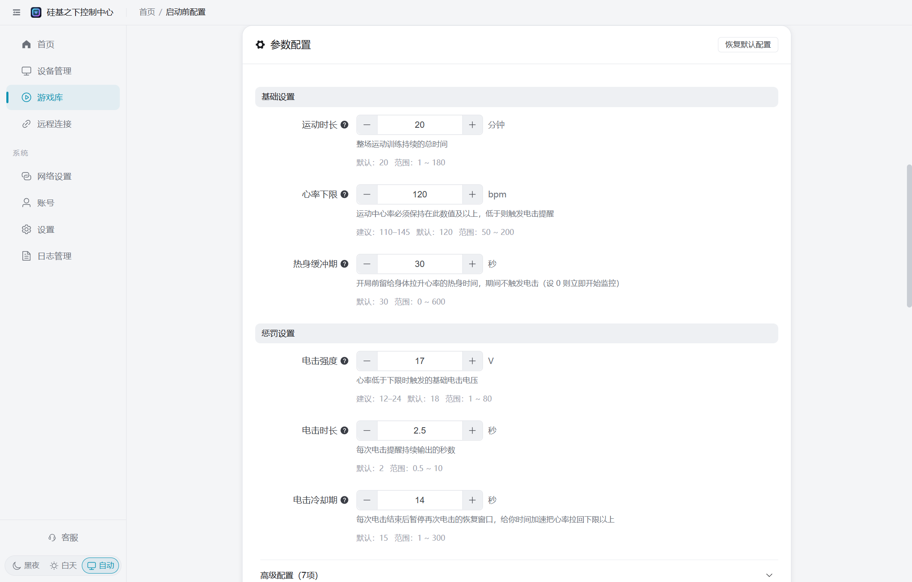
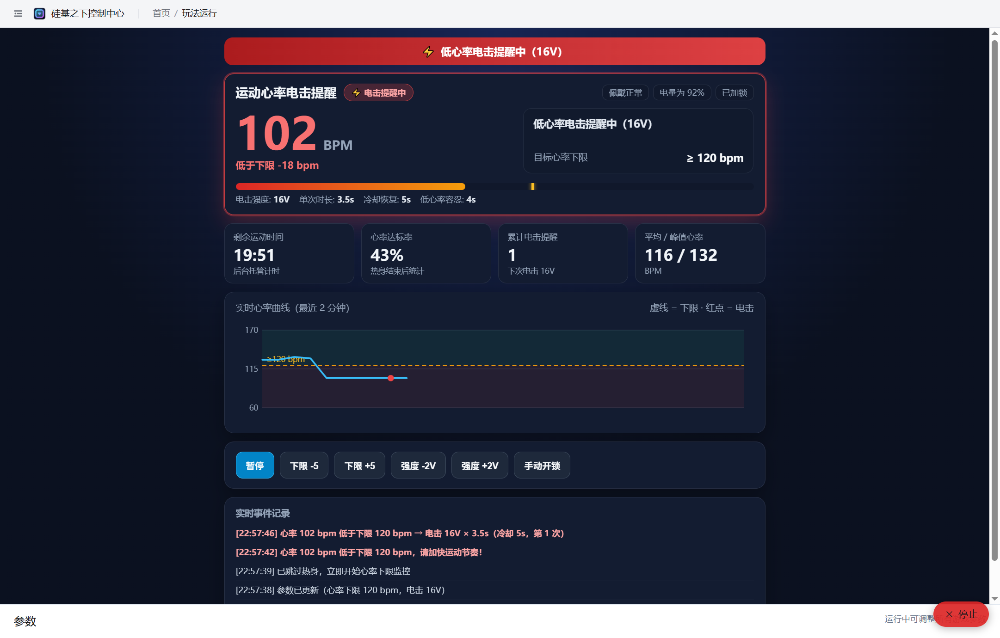

# 运动心率电击提醒

在跑步、跳绳、骑行或居家有氧训练时连接标准蓝牙心率带实时监测心率（BPM）：**心率跌破设定下限超过容忍期即触发电击提醒**，随后进入冷却恢复期给你时间加速拉回心率，坚持到设定时长结束即完成训练并自动解锁。

玩法内置客户端后台托管核心（`HostRuntime`），开启后台运行后即使手机锁屏放进口袋或切换页面，也能持续监测心率并执行提醒。

> ⚠️ 单人游玩或贴电极片前，请务必先阅读 [安全须知](/docs/player/solo-safety)。电极贴严禁贴在胸口、心脏附近、头颈部，避免与胸部心率带接触短路。

## 所需设备

| 设备角色 | 是否必需 | 说明 |
| --- | --- | --- |
| 心率传感器（`hrm`） | 是 | 任意支持标准蓝牙心率协议（BLE `0x180D`）的心率胸带或光电臂带，贴紧皮肤实时上报 BPM |
| 电击设备（`shock`） | 是 | 心率低于下限时执行电击提醒，可使用 [寸止综合设备](/docs/device/cunzhi01)、背单词电击强化器、DIANJI、郊狼等具备 `shock` 能力的设备 |
| 辅助震动预警（`motor`） | 否 | 在低心率容忍期内提前震动提醒加速（如寸止综合设备、TD01 等） |
| [自动锁](/docs/device/lock-controller)（`lock`） | 否 | 启动训练自动上锁，暂停时临时解锁，完成或停止自动开锁 |

使用寸止综合设备时，同一台设备可同时勾选到「电击设备」与「辅助震动预警」两个槽位。

## 快速开始

### 1. 穿戴与连接设备

1. 将蓝牙心率带贴紧皮肤佩戴好（电极胸带建议先用清水微湿电极区），确认能正常采集心率。
2. 将电脉冲贴片贴在大腿等安全部位，打开电源。
3. 在手机或电脑打开控制客户端并连接心率带与电击设备，下载与连接方法见 [客户端下载与设备连接](/docs/player/new-phone-client)。

### 2. 映射设备与设置参数

在客户端「游戏库」中找到 **运动心率电击提醒**，进入启动前配置页，勾选心率传感器与电击设备（及可选的震动预警、自动锁）：

根据自身体能设置 **运动时长**、**心率下限**、**热身缓冲期** 以及 **电击强度 / 时长 / 冷却期**。首次使用请先从低电压（如 `12–16 V`）、短时长开始测试体感；如果希望手机锁屏期间继续监测，展开底部 **高级设置** 打开「锁屏/切后台继续运行」：

### 3. 启动运动与实时监控

点击启动后进入运行界面，可实时查看当前 BPM、心率达标率、累计电击次数、最近 2 分钟心率曲线与事件记录，并支持在运动中快捷点击 **暂停 / 继续**、**下限 ±5**、**强度 ±2V** 或 **手动开锁**：

## 阶段流转与安全保护

整局训练按以下闭环运行：

**热身缓冲期 → 达标巡航 → 低心率容忍预警（可选震动提醒）→ 电击提醒 → 冷却恢复期 → 回到心率监控**

- **热身缓冲期**：默认开局前 `30 秒` 供身体拉升心率，期间不会触发震动或电击；也可随时点击「跳过热身」立即开始监控。
- **低心率预警与电击**：心率跌破下限时先进入容忍倒计时（已映射震动器时会提前震动预警）；若容忍期满仍未回到下限以上，则按设定电压和时长执行一次电击提醒。
- **冷却恢复期**：单次电击结束后自动断电并进入冷却窗口，冷却期内不再重复触发电击，留出提速拉升心率的时间。
- **脱落与断连保护**：运动中心率带松脱、未贴合皮肤或蓝牙断连（心率归零）时，系统会**立即切断电击与震动输出**，零值期间绝不会误触发电击；重新贴合恢复信号后自动衔接。
- **结束与复位**：倒计时归零或手动点击右下角「停止」后，所有电击、震动输出立即归零，已连接的自动锁自动开锁。

## 参数说明

### 常规参数

| 参数 | 默认值 | 范围 | 说明 |
| --- | --- | --- | --- |
| 运动时长 | 20 分钟 | 1–180 分钟 | 整场运动训练持续的总时间 |
| 心率下限 | 120 bpm | 50–200 bpm | 运动中需保持的最低心率（建议有氧区间 `110–145 bpm`） |
| 热身缓冲期 | 30 秒 | 0–600 秒 | 开局前拉升心率的热身时间，期间不电击（设 `0` 立即开始监控） |
| 电击强度 | 18 V | 1–80 V | 低于心率下限时触发的基础电击电压（默认最高限幅 `30 V`） |
| 电击时长 | 2 秒 | 0.5–10 秒 | 每次电击提醒持续输出的秒数 |
| 电击冷却期 | 15 秒 | 1–300 秒 | 每次电击结束后暂停再次电击的恢复窗口 |

### 高级设置（折叠项）

| 参数 | 默认值 | 说明 |
| --- | --- | --- |
| 锁屏/切后台继续运行 | 关 | 开启后手机锁屏或切后台继续由托管核心监控；关闭则切后台自动安全停机 |
| 低心率容忍期 | 5 秒 | 心率连续低于下限满该秒数才触发电击，防止瞬时波动误电 |
| 连续偷懒递增强度 | 关 | 开启后若连续低心率触发电击则逐次升高电压（可设每次递增电压与递增上限），心率恢复达标满 3 秒自动重置 |
| 低心率震动预警强度 | 80 | 低心率容忍期内辅助震动设备的提醒强度（`0–255`，设 `0` 关闭，映射震动设备后显示） |
| 允许超过30V | 关 | 关闭时实际输出最高限制在 `30 V` 以内；开启前请谨慎评估自身耐受度 |
| 信号丢失处理 | 暂停判定等待信号恢复 | 心率信号中断时一律立即停电；可选持续等待恢复，或超出宽限期（默认 `8 秒`）自动暂停训练计时 |
