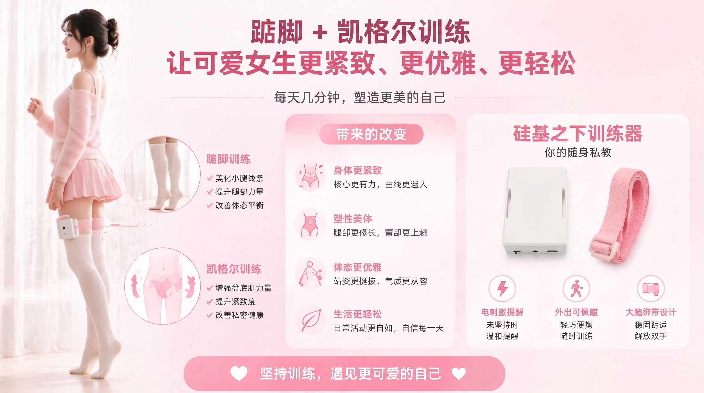

踮脚结合提肛是一种有效的体态训练方式，能够帮助强化盆底肌群和小腿肌肉。本教程将教你如何使用智能训练设备进行踮脚提肛训练。

> 🛒 **设备获取**：[淘宝购买](https://item.taobao.com/item.htm?id=1028272889035)  
> 🎬 **视频教程**：[硅基之下视频站](https://video.undersilicon.com/w/pcesS2gYvbfuU5Wcf5v7fQ) | [YouTube](https://youtu.be/Q7ti6oOdhpc)

## 准备工作

1. **连接客户端**：请先安装APP并连接主机，详见 [客户端下载与设备连接](/docs/player/new-phone-client)。
2. **穿戴设备**：
   - **盆底肌传感器**：配合润滑使用，侧卧放松后缓慢置入。注意循序渐进，不要急于求成。
   - **电极片**：贴在大腿部位（左右各一），用于提供训练反馈刺激。
   - **踮脚传感器**：塞入袜子或鞋内，贴紧脚后跟位置。
   - **主机**：用绑带固定在大腿上，将以上配件的线缆接入主机。连接方式如下图所示：

   

## 开始训练

1. **选择设备**：在APP中点击已连接的设备。
2. **选择玩法**：模式选择为"**踮脚提肛**"。
3. **设置参数**：设定合适的反馈强度（EMS电脉冲参数）。
4. **开始体验**：点击开始，进入训练状态。

## 训练规则

设备会实时检测你的身体动作。在训练过程中：
- 需要**保持盆底肌持续收缩**。
- 需要**保持脚后跟悬空（离地）**。

当检测到动作不到位时，设备会通过电脉冲进行提醒，帮助你重新调整姿态。坚持训练，逐步提升核心控制力。

### 注意事项
1. 传感器的清洗与收纳方式见 [组装与佩戴](/docs/device/cunzhi01/assembly#清洗与收纳)。
2. 电脉冲与电压安全事项见 [单人游玩必读](/docs/player/solo-safety)。
