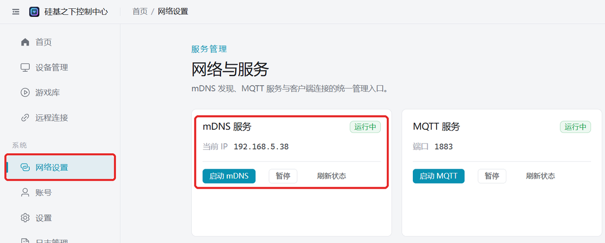

# 电脑走家里 WiFi（无热点时）

电脑开不了热点（如台式机没有无线网卡、公司电脑禁用热点）时，可以让设备和电脑连同一个路由器，客户端通过 mDNS 在局域网里找到设备。

## 前提

- 家里有 **2.4G** WiFi（2.4G/5G 同名的双频合一路由器也可以）。
- 电脑和设备连在同一个路由器下（电脑用网线或 WiFi 都行）。
- 路由器支持 mDNS（大部分都支持），不确定可以先[检测路由器是否支持 mDNS](/docs/other/check-mdns)。

## 步骤

1. **设备配网**：把设备连到家里的 2.4G WiFi，任选一种方式：
   - [通过电脑客户端配网](/docs/other/wifi-config/pc-bluetooth)（电脑需要有蓝牙）
   - [通过 APP 配网](/docs/other/wifi-config/app)
   - [通过小程序配网](/docs/other/wifi-config/miniprogram)
2. **确认客户端已启用 mDNS**：客户端启动时会自动开启 mDNS。打开左侧「网络设置」，「mDNS 服务」显示「运行中」即可；如果显示已停止，点击「启动 mDNS」。
   
3. **重启设备**：约 15~30 秒后设备会出现在「设备管理」里。

## 设备没出现

- 关闭电脑防火墙后再试。
- 确认电脑和设备连的是同一个路由器，访客网络、开了 AP 隔离的网络无法互相发现。
- 配网后设备会关闭蓝牙；想改回手机蓝牙直连，需要把设备切回 BLE 模式。
