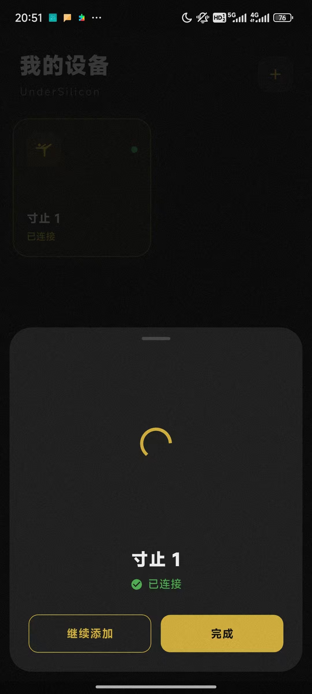

# 蓝牙直连（手机）

手机客户端日常控制设备用蓝牙直连，不需要 WiFi。开启设备后蓝灯闪烁，手机打开蓝牙，按下面步骤添加：

1. 开启设备，此时设备应该为蓝灯闪烁状态（如不闪烁请先充电）。
2. 打开客户端，点击「添加设备」或右上角加号。
   
3. 点击「添加设备」。
   
4. 点击「完成」。
   
5. 添加成功即已连接，连接成功后蓝灯会常亮几秒之后熄灭。
   

:::note
设备的蓝牙和 WiFi 是二选一的：配网或连上热点后设备会自动关闭蓝牙；需要蓝牙直连时，请把设备切回 BLE 模式。
:::
