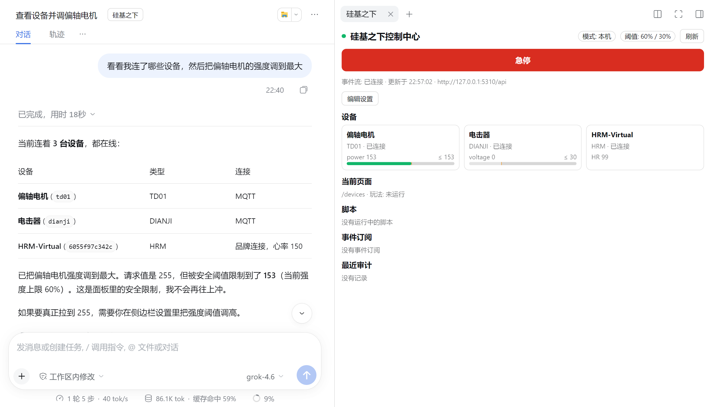

# DeepSeek-Harness-Plugin (KI-Steuerung)

Mit diesem Plugin kannst du in [DeepSeek Harness](https://www.npmjs.com/package/@deepseek-ai/dsh) (kurz dsh) per Chat deine Geräte und den PC-Client von der KI anzeigen und steuern lassen: Stärke einstellen, Spiele starten, Seiten wechseln, Screenshots erstellen — und die KI kann Skripte schreiben, die z. B. auf Herzfrequenzdaten automatisch reagieren.

## Vorbereitung

- Auf dem Computer den PC-Client „Untersilicon Control Center“ in Version 1.0.42 oder höher öffnen. Bei älteren Versionen verweigert das Plugin die Steuerung und fordert zum Upgrade auf.
- DeepSeek Harness 0.2.1 oder höher installieren und ein Modell konfigurieren.

## Plugin installieren

1. Öffne in der dsh-Seitenleiste die Seite „Plugins“ und klicke oben rechts auf „Plugin hinzufügen“.
2. Gib den Paketnamen `dsh-plugin-undersilicon` ein und klicke auf „Installieren“.

   

3. Klicke auf „Jetzt aktivieren“ und beende dsh anschließend **vollständig und starte es neu**. Ein bloßes Neuladen der Seite reicht nicht.

Alternativ per Kommandozeile installieren: `dsh plugin --profile <Profilname> add dsh-plugin-undersilicon`.

## Verwendung

Öffne eine Sitzung (bei einer neuen Sitzung zuerst eine Nachricht senden) und klicke neben dem Sitzungstitel auf die Schaltfläche „Untersilicon“ — rechts erscheint ein Bedienfeld: Gerätestatus mit Stärkebalken, **Notstopp-Schaltfläche** und Einstellungen.

Im Bild oben wollte die KI die Stärke auf das Maximum (255) setzen; wegen der Obergrenze von 60 % führt das Gerät tatsächlich nur 153 aus.

Danach sprich einfach mit der KI, zum Beispiel:

- „Zeig mir, welche Geräte verbunden sind“
- „Stell die Vibratorstärke auf die Hälfte und stoppe nach 5 Minuten“
- „Öffne das Edging-Spiel und starte mit Standardparametern“
- „Mach einen Screenshot — auf welcher Seite ist der Client gerade?“
- „Schreib ein Skript: Wenn die Herzfrequenz über 150 steigt, Stärke auf 0 senken und mich warnen“

Während die KI steuert, zeigt die Titelleiste des PC-Clients „AI-Steuerung aktiv · Limit X%“ an:

## Sicherheitseinstellungen

Im rechten Panel auf „Einstellungen bearbeiten“ klicken, ändern und mit „Einstellungen speichern“ sofort übernehmen:

| Einstellung | Standard | Beschreibung |
|---|---|---|
| Gesamtlimit / Limit pro Fähigkeit | 60 %, Elektroschock (shock) 30 % | Von der KI gesetzte Stärken über dem Limit werden automatisch auf das Limit skaliert; darunter liegende werden normal ausgeführt; pro Fähigkeit separat einstellbar |
| Geräte beim Sitzungsende stoppen | An | Stoppt beim Ende der Sitzung alle Geräte |
| Watchdog | 30 Sekunden | Wenn dsh abstürzt oder beendet wird, stoppen die Geräte innerhalb dieser Zeit automatisch |

- **Notstopp**: Die Notstopp-Schaltfläche im Panel ist jederzeit verfügbar und stoppt alle Geräte, Spiele und KI-Skripte. Nach dem Drücken werden alle KI-Steuerungen abgelehnt, bis du im Panel auf „Fortsetzen“ klickst.
- Das Limit wird sowohl im Plugin als auch im Client-Backend erzwungen — die KI kann es nicht durch geänderte Parameter umgehen.
- Jede KI-Steuerung wird in einem Audit-Log unter `~/.dsh/undersilicon/` protokolliert.

## Hinweise

- Das Plugin verbindet sich nur mit dem lokalen Client. In Remote-Sitzungen lassen sich nur Geräte steuern, die dir die Gegenseite freigegeben hat.
- Das Limit gilt nur für die KI innerhalb des Plugins. Gibst du der KI zusätzlich Terminal- oder Dateischreibrechte, kann sie die Plugin-Einstellungen ändern oder die API direkt aufrufen — öffne diese Berechtigungen daher nicht gleichzeitig.
- Meldet die Installation, dass GitHub nicht erreichbar ist: Als Quelle einfach den npm-Paketnamen `dsh-plugin-undersilicon` angeben.
- Geräte aus Skripten oder anderen KI-Werkzeugen steuern: siehe [Befehlszeilenwerkzeug](/docs/developer/cli).
