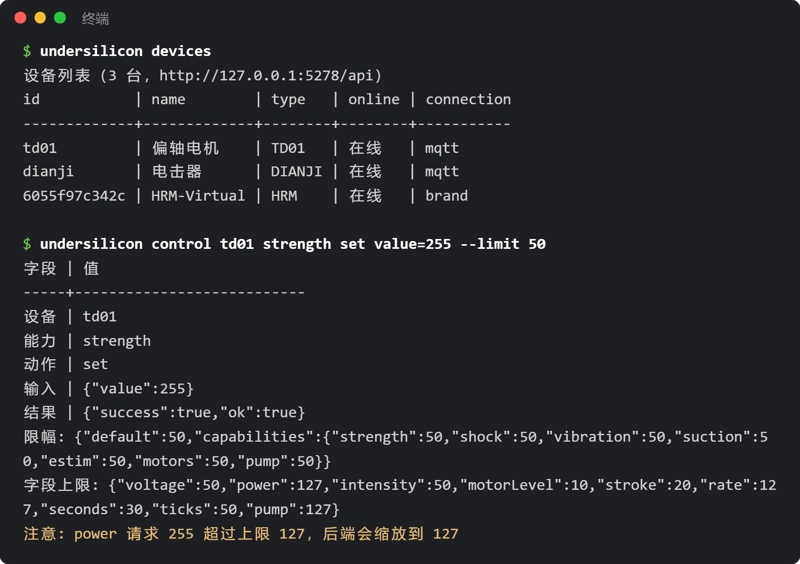

# Befehlszeilenwerkzeug (CLI)

`undersilicon` ist das Befehlszeilenwerkzeug zur Steuerung des PC-Clients „Untersilicon Control Center“: Geräte anzeigen, Stärke einstellen, Spiele starten, Screenshots machen und Ereignisse überwachen. Es eignet sich für Skripte und Automatisierung sowie für die Nutzung durch KI-Programmierassistenten wie Claude Code oder Codex.



## Installation

Zuerst ist [Node.js](https://nodejs.org/) 18 oder höher erforderlich.

```bash
npm i -g undersilicon-cli
undersilicon status
```

Wenn du nicht global installieren möchtest, kannst du auch direkt `npx undersilicon-cli status` verwenden.

Öffne vor der Nutzung den PC-Client. Die CLI verbindet sich standardmäßig mit `http://127.0.0.1:5278/api` auf dem lokalen Rechner.

:::info Client-Version
Fenster-, Screenshot-, Ereignis- und Begrenzungsfunktionen erfordern Client-Version 1.0.42 oder höher. Ältere Versionen können nur Geräte-, Notstopp- und Spiel-Start/Stopp-Befehle nutzen; die übrigen Befehle melden dann ein erforderliches Upgrade.
:::

## Häufige Befehle

```bash
undersilicon devices                                 # Geräteliste
undersilicon device dev01                            # Gerätedetails, Fähigkeiten und Parameterbereiche
undersilicon control dev01 strength set value=120    # Steuerung nach Fähigkeit
undersilicon op dev01 stop                           # Vordefinierte Operation
undersilicon stop                                    # Notstopp: alle Geräte und das laufende Spiel anhalten

undersilicon games                                   # Spielliste
undersilicon game:start surge-edging --device motor=dev01 --device punish=dev02
undersilicon game:status
undersilicon game:stop

undersilicon window show                             # Fenster anzeigen, auch hide/minimize usw.
undersilicon routes                                  # Öffnungsfähige Seiten
undersilicon open plays                              # Seite der Spielbibliothek öffnen (/plays)
undersilicon screenshot shot.png                     # Screenshot

undersilicon events --types device,game --count 20   # Echtzeit-Ereignisse, eine pro Zeile
```

Jeder Befehl akzeptiert `--help` zur Anzeige der Verwendung; `undersilicon help` listet alle Befehle.

- Die Geräterollenamen von `game:start` (z. B. motor, punish) sind in der Liste von `undersilicon games` zu sehen.
- In Git Bash unter Windows wird `open /plays` vom Terminal umgeschrieben; einfach `open plays` verwenden.

## Allgemeine Parameter

| Parameter | Wirkung |
|---|---|
| `--json` | Ausgabe als JSON, praktisch für Skripte und KI-Parsing |
| `--api <Adresse>` | Anderes Backend verwenden; geht auch über die Umgebungsvariable `UNDERSILICON_API` |
| `--limit <0-100>` | Stärkeobergrenze aktivieren (siehe nächster Abschnitt) |

Der Exit-Code ist bei Erfolg 0, bei Ausführungsfehlern 1 und bei falschen Parametern 2.

## Stärkeobergrenze (optional)

Standardmäßig gibt es keine Begrenzung — CLI-Operationen wirken wie manuelle Bedienung im Client. Mit `--limit` skaliert das Backend Stärken oberhalb der Grenze automatisch auf die Grenze herunter; Werte darunter laufen normal weiter:

```bash
undersilicon control dev01 strength set value=255 --limit 50          # wird tatsächlich mit 127 ausgeführt
undersilicon control dev01 shock start voltage=80 --limit 60 --cap-limit shock=30
```

- `--limit`: Obergrenze in Prozent für alle Stärken. `--cap-limit` setzt sie pro Fähigkeit separat; verfügbare Fähigkeiten: strength, shock, vibration, suction, estim, motors, pump.
- Alternativ lassen sich die Umgebungsvariablen `UNDERSILICON_LIMIT` und `UNDERSILICON_CAP_LIMIT` setzen, damit man den Parameter nicht bei jedem Befehl schreiben muss.
- Während einer Begrenzung zeigt die Titelleiste des Clients „AI-Steuerung aktiv · Limit X%“ an:

  

- Die Begrenzung gilt 10 Minuten (mit `--lease-ttl` änderbar, maximal 600 Sekunden); jeder Befehl mit aktiver Begrenzung startet den Timer neu. Nach Ablauf werden Spiele, die unter der Begrenzung gestartet wurden, automatisch gestoppt.
- `undersilicon lease:release` beendet die Begrenzung sofort und stoppt diese Spiele.
- Wenn der Client zu alt ist und keine Begrenzung unterstützt, schlagen Befehle direkt fehl — sie werden nicht ohne Begrenzung ausgeführt.

:::warning Bei Nutzung durch KI
Die Begrenzung wirkt nur für Befehle, die diesen Parameter mitführen. Kann die KI frei Terminalbefehle ausführen, kann sie den Parameter auch weglassen. Wenn echter Schutz nötig ist, verwende das [DeepSeek-Harness-Plugin](/docs/developer/dsh-plugin) oder lass die KI nur von dir geprüfte Skripte ausführen. Der Notstopp `undersilicon stop` funktioniert jederzeit.
:::
