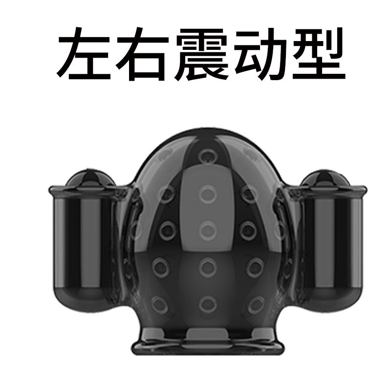

# Edging-Gesamtgerät (2. Generation)

> Ultimative Kontrolle am Rand des Kontrollverlusts — kein Luftverlust mehr, unbegrenzte Laufzeit, mehrere immersive Modi, per Handy sofort spielbereit.

Das Edging-Gesamtgerät ist der Flaggschiff-Host von „Untersilicon“ und vereint **Luftdrucksensor, Vibrationsstimulation und Elektroimpuls** in einem einzigen Gerät. Zusammen mit dem Handy- oder PC-Client lassen sich Edging-, Kegel-, Zehenspitzen- und weitere Spielweisen mit nur einem Gerät spielen.

## Kernvorteile

- **Präzises Auslösen**: hochgenaue Druckmessung, Reaktionszeit von 100 ms
- **Ausdauer ohne Sorgen**: großer 2000-mAh-Akku, dedizierter Spannungsregelchip — die Stimulation bleibt auch bei niedrigem Akkustand konstant
- **Unauffälliges Tragen**: 29-mm-Analplug + diskretes Beinband-Design
- **Ein Gerät, viele Spielweisen**: Edging / Kegel / Zehenspitzen, mit Unterstützung für Multi-Geräte-Kopplung

## Verbesserungen gegenüber der Vorgängergeneration

| Aspekt | Bisherige Lösung | 2. Generation |
| :--- | :--- | :--- |
| Spieldauer | Luftkissen verliert Luft, ca. 20 Minuten | Fester hochpräziser Drucksensor, **unbegrenzte Dauer** |
| Einführ-Erlebnis | 35 mm | 29 mm (Durchmesser um 18 % reduziert) |
| Akkulaufzeit | Normaler Akku | 2000 mAh (um 300 % gesteigert) |

## Geräteparameter

| Punkt | Beschreibung |
| :--- | :--- |
| Logische ID | CUNZHI01 |
| Funktion | Motor (Vibration) + Luftdrucksensor + Elektroimpuls — drei in einem |
| Kommunikation | Dual-Mode BLE + 2,4G WiFi |
| Stärkeeinstellung | 256 Stufen |
| Reaktionszeit | 100 ms |
| Akku | 2000 mAh |
| Laden | Kein Ladekabel im Lieferumfang; ein normales Handy-Ladekabel genügt. Erste Ladung ca. 8 Stunden, danach 4–6 Stunden; grüne Lampe = voll geladen |

## Versionen und Zubehör

### Versionsübersicht {#版本介绍}

【Komplettversion】Edging-Gerät (Luftdruck+Vibration+Elektroschock) + Einzelteil für Männer + Zehenspitzensensor

【Edging-Version】Edging-Gerät (Luftdruck+Vibration+Elektroschock) + Einzelteil für Männer

【OSR6-Version】Edging-Gerät (Luftdruck+Vibration+Elektroschock)

Zubehör: Zehenspitzensensor, Analplug-Drucksensor. Für Frauen ist zusätzlich eine Fucking Machine + [Fucking-Machine-Controller](/docs/device/reciprocating-motor) nötig.

**Kein Ladekabel im Lieferumfang** — das Hauptgerät lädt mit einem normalen Handy-Ladekabel (Type-C), kein Separatkauf nötig.

### Kaufberatung {#导购}

1. Edging + Elektroschock spielen -> Edging-Version
2. Zusätzlich die Zehenspitzen-Spielweise -> Komplettversion
3. „Nicht fertig, nicht weg“ (Verriegelungsfunktion hinzufügen) -> zusätzlich ein automatisches Schloss kaufen
4. OSR-Gerät vorhanden -> OSR6-Version
5. Als Frau eine Fucking Machine nutzen -> zusätzlich einen Fucking-Machine-Controller kaufen
6. Bei allen anderen Fragen den Taobao-Kundenservice kontaktieren oder der Gruppe beitreten~

### Begriffserklärung {#名词解释}

Edging-Gerät = Edging-Hauptgerät + Drucksensor-Analplug + normal großes Vibro-Ei + Elektroschock-Pads

Verriegelung = automatisches Schloss

Einzelteil für Männer = kleines Vibro-Ei + Penishülle (siehe Bild unten)

Einzelteil für Frauen = Fucking Machine + Fucking-Machine-Controller

### Vorstellung der Stimulationsgeräte

## Zugehörige Spielweisen

Weißt du nicht, welche Edging-Spielweise du wählen sollst? Lies zuerst [Welche Edging-Spielweise wählen](/docs/player/edging).

- [Tutorial zum eingebauten Edging des Hauptgeräts (Edging+Kegel)](/docs/player/cunzhi01)
- [Luftdruck-Edging-Spielweise (3-Phasen-Upgrade)](/docs/player/cunzhi3step)
- [Luftdruck-Sprung-Edging-Spielweise](/docs/player/surge-edging)
- [Kegel-Trainingsspielweise](/docs/player/kegel-training)
- [Zehenspitzen-Bestrafungsspielweise v2](/docs/player/tiptoe-v2)
- [Tutorial zu Zehenspitzen- und Kegel-Training](/docs/player/tiptoe-kegel)
- [Trinken-/Flüssigkeitssammeln-Freischalt-Spielweise](/docs/player/drink-pee-unlock)

## Vorbereitung vor der Nutzung

1. Client installieren und Gerät verbinden: [Mobil-Client](/docs/player/new-phone-client) | [PC-Client](/docs/player/new-phone-client#pc)
2. Konkrete Trage- und Verbindungsschritte siehe [Zusammenbau und Tragen](/docs/device/cunzhi01/assembly)

## Sicherheitshinweise

Hinweise zu Elektroimpuls und Tragesicherheit siehe [Pflichtlektüre für Solo-Spiel](/docs/player/solo-safety): Die Elektroimpuls-Funktion darf nicht an Herz, Kopf, Rumpf oder anderen zentralen Körperpartien verwendet werden, und es darf kein Strom durch diese Bereiche fließen; die am menschlichen Körper verwendete Spannung darf 36 V nicht überschreiten. Reinigung und Aufbewahrung siehe [Zusammenbau und Tragen](/docs/device/cunzhi01/assembly#清洗与收纳).

## Kaufen

- Taobao (Jiandan-Wulian-Shop): [https://item.taobao.com/item.htm?id=1028272889035](https://item.taobao.com/item.htm?id=1028272889035)
- Gutschein: [Gutschein einlösen](/docs/coupon)
