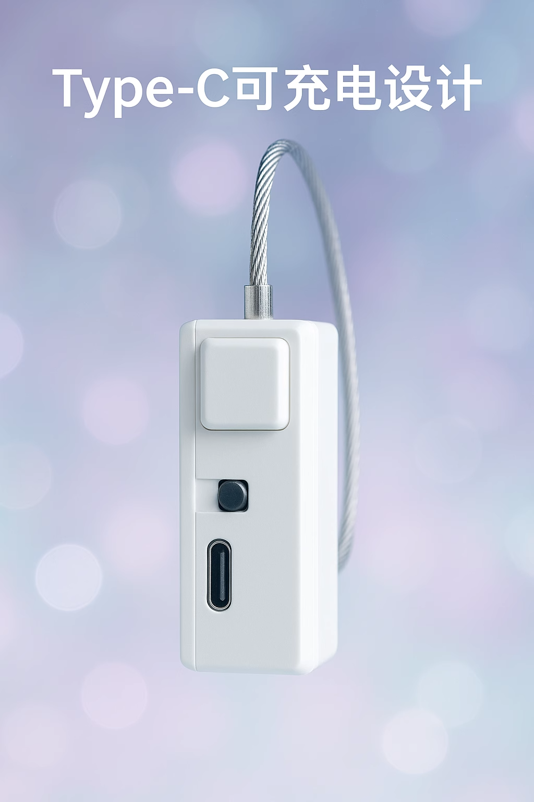

# Einfaches intelligentes Verriegelungsterminal

> Logische ID `ZIDONGSUO`. Steuert Ver-/Entriegelung drahtlos per WiFi — für „nicht fertig, nicht weg“-Spielweisen mit Zwangskomponente.

## Produktmerkmale

- Drahtlose Ver-/Entriegelung (WiFi / BLE)
- 60 Sekunden Tasten-Langdruck erzwingt Entriegelung
- Automatische Entriegelung unter 20 % Akku (Schutz vor Festsitzen)
- Programmierbar, unterstützt zeitgesteuerte Steuerung
- Type-C-Laden

## Geräteparameter

| Punkt | Beschreibung |
| :--- | :--- |
| Logische ID | ZIDONGSUO |
| Funktion | Automatisches Schloss |
| Steuerattribut | open |
| Stromversorgung | Integrierter Akku + Type-C-Laden |
| Kommunikation | WiFi (2,4G) / BLE |

## Zugehörige Spielweisen

- [Zehenspitzen-Bestrafungsspielweise v2](/docs/player/tiptoe-v2)
- [Liegestütz-Erkennungs-Trainingsspiel](/docs/player/pushup-game)
- [Edge-Control-(Edging-)Spielweise](/docs/player/old/edge-control)
- [Kegel-Trainingsspielweise](/docs/player/kegel-training)
- [Trinken-/Flüssigkeitssammeln-Freischalt-Spielweise](/docs/player/drink-pee-unlock)

## Vorbereitung vor der Nutzung

- Client: [Mobil-Client](/docs/player/new-phone-client) | [PC-Client](/docs/player/new-phone-client#pc)

## Hinweise

1. Bitte während der Nutzung ein Befreiungswerkzeug bereithalten! Wegen Netzwerkproblemen o. Ä. kann die Entriegelung des Geräts nicht garantiert werden!
2. Schalterrichtung: Vom Ladeanschluss weg = ein, andernfalls = aus

## Kaufen

- Taobao (Jiandan-Wulian-Shop): [https://item.taobao.com/item.htm?id=925058360048](https://item.taobao.com/item.htm?id=925058360048)
