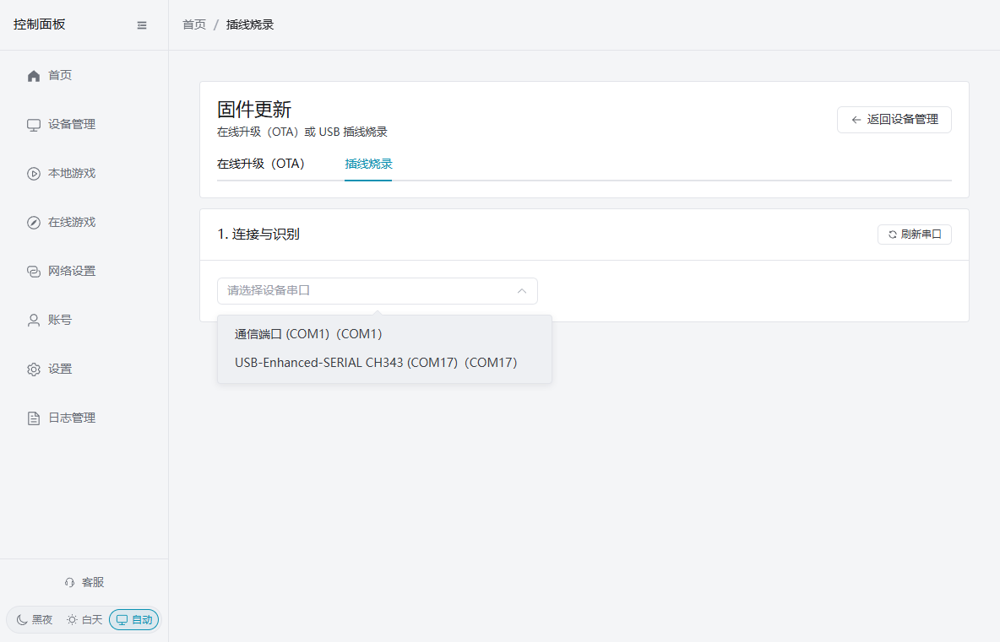
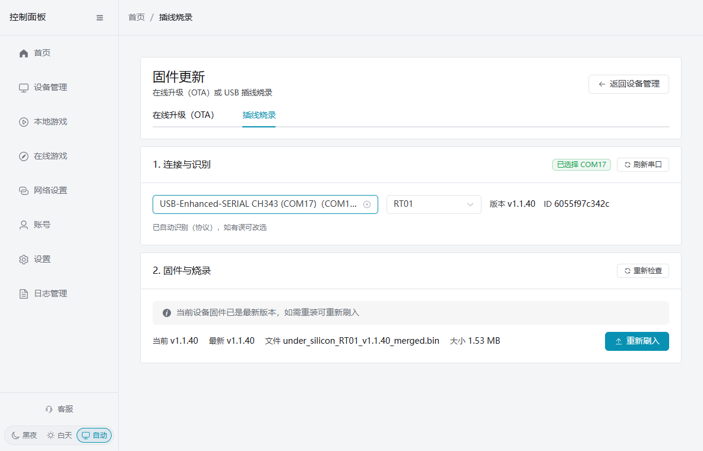
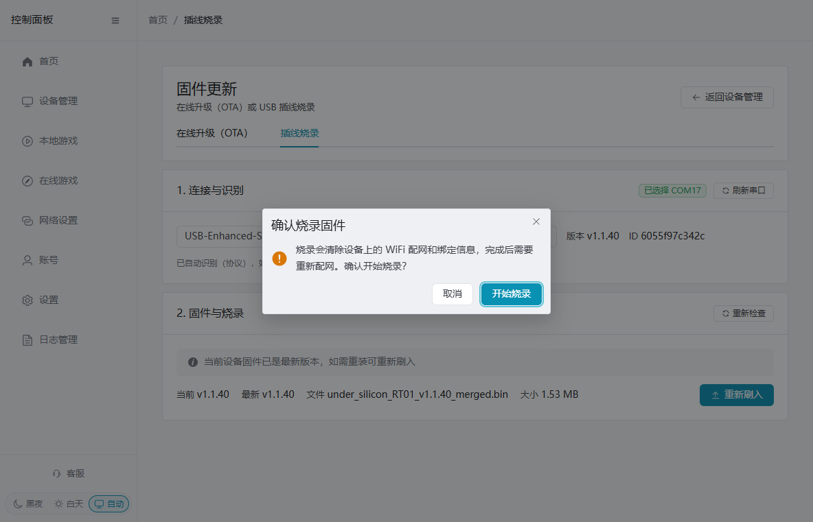
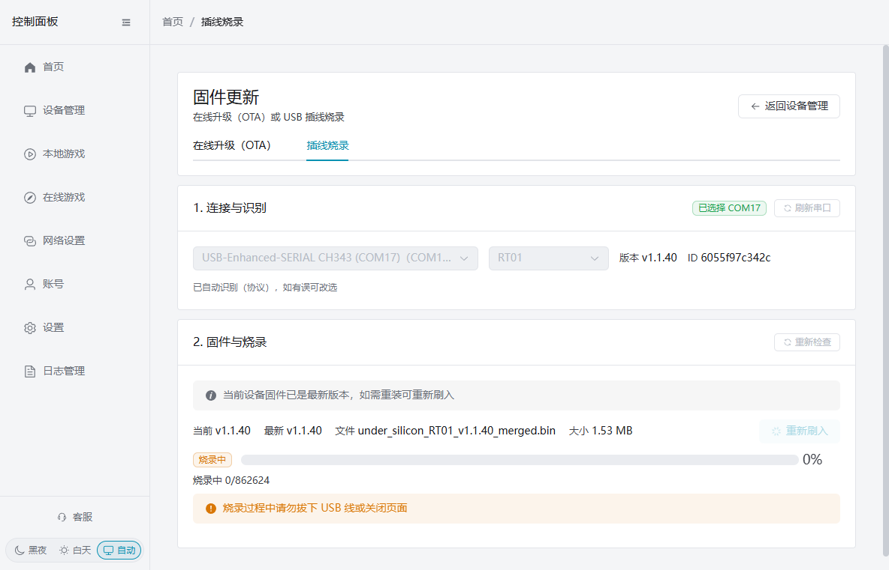
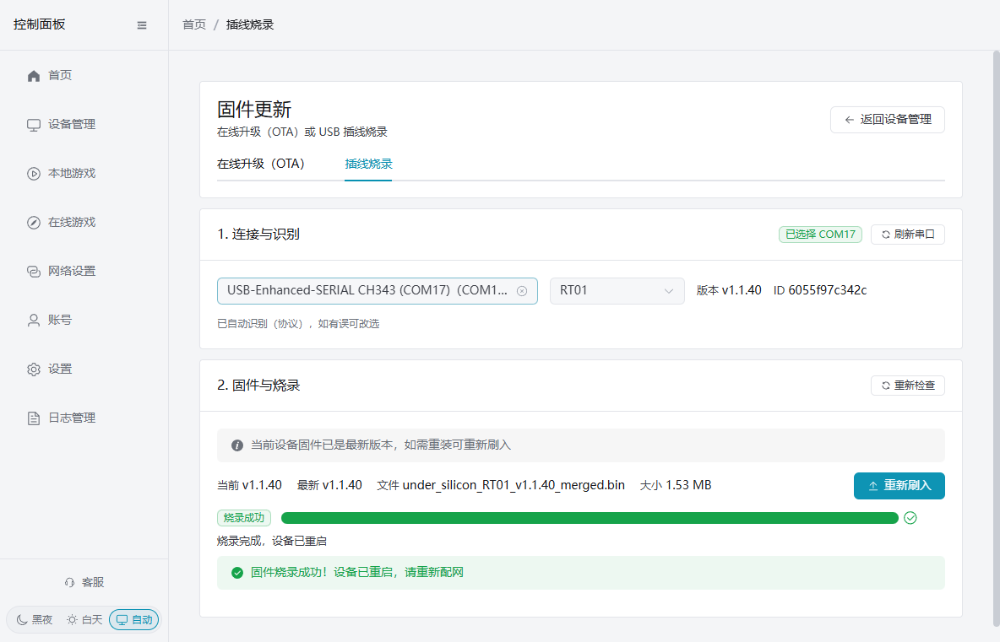
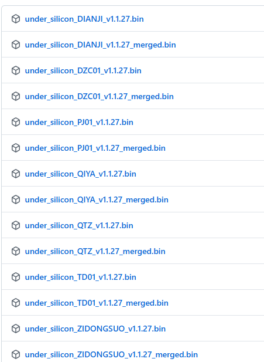

# Firmware-Update per Kabel über das Kontrollpanel

Wenn das Gerät nicht online geht, ein OTA-Update fehlschlägt oder die aktuelle Firmware neu installiert werden muss, kann die Firmware per USB-Kabel über den PC-Client geflasht werden. Der Client erkennt das Gerät automatisch, lädt und prüft die Firmware, versetzt das Gerät selbstständig in den Download-Modus, schreibt die Firmware und startet neu — kein manuelles Flash-Tool und kein Tastendruck am Gerät nötig.

## Vorbereitung

- Das Gerät mit einem stabilen USB-**Daten**kabel an den Computer anschließen; reine Ladekabel funktionieren nicht.
- Computer und Gerät während des Updates mit Strom versorgen; Kabel nicht ziehen und die Client-Seite nicht schließen.
- **Der Flash löscht die WiFi-Konfiguration und Bindungsdaten des Geräts.** Danach ist eine neue Netzwerkkonfiguration nötig.

### Erste Nutzung: seriellen Treiber installieren

Beim ersten kabelgebundenen Update auf diesem Computer zuerst den WCH CH340/CH341-Treiber installieren:

- [CH340/CH341-Treiber](https://www.wch.cn/downloads/CH341SER_EXE.html)

Nach dem Download das Installationsprogramm direkt ausführen. Danach das Gerät neu einstecken und im Client auf „Serielle Schnittstellen aktualisieren“ klicken. Meldet die Seite „CH34x-Gerät erkannt, aber Treiber nicht installiert“, den Treiber wie angegeben installieren und erneut aktualisieren.

## Automatisches Update per Kabel im Client

1. Kontrollpanel öffnen: „Geräteverwaltung“ → „Gerätewerkzeuge“ → „Firmware-Update“, dann „Kabel-Flash“ wählen.
2. Unter „Verbindung und Erkennung“ den zum Gerät gehörenden seriellen Port wählen. Geräteports heißen meist CH340, CH343 oder USB-Enhanced-SERIAL; nicht den rechnereigenen `COM1` wählen.

3. Der Client erkennt automatisch Modell und aktuelle Version und zeigt dann verfügbare Vollfirmware, Version und Dateigröße an. Schlägt die Erkennung fehl, im Modell-Dropdown manuell das richtige Modell wählen und fortfahren.

4. Bei neuerer Version auf „Firmware aktualisieren“ klicken; ist die neueste Version installiert, aber eine Reparatur oder Neuinstallation nötig, auf „Neu flashen“ klicken. Im Bestätigungsfenster den Hinweis auf gelöschte WiFi-Konfiguration und Bindungsdaten prüfen und „Flash starten“ wählen.

5. Der Client lädt und prüft die Firmware automatisch, wechselt in den Download-Modus, flasht und startet neu. Kein manuelles Eintritt in den Download-Modus nötig; das USB-Kabel weder vor noch während des Fortschrittsbalkens ziehen und die Seite nicht schließen.

6. „Firmware erfolgreich geflasht! Das Gerät wurde neu gestartet, bitte Netzwerk neu konfigurieren“ bedeutet Fertigstellung. Nach der Netzwerkkonfiguration in der Geräteverwaltung prüfen, ob das Gerät online ist.

## Häufige Fälle

### Kein serieller Port gefunden

Prüfen, ob das Gerät eingesteckt ist und das USB-Kabel Daten überträgt, und zuerst die Treiberinstallation oben abschließen. Gerät neu einstecken und „Serielle Schnittstellen aktualisieren“ klicken.

### Modell wird nicht erkannt

Nach Ende der automatischen Erkennung das tatsächliche Gerätemodell im Dropdown wählen. Lässt sich das Modell nicht sicher bestimmen, auf keinen Fall die Firmware eines anderen Modells flashen.

### Flash fehlgeschlagen

USB-Verbindung beibehalten und zuerst „Flash wiederholen“ klicken. Bei weiterem Fehlschlag ein anderes Datenkabel oder einen anderen USB-Port verwenden und neu beginnen; das Gerät während des Flashens nicht wiederholt ein- und ausstecken.

## Manueller Flash (nur wenn der Client nicht nutzbar ist)

1. Treiber installieren
    1. CH340-UART-Chiptreiber: [https://www.wch.cn/downloads/CH341SER_EXE.html](https://www.wch.cn/downloads/CH341SER_EXE.html)
    2. Nach dem Download direkt ausführen
2. Flash-Tool herunterladen
    1. [https://dl.espressif.com/public/flash_download_tool.zip](https://dl.espressif.com/public/flash_download_tool.zip)
    2. Entpacken und ausführen
    3. Bedienungsanleitung:
    4. [https://docs.espressif.com/projects/esp-test-tools/zh_CN/latest/esp32/production_stage/tools/flash_download_tool.html#id5](https://docs.espressif.com/projects/esp-test-tools/zh_CN/latest/esp32/production_stage/tools/flash_download_tool.html#id5)
    5. Im dritten Schritt der Anleitung den COM-Port anpassen; sonst nichts ändern
3. Firmware herunterladen
    1. [https://github.com/jiandanzhineng/hardware/releases/latest](https://github.com/jiandanzhineng/hardware/releases/latest)
    2. 
    3. Firmware je nach Gerätetyp herunterladen (die mit „merged“ gekennzeichnete Firmware): Elektroschock-DIANJI, Luftdrucksensor-QIYA, Exzenter-Motorcontroller-TD01, Abstandssensor-QTZ
    4. Mit dem Tool an Position 0x0 auf das Gerät flashen

## Drahtloses OTA-Update

Ist das Gerät bereits mit WiFi verbunden und online, kann die Firmware drahtlos über den Client aktualisiert werden — kein USB-Kabel nötig.

1. PC- oder Handy-Client öffnen und in die **Geräteverwaltung** gehen
2. Das zu aktualisierende Gerät finden und auf **Firmware-Update** (oder „Auf Updates prüfen“) klicken
3. Der Client vergleicht automatisch aktuelle und neueste Firmware-Version
4. Gibt es eine neue Version, einfach auf **Aktualisieren** klicken
5. Ablauf: Client sendet den Update-Befehl per MQTT an das Gerät → das Gerät lädt die Firmware selbst herunter → schreibt und startet neu
6. Nach dem Update geht das Gerät automatisch wieder online

**Hinweis:**
- OTA-Update setzt ein verbundenes, online befindliches WiFi-Gerät voraus
- Während des Updates das Gerät nicht vom Strom trennen
- Stapel-Updates mehrerer Geräte werden unterstützt
- Firmware-Download: [https://github.com/jiandanzhineng/hardware/releases/latest](https://github.com/jiandanzhineng/hardware/releases/latest)
