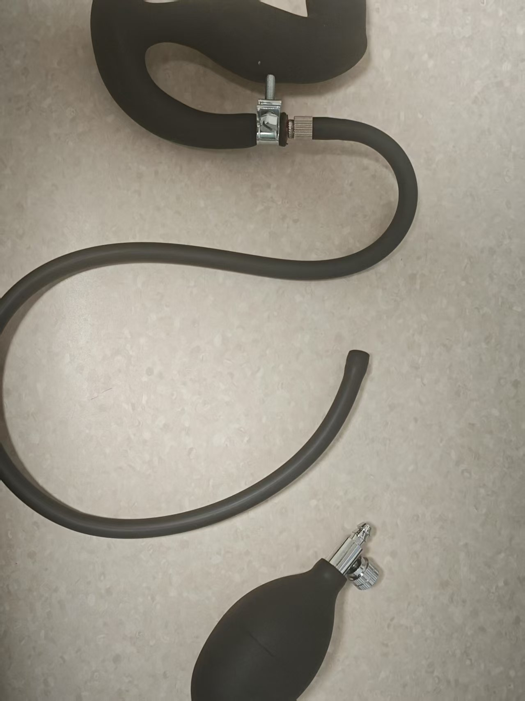
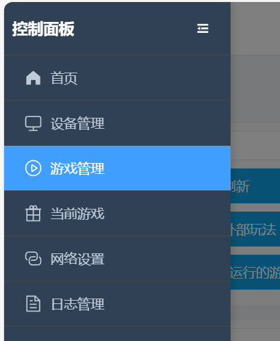
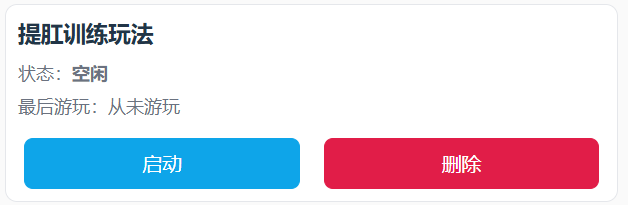

# Kegel-Trainingsspielweise

> ⚠️ **Hinweis zur alten Dokumentversion**: Dies ist die Anleitung zur alten Spielweise; Geräte und Vorgehensweise wurden aktualisiert. Bitte lies vorrangig das neue Tutorial: [Edging-+Kegel-Spielweise-Tutorial](/docs/player/cunzhi01).

# Einführung in die Spielweise
+ Das Kegel-Training wechselt zwischen „Entspannungsphase“ und „Anspannungsphase“ ab.
+ Ziel ist es, in der vorgegebenen Zeit möglichst viele „erfolgreiche Anspannungen“ zu schaffen.
+ Erfolg oder Misserfolg wird direkt in der Oberfläche angezeigt; bei Misserfolg wird ein Elektroschock ausgelöst (falls angeschlossen und aktiviert).

## Software-Download und Vorbereitung
Android-Handy: [Mobil-Client](/docs/player/new-phone-client)

Windows-PC: [PC-Steuerungsclient](/docs/player/new-phone-client#pc)

# Geräte und Vorbereitung
+ Erforderliches Gerät: `Luftdrucksensor (QIYA)`
+ Optionale Geräte: `Elektroschock-Gerät (DIANJI)`, `Automatisches Schloss (ZIDONGSUO)`
+ Zu Beginn wird automatisch verriegelt, am Ende automatisch entriegelt (falls ein automatisches Schloss angeschlossen ist)

## Gerätezusammenbau
Den Pumpball des aufblasbaren Analplugs abziehen und an den Schlauch des Luftdrucksensors anschließen; den Schlauch des Analplugs an das T-Stück des Luftdrucksensors anschließen — fertig~

1. So sieht der Plug bei Erhalt aus (der neue Plug sieht etwas anders aus, dichtet aber besser ab — ähnlich wie unten)

2. Pumpball abnehmen

3. An beide Enden des Luftdrucksensors anschließen

4. Fertige Einheit

5. Optional, wenn der Druck zu schnell abfällt

Diese Klemme an der Verbindungsstelle festdrehen, um den Druckverlust zu verringern.

Kauf-Link für die Klemme: [https://item.taobao.com/item.htm?id=724827233726](https://item.taobao.com/item.htm?id=724827233726) (11–13 mm

## Spieleinstieg

# Parameterbeschreibung
+ `Dauer (Minuten)`: Gesamtdauer einer Runde
+ `Ziel-Anspannungsanzahl`: Gewünschte Anzahl erfolgreicher Wiederholungen, dient der Fortschrittsanzeige
+ `Luftdruckänderung (kPa)`: In der Anspannungsphase zu erreichender Druckanstieg (relativ zum niedrigsten Druck der Entspannungsphase)
+ `Elektroschock-Stärke (V)`: Elektroschock-Stärke bei Misserfolg
+ `Elektroschock-Dauer (Sekunden)`: Dauer des Elektroschocks bei Misserfolg
+ `Zykluszeit (Sekunden)`: Dauer jeder Phase, Standard 10 Sekunden (10 s Entspannung → 10 s Anspannung → Wiederholung)

# Spielablauf
+ Entspannungsphase
    - Entspannen und normal atmen; das System speichert den „niedrigsten Druck“ dieser Phase als Referenz.
    - Nach dem Countdown beginnt die Anspannungsphase.
+ Anspannungsphase
    - Innerhalb der Phasendauer muss der Druck auf „niedrigster Druck + Luftdruckänderung“ angehoben werden.
    - Erreicht = „erfüllt“; dennoch muss der Countdown der Phase ablaufen, bevor die nächste Runde beginnt.
    - Wird das Ziel vor Phasenende nicht erreicht, gilt „Challenge fehlgeschlagen · Elektroschock startet“ (falls ein Elektroschock-Gerät verfügbar ist).
+ Phasenwechsel
    - Jede Runde läuft „Entspannung → Anspannung → Entspannung → …“, bis die Zeit endet oder die Zielanzahl erreicht ist.

# Oberflächenhinweise
+ Oben zeigt eine große Anzeige die aktuelle Phase (Entspannungsphase/Anspannungsphase) und die Restzeit der Phase.
+ Gesamtfortschritt
    - Fortschrittsbalken nach Anzahl: abgeschlossene / Zielanzahl
    - Fortschrittsbalken nach Zeit: verbrauchte / Gesamtzeit
+ Druck und Ziel
    - Aktueller Druck (kPa)
    - Niedrigster Druck der Entspannungsphase (Referenz)
    - Zieldruck für die Anspannung (niedrigster Druck + Luftdruckänderung)
+ Erfolg-/Misserfolgshinweis
    - Erfolg: grüne Kapsel „erfüllt“ hinter der Zahl
    - Misserfolg: rote Kapsel „Challenge fehlgeschlagen · Elektroschock startet“
+ Bedienung und Log
    - Schaltflächen: Pause, manueller Elektroschock
    - Log: letzte Meldungen und Systemhinweise

**Ende und Statistik**

+ Endet bei Erreichen der eingestellten Dauer oder der Zielanzahl erfolgreicher Wiederholungen.
+ Danach wird automatisch entriegelt (falls ein automatisches Schloss angeschlossen ist).
+ Die Oberfläche zeigt kumulierte Erfolge und Elektroschock-Anzahl usw.

**Nutzungsempfehlungen**

+ Beim ersten Mal die „Luftdruckänderung“ niedrig einstellen, um den Rhythmus kennenzulernen.
+ Bei angeschlossenem Elektroschock-Gerät mit niedriger Stärke beginnen und langsam steigern.
+ Ruhig atmen und in der Anspannungsphase konzentriert auf den Zieldruck hin arbeiten.

**Schnelleinstieg**

+ Luftdrucksensor anschließen (optional Elektroschock und automatisches Schloss)
+ Parameter einstellen und starten
+ In der Entspannungsphase nichts tun und den Countdown abwarten; in der Anspannungsphase bis zum Ziel anspannen
+ „Erfüllt“ bis zum Phasenende halten; bei Misserfolg erfolgt Hinweis und Elektroschock
+ Zyklus wiederholen bis zum Ende; Statistik und Fortschrittsbalken zeigen das Ergebnis
