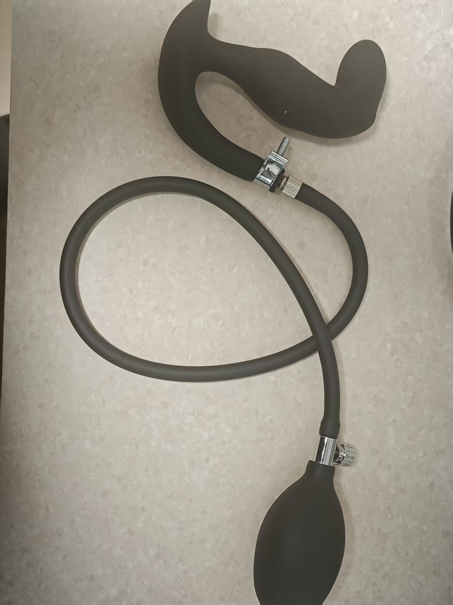
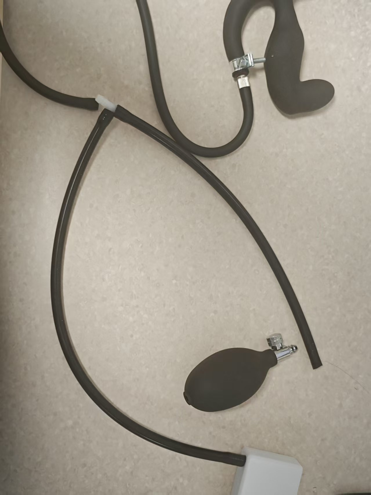
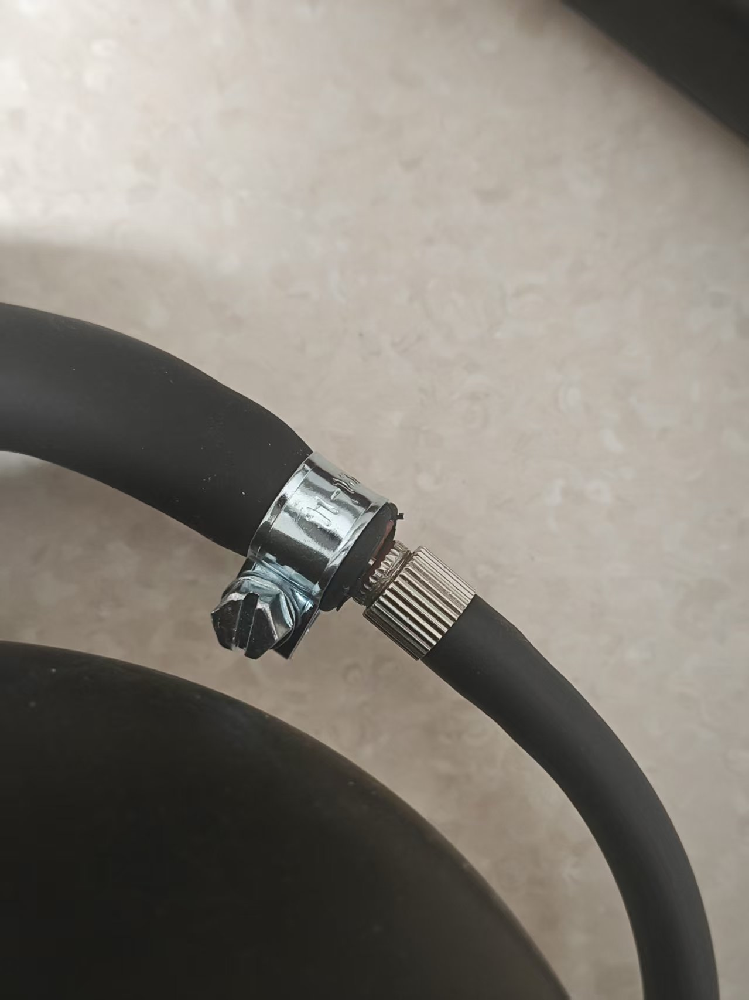

# Edge-Control-(Edging-)Spielweise

> ⚠️ **Hinweis zur alten Dokumentversion**: Dies ist die Anleitung zur alten Spielweise; Geräte und Vorgehensweise wurden aktualisiert. Bitte lies vorrangig das neue Tutorial: [Edging-+Kegel-Spielweise-Tutorial](/docs/player/cunzhi01).

Ein auf einem Luftdrucksensor basierendes Edging-Trainingsspiel: Es erkennt Druckveränderungen des Schließmuskels und steuert die Stimulation intelligent in Kombination mit einem Exzenter-Motorcontroller und einem Elektroschock-Gerät.

Kauf-Link zum Spiel-Set:

[https://item.taobao.com/item.htm?id=1017049175869](https://item.taobao.com/item.htm?id=1017049175869)

# Tutorial für die Handy-Version:
[https://www.bilibili.com/video/BV1xA1fBsErr/](https://www.bilibili.com/video/BV1xA1fBsErr/?share_source=copy_web&vd_source=3dd9ee8089c213072e87f2745c7050aa)

Original-Tutorial auf Yuque: https://www.yuque.com/easysmart/easysmart/oe8gsvyhtflb9pqt

# Zugehörige PC-Tutorials:

Client-Download: [PC-Steuerungsclient](/docs/player/new-phone-client#pc)

Video-Tutorial: [【玩法教程】寸止套装大公开：3步玩出巅峰体验，视频教你征服它_哔哩哔哩_bilibili](https://www.bilibili.com/video/BV1WXWpzUEoW/?spm_id_from=333.1007.top_right_bar_window_dynamic.content.click)

Empfohlen werden Hotspot und das Standard-WLAN — dabei ist keine Netzwerkkonfiguration nötig. Wenn du die Router-Lösung nutzen willst, **<font>konfiguriere das Gerät vor Spielbeginn</font>** bitte nach dem Abschnitt zur Netzwerkkonfiguration im linken Inhaltsverzeichnis~

# Wichtige Hinweise
1. Der aufblasbare Analplug wurde überarbeitet: bessere Abdichtung und weniger Luftverlust; er sieht anders aus als unten abgebildet.
2. Der Luftdruck sollte beim Spielen **<font>nicht zu hoch sein</font>** (verursacht Luftverlust) — etwa 22–24 reicht, solange er sich beim Anspannen sichtbar ändert.
3. Beim Einführen kann etwas Luftdruck aufgebaut werden; zu weich lässt er sich sonst eventuell nicht einführen.

# Zusammenbau des Sets (Pflichtlektüre)
Den Pumpball des aufblasbaren Analplugs abziehen und an den Schlauch des Luftdrucksensors anschließen; den Schlauch des Analplugs an das T-Stück des Luftdrucksensors anschließen — fertig~

1. So sieht der Plug bei Erhalt aus



2. Pumpball abnehmen


3. An beide Enden des Luftdrucksensors anschließen



4. Fertige Einheit


5. Optional, wenn der Druck zu schnell abfällt



Diese Klemme an der Verbindungsstelle festdrehen, um den Druckverlust zu verringern.

Kauf-Link für die Klemme: [https://item.taobao.com/item.htm?id=724827233726](https://item.taobao.com/item.htm?id=724827233726) (11–13 mm)

### Spielmechanik
1. **Drucküberwachung**: Der Luftdrucksensor erkennt Druckveränderungen des Schließmuskels in Echtzeit.
2. **Intelligente Regelung**: Bei hohem Druck wird die Stimulation verringert, bei niedrigem erhöht.
3. **Elektroschock-Warnung**: Überschreitet der Druck den Grenzwert, wird ein Elektroschock ausgelöst, der den Nutzer aufschreckt.
4. **Verzögerter Start**: Bei niedrigem Druck beginnt die Stimulation erst nach einer Verzögerung langsam.
5. **Dynamisches Gleichgewicht**: Hält einen Gleichgewichtszustand nahe dem kritischen Druck aufrecht.

## Zustandsübergangsdiagramm


## Geräteanforderungen
### Gerätekonfiguration
| Gerätetyp | Logische ID | Gerätename | Erforderlich | Funktion |
| --- | --- | --- | --- | --- |
| QIYA | pressure_sensor | Luftdrucksensor | Ja | Erkennt Druckveränderungen des Schließmuskels |
| TD01 | motor_controller | Exzenter-Motorcontroller | Ja | Stimulation mit einstellbarer Stärke |
| DIANJI | shock_device | Elektroschock-Gerät | Nein | Warnelektroschock bei zu hohem Druck |
| ZIDONGSUO | auto_lock | Automatisches Schloss | Nein | Verriegelt zu Spielbeginn, entriegelt am Ende |


## Spielparameter-Konfiguration
### Basisparameter
| Parametername | Typ | Bereich | Standardwert | Beschreibung |
| --- | --- | --- | --- | --- |
| duration | Zahl | 1–120 Minuten | 20 Minuten | Spieldauer |
| criticalPressure | Zahl | 0–40 kPa | 20 kPa | Kritischer Luftdruckwert |
| maxMotorIntensity | Zahl | 1–255 | 200 | Maximale TD01-Stärke |


### Stimulationssteuerungsparameter
| Parametername | Typ | Bereich | Standardwert | Beschreibung |
| --- | --- | --- | --- | --- |
| lowPressureDelay | Zahl | 1–30 Sekunden | 5 Sekunden | Verzögerung vor Stimulationsstart bei niedrigem Druck |
| stimulationRampRateLimit | Zahl | 1–50 | 10 | Ratenbegrenzung für den Anstieg der Stimulationsstärke (Änderung pro Sekunde nicht größer als dieser Wert) |
| pressureSensitivity | Zahl | 0,1–5,0 | 1,0 | Empfindlichkeitskoeffizient für Druckänderungen |
| stimulationRampRandomPercent | Zahl | 0–100 % | 0 % | Prozentsatz zufälliger Störung der Stimulationsstärke |


### Elektroschock-Parameter
| Parametername | Typ | Bereich | Standardwert | Beschreibung |
| --- | --- | --- | --- | --- |
| shockIntensity | Zahl | 10–100 V | 20 V | Elektroschock-Stärke |
| shockDuration | Zahl | 0,5–5 Sekunden | 1 Sekunde | Elektroschock-Dauer |


## Algorithmuslogik
### Druck-Stärke-Abbildungsalgorithmus
```plain
if (currentPressure >= criticalPressure) {
    motorIntensity = 0
    triggerShock()
} else if (currentPressure < criticalPressure) {
    pressureDiff = criticalPressure - currentPressure
    targetIntensity = (pressureDiff / criticalPressure) * maxMotorIntensity
    
    // Verzögerter Startmechanismus, allmähliche Stärkenänderung, zufällige Stärkestörung
}
```
