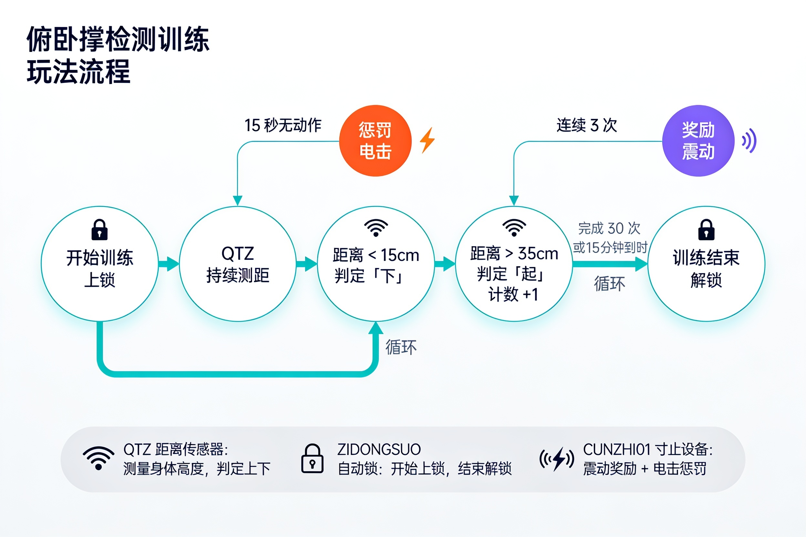

# Liegestütz-(ungefähr-)Erkennungs-Trainingsspiel

Ein auf einem Abstandssensor basierendes Liegestütz-Trainingsspiel, das über den QTZ-Abstandssensor die Ausführung von Liegestützen erkennt und mit automatischem Schloss und dem Edging-Gesamtgerät (CUNZHI01) Trainingsanreize und Bestrafungsmechanismen kombiniert.

Man kann vor dem Mund einen kleinen Stab anbringen — das ergibt eine neue Spielvariante = =

Kauf-Link: [Taobao-Kauf-Link](https://item.taobao.com/item.htm?id=964389698138)

## Spielüberblick
### Spielziel
+ Eine vorgegebene Anzahl Liegestütze innerhalb der festgelegten Zeit absolvieren
+ Eine korrekte Liegestütz-Haltung beibehalten
+ Trainingseffekt und Konzentration durch Geräterückmeldung steigern

### Spielmechanik
1. **Spielstart**: Das automatische Schloss verriegelt; Zeitmessung und Bewegungserkennung beginnen.
2. **Bewegungserkennung**: Der QTZ-Abstandssensor überwacht die Körperhöhe in Echtzeit.
3. **Abschlussbewertung**: Sinkt der Körper unter den eingestellten Abstand, gilt „unten“; steigt er über den eingestellten Abstand, gilt „oben“.
4. **Bestrafungsmechanismus**: Längere Inaktivität löst einen Elektroschock mit zufälliger Stärke und Dauer aus.
5. **Belohnungsstörung**: Nach der eingestellten Anzahl aufeinanderfolgender Wiederholungen kann jede weitere mit einer gewissen Wahrscheinlichkeit eine Vibrationsstörung auslösen.
6. **Statusrücksetzung**: Nach einer Bestrafung wird die Serie auf null gesetzt und die Belohnungsprüfung beginnt von neuem.
7. **Spielende**: Bei Erreichen der Zielzahl oder Zeitablauf wird automatisch entriegelt.

## Geräteanforderungen
### Gerätekonfiguration
| Gerätetyp | Logische ID | Gerätename | Erforderlich | Funktion |
| --- | --- | --- | --- | --- |
| QTZ | distance_sensor | QTZ-Abstandssensor | Ja | Erkennt Körperhöhenänderungen, bewertet Liegestütze |
| ZIDONGSUO | auto_lock | Automatisches Schloss | Nein | Verriegelt zu Spielbeginn, entriegelt bei Abschluss oder Zeitablauf |
| CUNZHI01 | cunzhi01 | Edging-Gesamtgerät | Nein | Elektroschock-Strafe bei längerer Inaktivität, Zufalls-Vibrationsstörung nach Serienabschlüssen |

> In der zweiten Generation wurden die beiden Einzelgeräte Elektroschock (DIANJI) und Vibro-Ei (TD01) zu einem [Edging-Gesamtgerät](/docs/device/cunzhi01) zusammengeführt (Luftdrucksensor + Vibration + Elektroimpuls — drei in einem); Bestrafung und Belohnung übernimmt CUNZHI01, die Einrichtungsweise bleibt unverändert.

## Spielparameter-Konfiguration
### Basisparameter
| Parametername | Typ | Bereich | Standardwert | Beschreibung |
| --- | --- | --- | --- | --- |
| duration | Zahl | 1–240 Minuten | 15 Minuten | Spieldauer |
| targetCount | Zahl | 1–2000 Stück | 30 Stück | Zielanzahl der Liegestütze |
| downThreshold | Zahl | 5–30 cm | 15 cm | „Unten“ gilt, wenn der Körper unter diesen Abstand sinkt |
| upThreshold | Zahl | 20–50 cm | 35 cm | „Oben“ gilt, wenn der Körper über diesen Abstand steigt |

### Bestrafungsmechanismus-Parameter
| Parametername | Typ | Bereich | Standardwert | Beschreibung |
| --- | --- | --- | --- | --- |
| idleTimeLimit | Zahl | 10–120 Sekunden | 30 Sekunden | Inaktivität über diese Zeit löst eine Bestrafung aus |
| shockIntensity | Zahl | 10–100 V | 15 V | Basiswert der Elektroschock-Stärke |
| shockDuration | Zahl | 1–10 Sekunden | 3 Sekunden | Basiswert der Elektroschock-Dauer |
| randomIntensityRange | Zahl | 0–50 V | 10 V | Zufallsbereich der Elektroschock-Stärke (± dieser Wert) |
| randomDurationRange | Zahl | 0–5 Sekunden | 1 Sekunde | Zufallsbereich der Dauer (± dieser Wert) |

### Belohnungsstörungs-Parameter
| Parametername | Typ | Bereich | Standardwert | Beschreibung |
| --- | --- | --- | --- | --- |
| rewardTriggerCount | Zahl | 3–20 Stück | 5 Stück | Ab so vielen aufeinanderfolgenden Abschlüssen wird die Belohnungsauslösung geprüft |
| rewardTriggerProbability | Zahl | 0–100 % | 30 % | Wahrscheinlichkeit einer Störung je Abschluss nach Erreichen der Bedingung |
| vibratorIntensity | Zahl | 1–255 | 100 | Vibrationsstärke |
| vibratorDuration | Zahl | 5–60 Sekunden | 15 Sekunden | Arbeitsdauer der Vibration |

## Oberflächenbeschreibung
### Hauptelemente
+ **Verbleibende Zeit**: Zeigt die restliche Spielzeit.
+ **Abschlussfortschritt**: Aktuelle Anzahl / Zielanzahl.
+ **Bewegungsstatus**: Zeigt die aktuelle Bewegungsphase (unten/oben).
+ **Sperrstatus**: Zeigt den aktuellen Status des automatischen Schlosses.
+ **Gerätestatus**: Zeigt den Arbeitsstatus der einzelnen Geräte.

## Entwicklerinformationen
### Versionsverlauf
+ v1.0.0: Grundfunktionen implementiert
+ v2.0.0: Elektroschock (DIANJI) und Vibro-Ei (TD01) zum Edging-Gesamtgerät (CUNZHI01) zusammengeführt

Für Geräte der alten Version siehe das Tutorial: [Liegestütz-(ungefähr-)Erkennungs-Trainingsspiel (alte Version)](/docs/player/old/pushup-game-v1)
