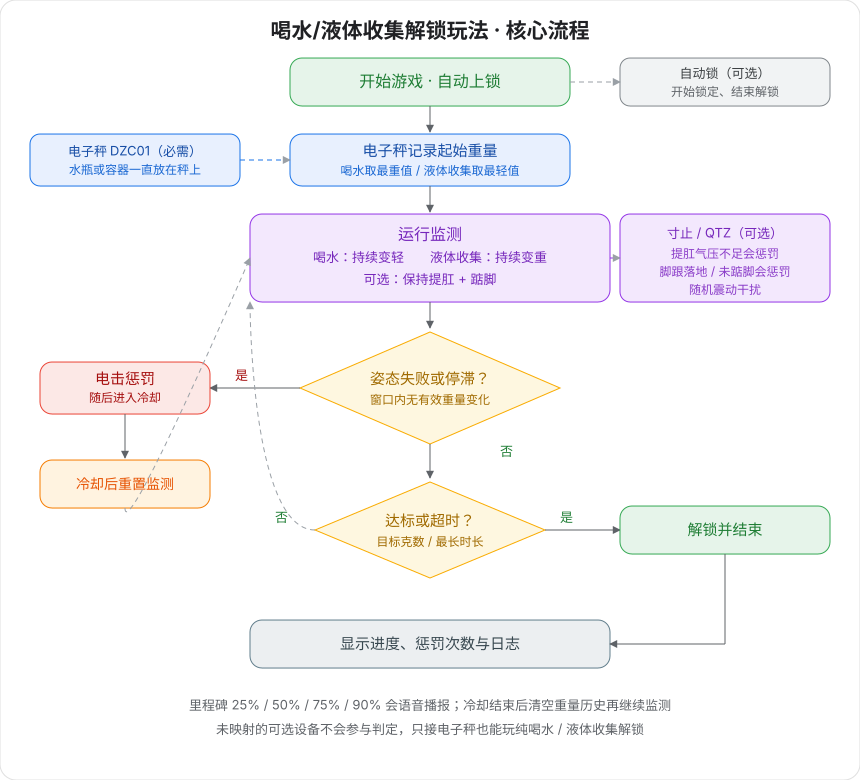

# Trinken-/Flüssigkeitssammeln-Freischalt-Spielweise

Wasserflasche oder Behälter auf die Waage stellen: Beim Trinken wird sie leichter, beim Sammeln von Flüssigkeit schwerer. Erreicht die Gewichtsänderung das Ziel oder läuft die Zeit ab, wird automatisch entriegelt; optional lassen sich Kegel- und Zehenspitzen-Überwachung hinzufügen — bei Verstößen gibt es eine Elektroschock-Strafe.

## Spielbeschreibung

- **Trinkmodus (Standard):** Die Wasserflasche bleibt auf der Waage; über einen Strohhalm wird kontinuierlich getrunken, sodass die Waage leichter wird. Erreicht die Abnahme das Ziel, wird entriegelt.
- **Flüssigkeitssammelmodus:** Der Behälter bleibt auf der Waage; gesammelte Flüssigkeit macht die Waage schwerer. Erreicht die Zunahme das Ziel, wird entriegelt.
- **Haltungsauflage (optional):** Nach Zuordnung von Luftdruck-/Zehenspitzengerät müssen Kegel-Anspannung und Zehenspitzenstand gehalten werden, sonst gibt es Elektroschock.
- **Optionale Verriegelung:** Mit verbundenem automatischem Schloss wird zu Beginn verriegelt und erst bei Zielerreichung oder Zeitablauf entriegelt.

## Geräteanforderungen

| Gerät | Logische ID | Erforderlich | Funktion |
| --- | --- | --- | --- |
| [Waage](/docs/device/electronic-scale) | scale / DZC01 | Ja | Echtzeit-Wägung; erkennt Leichterwerden durch Trinken oder Schwererwerden durch Sammeln |
| [Edging-Gesamtgerät](/docs/device/cunzhi01) | sensor / cunzhi / punish / vibe | Nein | Kegel-Luftdruck, Zehenspitzen-Druck, Elektroschock-Strafe, zufällige Vibration |
| [Automatisches Schloss](/docs/device/lock-controller) | lock / ZIDONGSUO | Nein | Verriegelt zu Beginn, entriegelt am Ende |

Nicht zugeordnete optionale Geräte nehmen an der Auswertung nicht teil. Nur mit der Waage ist es reines Trinken-/Flüssigkeitssammeln-Freischalten.

Ein einziges Edging-Gesamtgerät kann gleichzeitig die vier Rollen Kegel, Zehenspitze, Elektroschock und Vibration übernehmen — im Client einfach den entsprechenden Slots zuordnen.

> 🛒 **Spiel-Set**: [Im offiziellen Shop kaufen](https://shop.undersilicon.cn/zh/products/force-drink)

## Tragen und Verbinden

Bitte zuerst den Client installieren und das Gerät verbinden, siehe [Client-Download und Geräteverbindung](/docs/player/new-phone-client).

- **Waage**: Auf ebene Fläche stellen. Wasserflasche (Trinken) bzw. Behälter (Sammeln) bleibt die ganze Runde auf der Waage — nicht die ganze Flasche hochheben.
- **Beckenbodensensor (optional)**: Mit Gleitmittel in Seitenlage entspannt langsam einführen.
- **Elektroimpuls-Pads (optional)**: Auf die Innenseite der Oberschenkel kleben, je eines links und rechts. Nicht auf Rumpf, Herz oder Kopf kleben.
- **Zehenspitzensensor (optional)**: In die Socke stecken und eng an die Ferse legen oder im Schuh an der Fersenposition platzieren.
- **Hauptgerät befestigen (optional)**: Mit dem Band am Oberschenkel festbinden.
- **Automatisches Schloss (optional)**: Eigenständiges Funkgerät, wird nicht an das Hauptgerät angeschlossen.

Kabelverbindungen siehe [Tutorial zur Edging-Spielweise der 2. Generation](/docs/player/cunzhi01#operation-steps).

## Software-Einstellungen

1. Im Client die Spielbibliothek öffnen und „Trinken-/Flüssigkeitssammeln-Freischalt-Spielweise“ wählen.
2. Die Waage zuordnen (erforderlich), dann bei Bedarf Luftdruck, Zehenspitze, Elektroschock, Vibration und automatisches Schloss zuordnen.
3. Trinken oder Flüssigkeitssammeln wählen und Zielgewicht, maximale Dauer sowie Bestrafungsparameter festlegen.
4. Auf Start klicken. Die Sprachausgabe ist standardmäßig aktiv und kann in den Parametern deaktiviert werden.

## Spielverlauf

### Kernregeln

+ **Trinkmodus**: Ausgangspunkt ist der höchste Gewichtswert während des Verlaufs; der Fortschritt zählt die gegenüber diesem Start verlorenen Gramm.
+ **Flüssigkeitssammelmodus**: Ausgangspunkt ist der niedrigste Gewichtswert während des Verlaufs; der Fortschritt zählt die gegenüber diesem Start gewonnenen Gramm.
+ Ohne eine einzige Änderung über der „Schwelle gültiger Änderung“ innerhalb des Verlaufsfensters (Standard 30 Sekunden) gilt es als Stillstand und wird bestraft.
+ Bei zugeordnetem Luftdruck muss der Druck über der Kegel-Schwelle liegen.
+ Bei zugeordneter Edging-Zehenspitze gilt Überschreiten der Fersendruckschwelle länger als die Entprellzeit als Aufsetzen und wird bestraft.

### Zustandszyklus

+ **Läuft**: Jede Sekunde werden Haltung, Stillstand und Zufallsvibration geprüft und der Gewichtsfortschritt summiert.
+ **Bestrafung**: Elektroschock auslösen (ohne zugeordnetes Elektroschock-Gerät wird nur der Grund protokolliert) und die entsprechende Ansage abspielen.
+ **Abkühlung**: Standardmäßig 10 Sekunden Erkennungspause; danach wird die Gewichtshistorie geleert und die Überwachung startet neu.
+ **Entriegelt**: Fortschritt erreicht oder maximale Dauer abgelaufen — Schloss öffnet und das Spiel endet.

### Ansagen und Störungen

+ Start, Bestrafungsgrund, Abkühlung, Zielerreichung / Zeitablauf / manuelles Ende werden angesagt.
+ Bei 25 % / 50 % / 75 % / 90 % Fortschritt erfolgt je eine Ansage.
+ Während des Laufs gibt es zufällige Ermutigungen und Hinweise auf verbundene Kegel-/Zehenspitzen-Auflagen.
+ Pro Sekunde wird mit einer gewissen Wahrscheinlichkeit eine Vibrationsstörung ausgelöst (Standard ca. 5 %).

### Spielende

+ Kumulierte Änderung erreicht das Zielgewicht: erfolgreiche Entriegelung.
+ Maximale Dauer erreicht: Entriegelung per Zeitablauf.
+ Manuelles Ende entriegelt ebenfalls.
+ Die Oberfläche zeigt Fortschritt, Elektroschock-Anzahl, letzten Bestrafungsgrund und Log.

## Parameterbeschreibung

### Basisparameter

| Parameter | Standard | Beschreibung |
| --- | --- | --- |
| Spielmodus | Trinken (leichter werden) | Trinken: Waage muss leichter werden; Flüssigkeitssammeln: Waage muss schwerer werden |
| Maximale Dauer | 1800 Sekunden | Nach Zeitablauf automatisch beenden und entriegeln. Anfänger: 900–1800 |
| Ziel-Gewichtsänderung | 500 g | Erforderliche Änderung in Gramm gegenüber dem Ausgangswert |
| Sprachansage | Ein | Ansagen zu Phasen, Bestrafungen und Meilensteinen |

### Auswertung und Schwierigkeit

| Parameter | Standard | Beschreibung |
| --- | --- | --- |
| Schwelle gültiger Änderung | 1 g | Kleinere Änderungen gelten als Rauschen und setzen den Stillstand-Countdown nicht zurück |
| Verlaufsfenster | 30 Sekunden | Keine gültige Änderung im Fenster -> Bestrafung |
| Kegel-Luftdruckschwelle | 20 kPa | Darunter gilt als nicht angespannt (erfordert zugeordneten Luftdruck) |
| Zehenspitzen-Druckschwelle | 100 | Darüber gilt die Ferse als aufgesetzt |
| Zehenspitzen-Entprellung | 300 ms | Filter für Druckzittern; zu kleine Werte führen zu Fehlentscheidungen |

### Bestrafung und Störung

| Parameter | Standard | Beschreibung |
| --- | --- | --- |
| Bestrafungs-Abkühlung | 10 Sekunden | Erkennungspause nach dem Elektroschock |
| Elektroschock-Stärke | 24 V | Empfohlen 15–24 V, nicht über 30 V |
| Elektroschock-Dauer | 2 Sekunden | Dauer eines einzelnen Schocks |
| Vibrations-Aktivierungswahrscheinlichkeit | 0,05 / Sekunde | Etwa 5 % pro Sekunde |
| Vibrationsstärke | 255 | 0–255 |
| Vibrationsdauer | 3 Sekunden | Dauer einer einzelnen Vibration |

## Oberflächenbeschreibung

+ **Aufgabenfortschritt**: Bereits geänderte Gramm / Zielgramm, zusammen mit dem Ausgangsgewicht.
+ **Aktuelles Gewicht / Luftdruck / Zehenspitzen-Status**: Echtzeit-Messwerte.
+ **Bestrafungs-Countdown**: Verbleibende Sekunden bis zur nächsten „Stillstandsbestrafung“.
+ **Elektroschock-Info**: Auslöseanzahl, ob zugeordnet, ob gerade aktiv, verbleibende Abkühlung, letzter Grund.
+ **Systemkennzahlen**: Modus, Minimum/Maximum des Gewichts im Fenster, Stichprobenzahl usw.
+ **Systemlog**: Aufzeichnungen zu Start, Fortschritt, Bestrafung, Abkühlung und Ende.

## Nutzungsempfehlungen

+ Wasserflasche oder Behälter muss die ganze Zeit auf der Waage bleiben. Zum Trinken einen Strohhalm verwenden und die Flasche nicht ganz hochheben — sonst fällt das Gewicht abrupt und kann sofort als Zielerreichung gewertet werden.
+ Nicht selbst auf die Waage steigen, damit das Körpergewicht die Auswertung nicht stört.
+ Beim ersten Mal nur die Waage anschließen und den Trinkablauf testen; Kegel, Zehenspitze und Elektroschock danach hinzufügen.
+ Zunächst Ziel 200–300 g und Fenster 45–60 Sekunden wählen; nach Eingewöhnung verschärfen.
+ Bei Elektroschock mit niedriger Spannung und kurzer Dauer anfangen.

## Sicherheitshinweise

+ Nur bei guter Gesundheit verwenden — nicht bei Herzkrankheiten, Epilepsie usw.; nur für Erwachsene über 18 Jahre.
+ Mit niedriger Stärke und kurzer Dauer beginnen; bei Unwohlsein sofort abbrechen.
+ Elektroimpuls-Sicherheit und Spannungsgrenzen siehe [Pflichtlektüre für Solo-Spiel](/docs/player/solo-safety).
+ Nicht zu viel und nicht zu schnell trinken; den Flüssigkeitssammelmodus nicht bei Magen-Darm- oder Harnwegsbeschwerden verwenden.
+ Bei verbundenem automatischem Schloss sicherstellen, dass jemand in der Nähe helfen kann; zum Verhalten des Schlosses siehe [Pflichtlektüre für Solo-Spiel](/docs/player/solo-safety).
