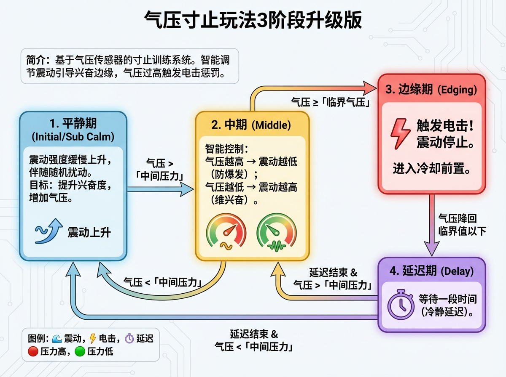
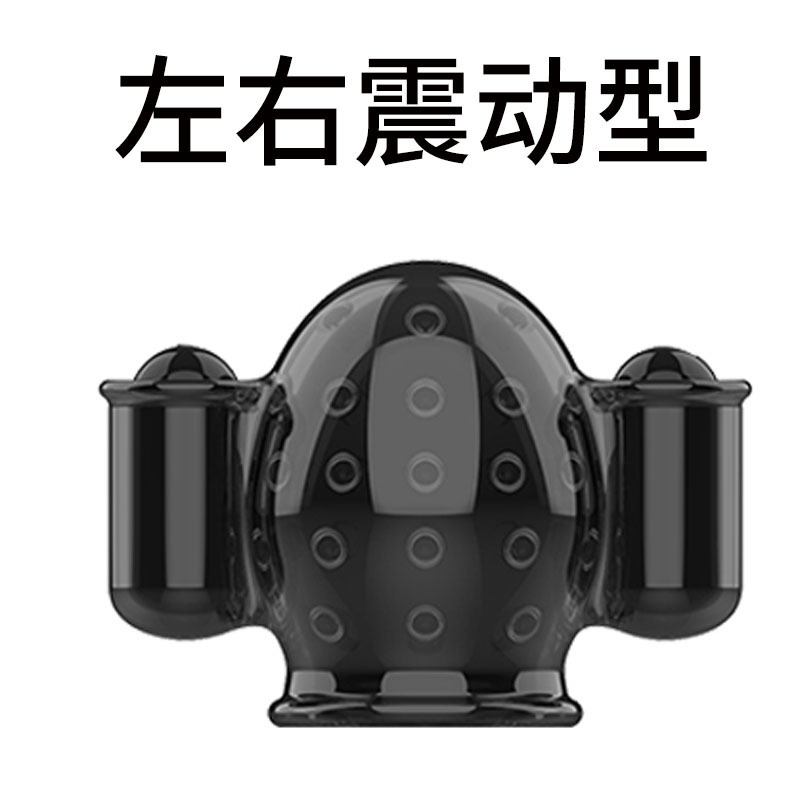

# Edging-Spielweise Upgrade (3-Phasen-Version) 2. Generation

## Einführung
Dies ist eine Edging-Trainingsspielweise auf Basis eines Luftdrucksensors. Das System passt die Vibrationsstärke intelligent an den Luftdruck an und hält den Nutzer am Rand der Erregung. Überschreitet der Luftdruck den kritischen Wert, wird eine Elektroschock-Strafe ausgelöst.

Es gibt außerdem eine Spielweise, die über kurzfristigen Druckanstieg auslöst und den Mitteldruck jede Runde automatisch kalibriert:

[Anleitung zur Luftdruck-Sprung-Edging-Spielweise](/docs/player/surge-edging)

## Spieleinführung

Bilibili: https://www.bilibili.com/video/BV1ZicuzkESJ/
YouTube: https://youtu.be/HvIN5CQ44dI

[Hinweise vor der Nutzung (Pflichtlektüre)](#use_instruction)

## Spielablauf
Das Spiel durchläuft die folgenden Zustandszyklen:

1. **Ruhephase (Initial/Sub Calm)**
   - Die Vibrationsstärke steigt langsam an, begleitet von zufälligen Störungen.
   - **Ziel**: Erregungsgrad steigern, Luftdruck erhöhen.
   - **Übergang**: Bei Überschreiten des „Mitteldrucks“ in die mittlere Phase.

2. **Mittlere Phase (Middle)**
   - Intelligente Steuerung: Je höher der Luftdruck, desto niedriger die Vibrationsstärke (verhindert zu schnelles Kommen); je niedriger der Luftdruck, desto höher die Vibrationsstärke (hält die Erregung aufrecht).
   - **Übergänge**:
     - Luftdruck >= „kritischer Druck“: **Elektroschock** wird ausgelöst, Übergang in die Edging-Phase.
     - Luftdruck < „Mitteldruck“: Rückfall in die Ruhephase.

3. **Edging-Phase (Edging)**
   - **Elektroschock wird ausgelöst!** Vibration stoppt.
   - **Übergang**: Nachdem der Luftdruck unter den kritischen Wert gefallen ist, Übergang in die Abkühlverzögerung.

4. **Verzögerungsphase (Delay)**
   - Wartezeit (Beruhigungsverzögerung).
   - **Übergang**: Nach Ende der Verzögerung entscheidet der aktuelle Luftdruck, ob in die mittlere Phase (größer als Mitteldruck) oder Ruhephase (kleiner als Mitteldruck) zurückgekehrt wird.

## Benötigte Geräte
1. **Edging-Sensor (CUNZHI01)**: Erforderlich. Misst den Erregungsgrad, bietet Vibrationsstimulation und Edging-Bestrafung (Elektroschock).
   - Kaufadresse: https://item.taobao.com/item.htm?ft=t&id=1028272889035

2. **Automatisches Schloss (ZIDONGSUO)**: Optional. Verriegelt zu Spielbeginn automatisch, entriegelt am Ende.
   - Kaufadresse: https://item.taobao.com/item.htm?ft=t&id=925058360048

## Kauf-Links und dazugehörige Versionsinformationen {#buy-link-info}

Taobao: https://item.taobao.com/item.htm?id=1028272889035

### Kaufberatung

Ob Edging- oder Komplettversion, ob automatisches Schloss oder Fucking-Machine-Controller dazu — siehe [Kaufberatung zum Edging-Gesamtgerät](/docs/device/cunzhi01#导购).

### Versionsübersicht

#### Version für Männer

【Komplettversion】Edging-Gerät (Luftdruck+Vibration+Elektroschock) + Einzelteil für Männer + Zehenspitzensensor

【Edging-Version】Edging-Gerät (Luftdruck+Vibration+Elektroschock) + Einzelteil für Männer

【OSR6-Version】Edging-Gerät (Luftdruck+Vibration+Elektroschock)

Zubehörliste und Versionen für Frauen siehe [Edging-Gesamtgerät](/docs/device/cunzhi01#版本介绍).

### Begriffserklärung

Erklärungen zu Edging-Gerät, Verriegelung, Einzelteilen für Männer/Frauen usw. siehe [Begriffserklärung zum Edging-Gesamtgerät](/docs/device/cunzhi01#名词解释).

## Gebrauchsanweisung {#use_instruction}

1. Gerät zusammenbauen und am Körper anlegen. (Details siehe [Zusammenbau und Tragen](/docs/device/cunzhi01/assembly))
   - Für die OSR6-Version bitte die [OSR6-Spielanleitung](/docs/device/osr6-control-plugin) beachten.
2. Alle Geräte mit dem Netzwerk verbinden
   - Handy: siehe [Mobil-Client](/docs/player/new-phone-client)
   - Computer: siehe [PC-Steuerungsclient](/docs/player/new-phone-client#pc)

3. Mitteldruck und kritischen Druck einstellen. **Diese Werte sind keine Festwerte — richte sie an deinem „Ruhemesswert“ aus, also dem Wert nach dem Einschalten ohne Einführen**:
   - Der Messwert ohne Einführen liegt normalerweise nicht bei 0 (die Silikonhülle erzeugt selbst Druck; üblich sind etwa 50–60, das ist normal).
   - Referenz-Ausgangswerte: **Mitteldruck ≈ Ruhewert + 2, kritischer Druck ≈ Ruhewert + 5**. Beispiel: Ruhewert 60 → Mitteldruck 62, kritischer Druck 65.
   - Das sind nur Ausgangswerte — im Spiel weiter anpassen: zu stark nach unten, zu schwach nach oben; am besten während des Spiels feinjustieren.

## Vorstellung der Stimulationsgeräte

> Hinweis: Das Set enthält zwei kleine Vibro-Eier; empfohlen wird eines an der Spitze und eines an der oberen Seite zu platzieren.

## Konfigurationsbeschreibung

| Parametername | Beschreibung | Empfohlener Wert |
| :--- | :--- | :--- |
| **Spieldauer** | Gesamtlaufzeit des Spiels (Minuten). | 20 |
| **Kritischer Luftdruck** | Höchste Luftdruckschwelle (kPa) zum Auslösen von Elektroschock und Edging. | Ruhewert + 5 (Referenz, nach Bedarf feinjustieren) |
| **TD01 Max. Stärke** | Maximale Vibrationsintensität (1–255). | 255 |
| **Mittlerer (Erregungs-)Druck** | Druckschwelle (kPa) für den Eintritt in die intelligente Steuerungsphase. | Ruhewert + 2 (Referenz, nach Bedarf feinjustieren) |
| **Elektroschock-Stärke** | Spannung (V) bei Bestrafung. | 20 |
| **Elektroschock-Dauer** | Dauer der Bestrafung (Sekunden). | 3 |
| **Niederdruck-Verzögerung** | Abkühl- und Ruhezeit (Sekunden) nach Edging-Auslösung. | 5 |
| **Stärke-Anstiegsratenlimit** | Höchstgeschwindigkeit des Vibrationsanstiegs, vermeidet abrupte Änderungen. | 10 |
| **Stärke-Zufallsstörung** | Zufällige Schwankungsamplitude der Vibrationsstärke (%). | 0 |
| **Verzögerter allmählicher Anstieg** | Automatischer Vibrationszuwachs pro Sekunde in der Ruhephase. | 10 |

## Sicherheitshinweise

Die Spannung von Elektroimpuls-Geräten nicht zu hoch einstellen und keinen Strom durch den Rumpf fließen lassen. Weitere Sicherheitshinweise siehe [Pflichtlektüre für Solo-Spiel](/docs/player/solo-safety).

## Hinweise zum Versions-Upgrade

In der zweiten Generation wurden Elektroschock-, Luftdruck- und Vibrationsgeräte aufgerüstet und zu einem einzigen Gerät vereint; die Einrichtungsweise hat sich nicht geändert.

Für Geräte der alten Version siehe das Tutorial [Luftdruck-Edging-Spielweise 3-Phasen-Upgrade](/docs/player/old/cunzhi3step).
