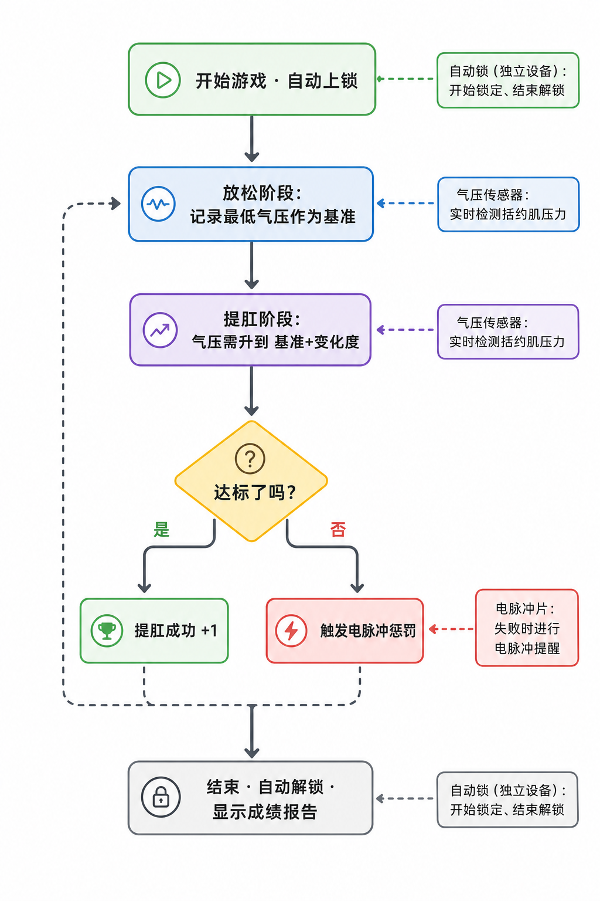

# Kegel-Trainingsspielweise (2. Generation)

Beckenboden-Training im Wechsel zwischen „Entspannungsphase“ und „Anspannungsphase“ — in der vorgegebenen Zeit möglichst viele „erfolgreiche Anspannungen“ schaffen; bei Misserfolg erfolgt eine Elektroimpuls-Mahnung.

> 🛒 **Geräteerwerb**: [Auf Taobao kaufen](https://item.taobao.com/item.htm?id=1028272889035)

## Spielbeschreibung

- **Kegel-Trainingsspielweise:** Das Gerät erkennt über den Luftdrucksensor Druckveränderungen des Schließmuskels in Echtzeit und führt dich abwechselnd durch die Phasen „Entspannung“ und „Anspannung“.
- **Ziel:** In der vorgegebenen Zeit möglichst viele „erfolgreiche Anspannungen“ schaffen; Erfolg oder Misserfolg wird direkt in der Oberfläche angezeigt.
- **Optionale Verriegelung:** Mit verbundenem automatischem Schloss wird zu Spielbeginn verriegelt — nicht fertig, nicht weg.

## Tragen und Verbinden

Bitte zuerst den Client installieren und das Gerät verbinden, siehe [Client-Download und Geräteverbindung](/docs/player/new-phone-client).

- **Beckenbodensensor (Analplug)**: Mit Gleitmittel verwenden, in Seitenlage entspannt langsam einführen; dient der Erkennung von Druckveränderungen des Schließmuskels.
- **Elektroimpuls-Pads**: Auf die Innenseite der Oberschenkel kleben, je eines links und rechts, für die Mahnung bei Misserfolg.
- **Hauptgerät befestigen**: Das Hauptgerät des Edging-Gesamtgeräts mit dem Band am Oberschenkel festbinden.
- **Automatisches Schloss (optional)**: Eigenständiges Funkgerät, wird nicht an das Hauptgerät angeschlossen. Nach Verbinden wird zu Spielbeginn verriegelt — nicht fertig, nicht weg; am Ende automatisch entriegelt. Kauf-Link: [Einfaches intelligentes Verriegelungsterminal](https://item.taobao.com/item.htm?ft=t&id=925058360048)
- **Kabelverbindungen**: Das andere Ende jeder Komponente mit dem Hauptgerät verbinden, wie im folgenden Bild gezeigt:

## Software-Einstellungen

1. **Spielauswahl aufrufen**: Im Client die Spielauswahl öffnen.
2. **Spielweise wählen**: Die Spielweise „Kegel-Training“ wählen.
3. **Parameter einstellen**: Dauer, Ziel-Anspannungsanzahl, Luftdruckänderung, Elektroschock-Stärke usw. festlegen (während des Spiels jederzeit änderbar).
4. **Erlebnis starten**: Auf „Start“ klicken, um ins Spiel zu gehen.

## Spielverlauf

### Kernregel
Im Zyklus „Entspannung → Anspannung → Entspannung → …“ wechseln; in der Anspannungsphase den Druck auf den Zielwert heben = „erfolgreiche Anspannung“.

### Ablauf
+ **Entspannungsphase**
    - Entspannen und normal atmen; das System speichert den „niedrigsten Druck“ dieser Phase als Referenz.
    - Nach dem Countdown beginnt die Anspannungsphase.
+ **Anspannungsphase**
    - Innerhalb der Phasendauer muss der Druck auf „niedrigster Druck + Luftdruckänderung“ angehoben werden.
    - Ziel erreicht = „erfüllt“; dennoch muss der Countdown der Phase ablaufen, bevor die nächste Runde beginnt.
    - Wird das Ziel vor Phasenende nicht erreicht, gilt „Challenge fehlgeschlagen · Elektroschock startet“.
+ **Phasenwechsel**
    - Jede Runde läuft „Entspannung → Anspannung → Entspannung → …“, bis die Zeit endet oder die Zielanzahl erreicht ist.

### Spielende
+ Endet bei Erreichen der eingestellten Dauer oder der Zielanzahl erfolgreicher Wiederholungen.
+ Danach wird automatisch entriegelt (falls ein automatisches Schloss angeschlossen ist).
+ Die Oberfläche zeigt kumulierte Erfolge und Elektroschock-Anzahl usw.

## Parameterbeschreibung
+ `Dauer (Minuten)`: Gesamtdauer einer Runde
+ `Ziel-Anspannungsanzahl`: Gewünschte Anzahl erfolgreicher Wiederholungen, dient der Fortschrittsanzeige
+ `Luftdruckänderung (kPa)`: In der Anspannungsphase zu erreichender Druckanstieg (relativ zum niedrigsten Druck der Entspannungsphase)
+ `Elektroschock-Stärke (V)`: Elektroschock-Stärke bei Misserfolg
+ `Elektroschock-Dauer (Sekunden)`: Dauer des Elektroschocks bei Misserfolg
+ `Zykluszeit (Sekunden)`: Dauer jeder Phase, Standard 10 Sekunden (10 s Entspannung → 10 s Anspannung → Wiederholung)

## Nutzungsempfehlungen
+ Beim ersten Mal die „Luftdruckänderung“ niedrig einstellen, um den Rhythmus kennenzulernen.
+ Bei angeschlossenem Elektroschock-Gerät mit niedriger Stärke beginnen und langsam steigern.
+ Ruhig atmen und in der Anspannungsphase konzentriert auf den Zieldruck hin arbeiten.

## Sicherheitshinweise
+ Nur bei guter Gesundheit verwenden — nicht bei Herzkrankheiten, Epilepsie usw.; nur für Erwachsene über 18 Jahre.
+ Mit niedriger Stärke und kurzer Dauer beginnen; bei Unwohlsein während des Spiels sofort abbrechen.
+ Elektroimpuls-Stärke vorsichtig einstellen — zu hohe Werte können Verletzungen verursachen; das Risiko trägt der Nutzer selbst.
+ Gerätesicherheit und Elektroimpuls-Hinweise siehe [Pflichtlektüre für Solo-Spiel](/docs/player/solo-safety).

## Hinweise zum Versions-Upgrade

In der zweiten Generation wurden die Einzelgeräte Luftdrucksensor (QIYA), Elektroschock (DIANJI) usw. aufgerüstet und zu einem Edging-Gesamtgerät vereint (Luftdrucksensor + Vibration + Elektroimpuls — drei in einem); die Einrichtungsweise hat sich nicht geändert.

Für Geräte der alten Version siehe das Tutorial: [Kegel-Trainingsspielweise (alte Version)](/docs/player/old/kegel-training)
