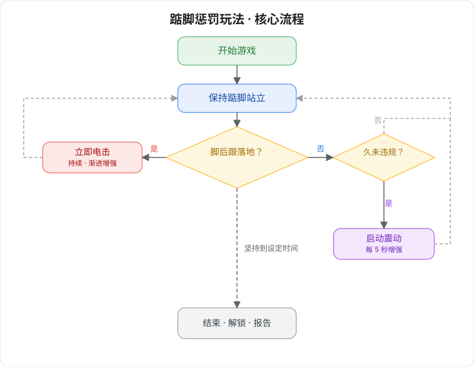

# Zehenspitzen-Bestrafungsspielweise v2 (2. Generation)

Hightech-Körpergefühls-Selbst­disziplin-Trainingsspiel — auf den Zehenspitzen stehen bleiben; setzt die Ferse auf, gibt es eine Strafe.

> 🛒 **Geräteerwerb**: [Auf Taobao kaufen](https://item.taobao.com/item.htm?id=1028272889035)

## Spielbeschreibung

- **Zehenspitzen-Bestrafungsspielweise:** Das Gerät überwacht die Fersenposition in Echtzeit. Sobald die Ferse aufsetzt, wird per Elektroimpuls bestraft — die Zehenspitzenhaltung muss stets gehalten werden.
- **Optionale Verriegelung:** Mit verbundenem automatischem Schloss wird zu Spielbeginn verriegelt — nicht fertig, nicht weg.

## Tragen und Verbinden

Bitte zuerst den Client installieren und das Gerät verbinden, siehe [Client-Download und Geräteverbindung](/docs/player/new-phone-client).

- **Elektroimpuls-Pads**: Auf die Innenseite der Oberschenkel kleben, je eines links und rechts, für das Bestrafungs-Feedback.
- **Zehenspitzensensor**: In die Socke stecken und eng an die Ferse legen, oder an der Fersenposition im Schuh platzieren.
- **Hauptgerät befestigen**: Das Hauptgerät des Edging-Gesamtgeräts mit dem Band am Oberschenkel festbinden.
- **Kabelverbindungen**: Das andere Ende jeder Komponente mit dem Hauptgerät verbinden.

## Software-Einstellungen

1. **Spielauswahl aufrufen**: Im Client die Spielauswahl öffnen.
2. **Spielweise wählen**: „Zehenspitzen-Bestrafungsspielweise“ wählen.
3. **Parameter einstellen**: Spieldauer, Elektroimpuls-Stärke, progressiven Modus usw. festlegen (während des Spiels jederzeit änderbar).
4. **Erlebnis starten**: Auf „Start“ klicken, um ins Spiel zu gehen.

## Spielverlauf

### Kernregel
Halte den Stand auf den Zehenspitzen — die Fersen dürfen auf keinen Fall den Boden berühren!

### Überwachungsmechanismus
+ Der Zehenspitzensensor überwacht die Fersenposition in Echtzeit.
+ Sobald die Ferse aufsetzt = Verstoß; der Elektroimpuls wird sofort ausgelöst.
+ Die Strafe stoppt erst, wenn die Ferse wieder angehoben ist.

### Bestrafungssystem
+ 🔴 **Sofortbestrafung**: Der Elektroimpuls beginnt in dem Moment, in dem die Ferse aufsetzt.
+ 📈 **Progressive Stärke**: Mit jedem Verstoß steigt die Elektroimpuls-Stärke automatisch.
+ ⏱️ **Dauerbestrafung**: Solange die Ferse aufsetzt, geht der Elektroimpuls weiter, bis sie komplett angehoben ist.
+ 🎮 **Verstärkte Vibration**: Zeigst du eine Weile gute Leistung (kein Verstoß), startet das Hauptgerät eine Vibrationsstörung mit schrittweise steigender Stärke.

### Mechanik der Vibrationsverstärkung
+ **Verzögerter Start**: Startet automatisch nach der eingestellten Zeit ohne ausgelösten Elektroimpuls.
+ **Stärkeanstieg**: Die Stärke steigt mit der Zeit schrittweise.
+ **Automatischer Stopp**: Stoppt und wird zurückgesetzt, sobald ein Elektroimpuls ausgelöst wird.

### Spielende
+ Wer die eingestellte Zeit durchhält, wird automatisch entriegelt.
+ Das System zeigt einen vollständigen Leistungsbericht mit Statistik zu Verstößen, Bestrafungen usw.

## Herausforderungen
+ **Körperliche Challenge**: Langer Zehenspitzenstand testet die Ausdauer der Beinmuskulatur.
+ **Willensprobe**: Trotz Ermüdung muss die korrekte Haltung gehalten werden.
+ **Präzise Kontrolle**: Jede noch so kleine Fersensenkung wird erkannt.
+ **Psychologisches Spiel**: Unter Elektroimpuls-Androhung ruhig und konzentriert bleiben.
+ **Doppelter Druck**: Bestrafung vermeiden und gleichzeitig die Vibrationsstörung ertragen.

## Siegbedingung
Die eingestellte Zeit erfolgreich durchhalten — je weniger Verstöße, desto besser:

+ 🌟 **Perfekt**: 0 Verstöße
+ ⭐ **Ausgezeichnet**: 1–2 Verstöße
+ 👍 **Gut**: 3–5 Verstöße
+ 😅 **Verbesserungswürdig**: mehr als 5 Verstöße

## Sicherheitshinweise
+ Nur bei guter Gesundheit verwenden — nicht bei Herzkrankheiten, Epilepsie usw.; nur für Erwachsene über 18 Jahre.
+ Mit niedriger Stärke und kurzer Dauer beginnen; bei Unwohlsein während des Spiels sofort abbrechen.
+ Elektroimpuls-Stärke vorsichtig einstellen — zu hohe Werte können Verletzungen verursachen; das Risiko trägt der Nutzer selbst.
+ Gerätesicherheit und Elektroimpuls-Hinweise siehe [Pflichtlektüre für Solo-Spiel](/docs/player/solo-safety).

## Hinweise zum Versions-Upgrade

In der zweiten Generation wurden die drei Geräte TD01 (Vibration), Elektroschock und Zehenspitzensensor aufgerüstet und zu einem Edging-Gesamtgerät vereint; die Einrichtungsweise hat sich nicht geändert.

Für Geräte der alten Version siehe das Tutorial: [Zehenspitzen-Bestrafungsspielweise v2 (alte Version)](/docs/player/old/tiptoe-v2)
