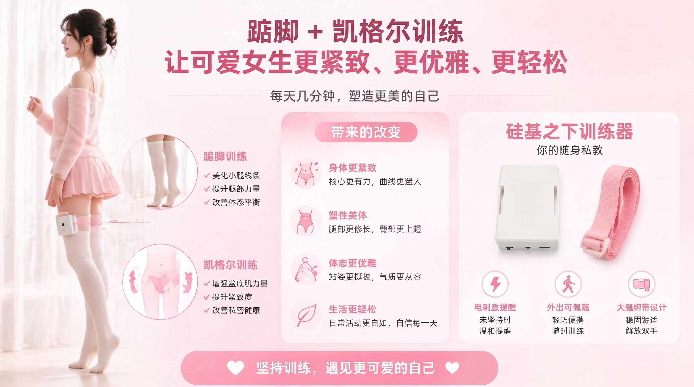

Auf den Zehenspitzen stehen in Kombination mit Kegel-Übungen ist ein effektives Haltungstraining, das Beckenboden- und Wadenmuskulatur stärkt. Dieses Tutorial zeigt dir, wie du das Zehenspitzen-Kegel-Training mit intelligenten Trainingsgeräten durchführst.

> 🛒 **Geräteerwerb**: [Auf Taobao kaufen](https://item.taobao.com/item.htm?id=1028272889035)  
> 🎬 **Video-Tutorials**: [Untersilicon-Videoseite](https://video.undersilicon.com/w/pcesS2gYvbfuU5Wcf5v7fQ) | [YouTube](https://youtu.be/Q7ti6oOdhpc)

## Vorbereitung

1. **Client verbinden**: Bitte zuerst die App installieren und das Hauptgerät verbinden, siehe [Client-Download und Geräteverbindung](/docs/player/new-phone-client).
2. **Geräte anlegen**:
   - **Beckenbodensensor**: Mit Gleitmittel verwenden, in Seitenlage entspannt langsam einführen. Schrittweise vorgehen, nichts überstürzen.
   - **Elektroden-Pads**: Auf die Oberschenkel kleben (je eines links und rechts) — liefern die Feedback-Stimulation während des Trainings.
   - **Zehenspitzensensor**: In die Socke oder den Schuh stecken und eng an die Ferse legen.
   - **Hauptgerät**: Mit dem Band am Oberschenkel befestigen und die Kabel der oben genannten Komponenten anschließen. Die Verbindungsweise ist unten dargestellt:

   

## Training starten

1. **Gerät wählen**: In der App auf das verbundene Gerät klicken.
2. **Spielweise wählen**: Den Modus „**Zehenspitzen-Kegel**“ wählen.
3. **Parameter einstellen**: Eine geeignete Feedback-Stärke (EMS-Elektroimpuls-Parameter) festlegen.
4. **Erlebnis starten**: Auf Start klicken und in den Trainingszustand gehen.

## Trainingsregeln

Das Gerät erkennt deine Körperbewegungen in Echtzeit. Während des Trainings:
- muss die **Beckenbodenmuskulatur dauerhaft angespannt** bleiben;
- müssen die **Fersen in der Schwebe (vom Boden abgehoben)** bleiben.

Erkennt das Gerät eine unzureichende Haltung, mahnt es per Elektroimpuls und hilft dir, die Haltung wieder anzupassen. Bleib dran und steigere schrittweise deine Rumpfkontrolle.

### Hinweise
1. Reinigung und Aufbewahrung der Sensoren siehe [Zusammenbau und Tragen](/docs/device/cunzhi01/assembly#清洗与收纳).
2. Sicherheitshinweise zu Elektroimpuls und Spannung siehe [Pflichtlektüre für Solo-Spiel](/docs/player/solo-safety).
