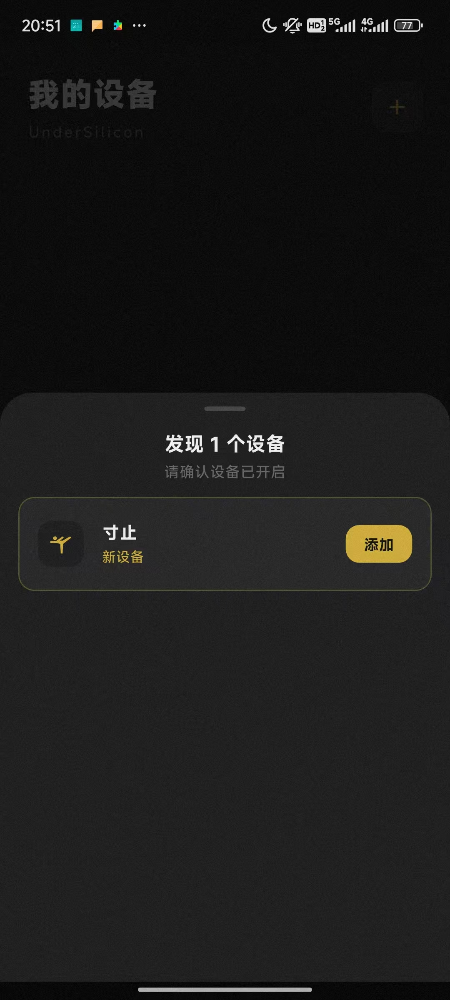
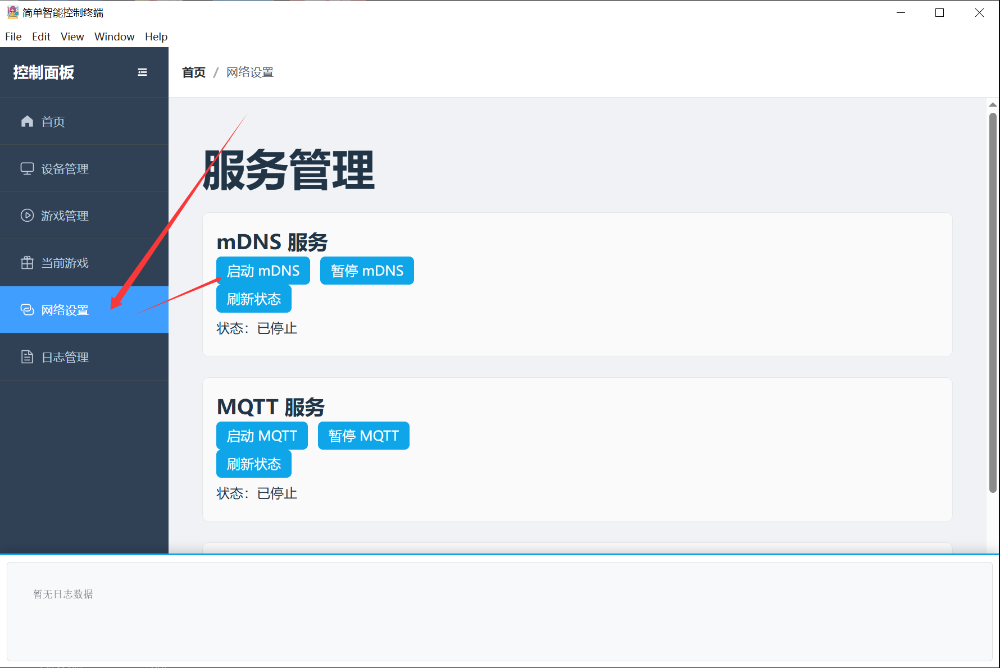

# Client-Downloads

## Android-Client {#安卓客户端}

Android-Download-Link: https://dl.undersilicon.cn/apk/latest/app-release.apk

### Geräteverbindung (am Beispiel von cunzhi01)

1. Schalten Sie das Gerät ein – zu diesem Zeitpunkt sollte das Gerät mit einer blinkenden blauen LED leuchten (falls es nicht blinkt, laden Sie den Akku bitte zuerst auf).
2. Öffnen Sie die Client-App. Klicken Sie auf „Gerät hinzufügen“ oder auf das Pluszeichen oben rechts.
   
3. Klicken Sie auf „Gerät hinzufügen“.
   
4. Klicken Sie auf „Fertig“.
   
5. Jetzt wurde das Gerät erfolgreich hinzugefügt und ordnungsgemäß verbunden. Nach einer erfolgreichen Verbindung bleibt die blaue LED für einige Sekunden dauerhaft leuchten und erlischt dann.
   

## iOS-Client {#ios}

Suche im App Store nach "硅基之下" oder lade die App über den untenstehenden Link herunter:

- App Store-Link: [https://apps.apple.com/app/硅基之下/id6777638368](https://apps.apple.com/app/%E7%A1%85%E5%9F%BA%E4%B9%8B%E4%B8%8B/id6777638368)
- Aktuelle Version: 1.0

## HarmonyOS-Client {#鸿蒙客户端}

Sie können die App herunterladen und installieren, indem Sie im Huawei AppGallery nach „Undersilicon“ suchen.

## PC-Client {#pc}

Bilibili: https://www.bilibili.com/video/BV1jBcuzGEyC/
YouTube: https://youtu.be/1m-OEwx_Gjg

### Bedienungsanleitung
1. Download-Link: [https://firmware.undersilicon.cn/control-panel/stable/UnderSilicon.zip](https://firmware.undersilicon.cn/control-panel/stable/UnderSilicon.zip)
2. **Bitte entpacken Sie die Datei und installieren Sie das Programm (falls das Entpacken fehlschlägt, können Sie [7zip](https://www.7-zip.org/download.html) installieren und die Datei mit dieser Software entpacken**)**
3. **Starten Sie den Client**
4. **Aktivieren Sie den Computer-Hotspot, setzen Sie den WLAN-Namen auf »easysmart«, das Passwort auf acht Einsen und das Band auf ****2,4 GHz**** (bei Problemen: [Nutzungsweise ohne Computer-Hotspot](#无电脑热点情况使用方式))**  
Hinweis: Wenn das Gerät bereits mit einem anderen 5-GHz-WLAN verbunden ist, kann es sein, dass es trotz 2,4-GHz-Konfiguration weiterhin im 5-GHz-Band arbeitet. In diesem Fall muss das Gerät mit einem 2,4-GHz-WLAN (oder per Ethernet) verbunden werden, um den WLAN-Hotspot richtig einrichten zu können.
5. **Wenn das Gerät mit dem WLAN verbunden ist, aber im Client nicht angezeigt wird, wurde es möglicherweise blockiert. Deaktivieren Sie in diesem Fall die Firewall auf dem Computer.**
6. **Starten Sie das Gerät. Nach etwa 15–30 Sekunden verbindet es sich automatisch mit dem Computer.**
7. **Nun können Sie loslegen und Spaß haben!**

 

### Nutzungsweise ohne Computer-Hotspot {#无电脑热点情况使用方式}
1. Gerätevernetzung: Bitte lesen Sie [Gerät mit WLAN verbinden (Vernetzung) über die APP](/docs/other/wifi-config/app), um das Gerät mit Ihrem Heim-WLAN zu verbinden (beachten Sie, dass es sich um ein 2,4-GHz-WLAN handeln muss).
2. Aktivieren Sie mDNS im Client.

### Weitere Download-Links

Stable Version: https://firmware.undersilicon.cn/control-panel/stable/UnderSilicon.zip

Beta-Version: https://firmware.undersilicon.cn/control-panel/test/UnderSilicon.zip

Ältere Versionen: https://github.com/jiandanzhineng/control-panel/releases
