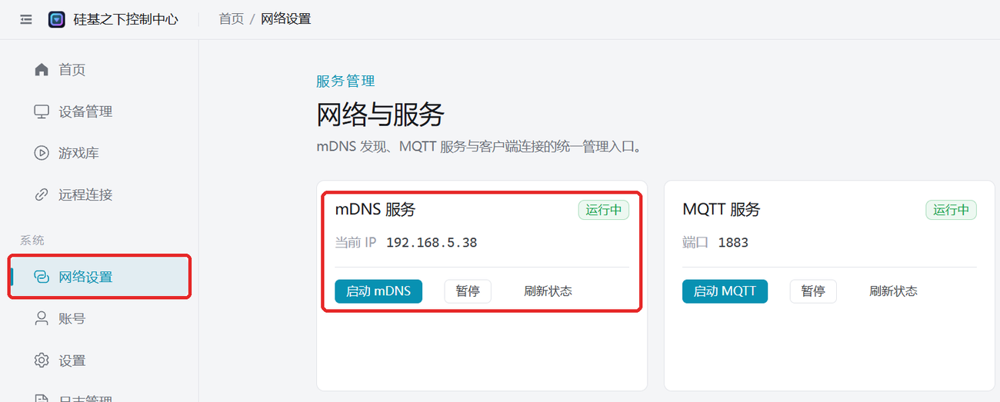

# Ins Heim-WLAN einbinden

Das Gerät mit dem heimischen Router verbinden. Geeignet für: PC kann keinen Hotspot öffnen (z. B. Desktop ohne WLAN-Karte oder Firmen-PC mit Hotspot-Sperre), Fernsteuerung per Handy, Firmware-Upgrades und mehrere Geräte gleichzeitig online.

:::note
Bluetooth und WLAN des Geräts schließen sich aus: Nach erfolgreicher Netzwerkkonfiguration schaltet das Gerät Bluetooth automatisch ab; für die Bluetooth-Direktverbindung am Handy bitte zurück in den BLE-Modus wechseln.
Wer nur das Standard-WLAN nutzen will (Name `easysmart`, Passwort `11111111`), braucht keine Konfiguration — das Gerät verbindet sich automatisch.
:::

## Voraussetzungen

- Zu Hause gibt es ein **2,4-GHz**-WLAN (Dualband-Router mit gleichem Namen für 2,4G/5G geht auch).
- Der Router unterstützt mDNS (die meisten tun es); im Zweifel zuerst [prüfen, ob der Router mDNS unterstützt](/docs/other/check-mdns).

## Schritt 1: Gerät konfigurieren

Eine der folgenden Methoden wählen, um das Gerät ins heimische 2,4G-WLAN zu bringen:

| Methode | Voraussetzung |
| --- | --- |
| [Über den PC-Client konfigurieren](/docs/other/wifi-config/pc-bluetooth) | PC mit Bluetooth |
| [Über die App konfigurieren](/docs/other/wifi-config/app) | Handy mit EspBlufi |
| [Über das Mini-Programm konfigurieren](/docs/other/wifi-config/miniprogram) | WeChat; Handy mit diesem WLAN verbunden |

## Schritt 2: Gerät im PC-Client verbinden

PC und Gerät sind an demselben Router (PC per LAN-Kabel oder WLAN); der Client findet das Gerät per mDNS im LAN.

1. Der Client startet mDNS beim Öffnen automatisch. Links „Netzwerkeinstellungen“ öffnen — unter „mDNS-Dienst“ muss „läuft“ stehen; steht dort „gestoppt“, auf „mDNS starten“ klicken.
   
2. Gerät neu starten — nach ca. 15–30 Sekunden erscheint es in der „Geräteverwaltung“.

## Gerät erscheint nicht

- PC-Firewall deaktivieren und erneut versuchen.
- Prüfen, ob PC und Gerät am selben Router hängen; Gastnetzwerke und Netze mit AP-Isolation können sich gegenseitig nicht finden.
