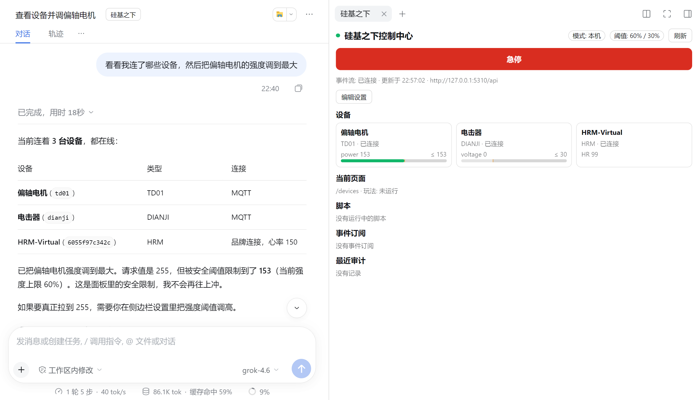

# DeepSeek Harness Plugin (AI Control)

With this plugin installed, you can chat in [DeepSeek Harness](https://www.npmjs.com/package/@deepseek-ai/dsh) (dsh for short) and let the AI view and control your devices and PC client: set intensity, start games, switch pages, take screenshots, and even have the AI write a script that watches data like heart rate and reacts automatically.

## Prerequisites

- The "UnderSilicon Control Center" PC client 1.0.42 or above, open on this computer. If the version is too old, the plugin refuses to control and asks you to upgrade.
- DeepSeek Harness 0.2.1 or above, with a model configured.

## Install the plugin

1. Open the "Plugins" page in the dsh sidebar, and click "Add plugin" at the top right.
2. Enter the package name `dsh-plugin-undersilicon` and click "Install".

   

3. Click "Enable now", then **quit dsh completely and reopen it**. Refreshing the page alone does not take effect.

You can also install it from the command line: `dsh plugin --profile <profile name> add dsh-plugin-undersilicon`.

## Usage

Open a session (send one message first in a new session), then click the "UnderSilicon" button next to the session title. A control panel appears on the right: device status and intensity bars, an **emergency-stop button**, and settings.

In the screenshot above, the AI tried to set the intensity to maximum (255); because the cap is 60%, the device actually ran at 153.

Then just tell the AI, for example:

- "See which devices are connected"
- "Set the vibrator to half intensity and stop after 5 minutes"
- "Open the edging game and start with the default parameters"
- "Take a screenshot to see which page the client is on"
- "Write a script: if heart rate goes above 150, drop the intensity to 0 and remind me"

While the AI is in control, the PC client title bar shows "AI control · limit X%":

## Safety settings

Click "Edit settings" on the right panel to change them; they take effect as soon as you click "Save settings":

| Setting | Default | Description |
|---|---|---|
| Global cap / per-capability caps | 60%, shock 30% | Any intensity the AI sends above the cap is scaled down to the cap; values below it run as-is. Caps can be set per capability |
| Stop devices when session ends | On | Stop all devices when the session ends |
| Watchdog | 30 seconds | If dsh hangs or exits, devices stop automatically within this time |

- **Emergency stop**: the stop button on the panel works at any time — it stops all devices, games, and AI scripts. Once pressed, every AI control is rejected until you click "Resume" on the panel.
- The cap is enforced once in the plugin and once in the client backend, so the AI cannot bypass it by tweaking parameters.
- Every AI control action is logged to the audit log under `~/.dsh/undersilicon/`.

## Notes

- The plugin only connects to the client on this machine. In a remote session, it can only control devices the other side has authorized to you.
- The cap only constrains the AI inside the plugin. If you also give the AI terminal or file-write permission, it can change the plugin settings or call the API directly — so do not open those permissions at the same time.
- If installation says it cannot access GitHub: set the source to the npm package name `dsh-plugin-undersilicon`.
- To control devices from a script or another AI tool, see the [command-line tool](/docs/developer/cli).
