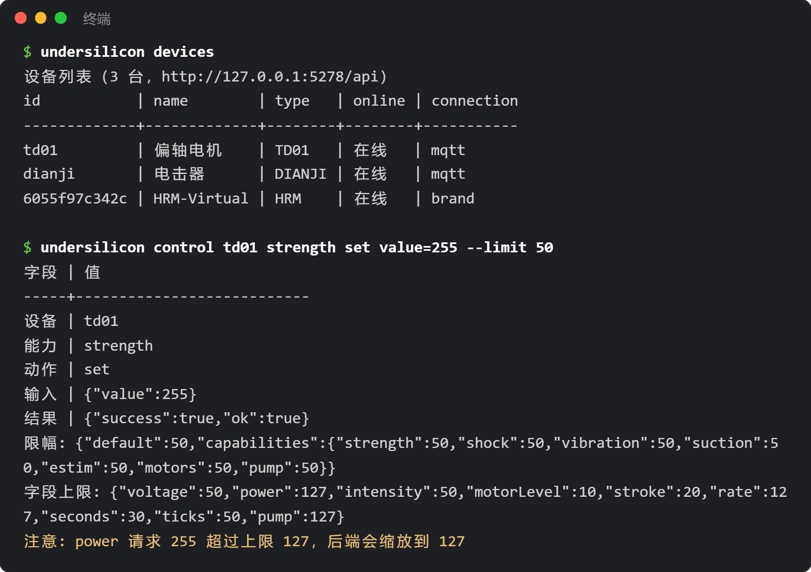

# Command-Line Tool (CLI)

`undersilicon` is the command-line tool for controlling the "UnderSilicon Control Center" PC client: list devices, set intensity, start games, take screenshots, and listen to events. It works well for automation scripts, and for handing control to AI coding assistants such as Claude Code or Codex.



## Install

Install [Node.js](https://nodejs.org/) 18 or above first.

```bash
npm i -g undersilicon-cli
undersilicon status
```

If you do not want a global install, run `npx undersilicon-cli status` directly.

Open the PC client first. The CLI connects to `http://127.0.0.1:5278/api` on this machine by default.

:::info Client version
Window, screenshot, event, and intensity-cap features need client 1.0.42 or above. Older versions only support device, emergency-stop, and game start/stop commands; other commands will ask you to upgrade.
:::

## Common commands

```bash
undersilicon devices                                 # device list
undersilicon device dev01                            # device details, capabilities, parameter ranges
undersilicon control dev01 strength set value=120    # control by capability
undersilicon op dev01 stop                           # preset operation
undersilicon stop                                    # emergency stop: stop all devices and the current game

undersilicon games                                   # game list
undersilicon game:start surge-edging --device motor=dev01 --device punish=dev02
undersilicon game:status
undersilicon game:stop

undersilicon window show                             # show the window; also hide/minimize etc.
undersilicon routes                                  # pages that can be opened
undersilicon open plays                              # open the play library page (/plays)
undersilicon screenshot shot.png                     # screenshot

undersilicon events --types device,game --count 20   # live events, one per line
```

Every command accepts `--help` for usage, and `undersilicon help` lists all commands.

- The device role names for `game:start` (such as motor, punish) are shown in the `undersilicon games` list.
- In Git Bash on Windows, `open /plays` gets rewritten by the terminal; write `open plays` instead.

## Global options

| Option | Effect |
|---|---|
| `--json` | Output JSON, easy for scripts and AI to parse |
| `--api <address>` | Change the backend address; the `UNDERSILICON_API` env var also works |
| `--limit <0-100>` | Enable the intensity cap (see below) |

Exit code is 0 on success, 1 on a run failure, and 2 on bad arguments.

## Intensity cap (optional)

By default there is no cap — the CLI acts just like you operating the client by hand. With `--limit`, the backend scales any intensity above the cap down to the cap; values below the cap run as-is:

```bash
undersilicon control dev01 strength set value=255 --limit 50          # actually runs at 127
undersilicon control dev01 shock start voltage=80 --limit 60 --cap-limit shock=30
```

- `--limit`: the cap percentage for all intensities. `--cap-limit` sets a cap per capability; capabilities include strength, shock, vibration, suction, estim, motors, pump.
- You can also use the `UNDERSILICON_LIMIT` and `UNDERSILICON_CAP_LIMIT` env vars so you do not have to write it on every command.
- While a cap is active, the client title bar shows "AI control · limit X%":

  

- A cap lasts 10 minutes (change with `--lease-ttl`, max 600 seconds); every capped command refreshes the timer. When it expires, games started under the cap stop automatically.
- `undersilicon lease:release` ends the cap immediately and stops those games.
- If the client is too old to support caps, the command fails outright instead of running uncapped.

:::warning When an AI uses it
The cap only applies to commands that carry the option. If the AI can run terminal commands freely, it can also drop the option. When you really need protection, use the [DeepSeek Harness plugin](/docs/developer/dsh-plugin), or only let the AI run scripts you wrote. The emergency stop `undersilicon stop` always works.
:::
