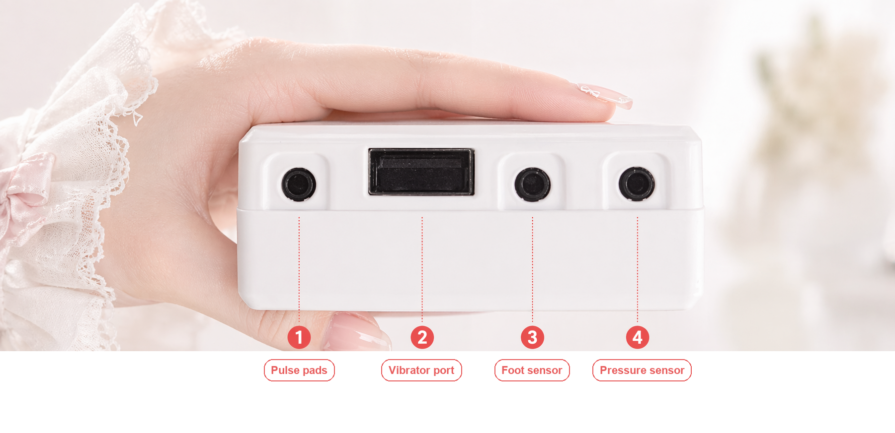

# Assembly and Wearing

This page applies to the edging combo device (CUNZHI01). The assembly is the same for every play: wear each component on your body and plug it into the host.

> ⚠️ Never put pulse pads on the torso, heart, or head. Voltage on the body must not exceed 36 V. For more safety notes see [Solo Play Safety](/docs/player/solo-safety).

## Wearing steps

**Note**: test that the play works before wearing it for real — nothing worse than strapping in and finding it won't run~

- **Anal plug**: use with lubricant. Lie on your side, relax the sphincter, and insert slowly.
  > ⚠️ **Note**: if you feel pain or discomfort, stop immediately, adjust, then continue slowly. The plug on this product is small — no need to worry, and no brute force; just take it slow.
- **Pulse pads**: stick one on the inner side of each thigh.
  > 🚫 **Warning**: do not stick them anywhere else on the torso — that can hurt you.
- **Tiptoe sensor**: tuck it into your sock tight against the heel, or place it at the heel inside your shoe.
- **Host**: strap the host unit to your thigh with the band.
- **Extra securing (optional)**: for going out or standing scenarios, use a leather harness or rope to keep the plug from falling out.
    > [Bilibili video tutorial](https://www.bilibili.com/video/BV11P411B7ZN/) | [YouTube video tutorial](https://www.youtube.com/watch?v=XMCO3YRegNw) | [How to wear the harness](/docs/device/wear-pants)
- **Wiring**: connect the other end of each component to the edging host, as shown below:

## Charging

The host does not come with a charging cable — any ordinary phone cable (Type-C) works. **Charge about 8 hours before first use; 4~6 hours for daily charging. The indicator turns green when full.**

## Cleaning and storage {#清洗与收纳}

1. The plug is not fully waterproof — do not soak it in water. You can wrap it in a condom during use and just throw the condom away afterwards, then wipe the plug clean.
2. After cleaning, put the plug in a sealed bag. Long exposure to dry air can crack the outer skin.

## Safety notes

Read [Solo Play Safety](/docs/player/solo-safety) before use: do not use the pulse function on the heart, head, torso, or other core areas, and do not let current pass through them; voltage on the body must not exceed 36 V; do not use this product if you feel unwell or have an underlying condition.
