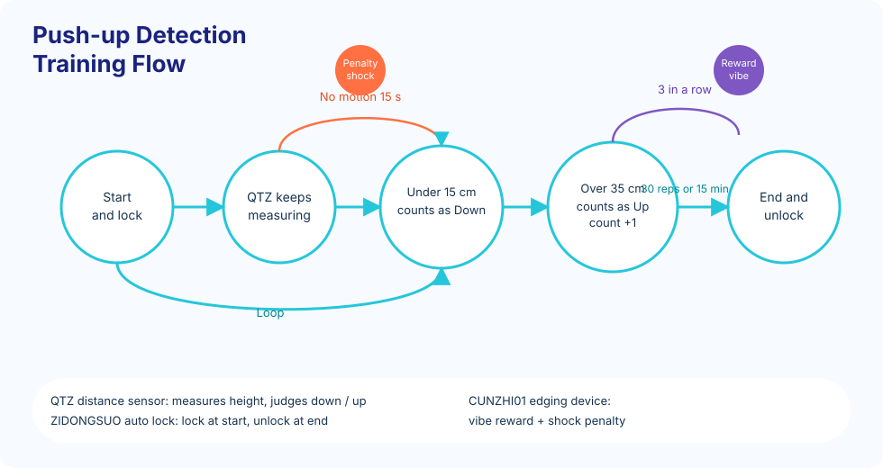

# Push-up (Approximate) Detection Training Game

A push-up game that uses the QTZ distance sensor to judge each rep, with an optional auto lock and the edging combo device (CUNZHI01) for incentive and penalty.

You can hold a small stick in your mouth and turn it into another play.

Buy: [Taobao](https://item.taobao.com/item.htm?id=964389698138)

## Overview

### Goal

+ Finish the set number of push-ups in the set time
+ Keep a standard push-up posture
+ Use device feedback to stay focused

### Rules

1. **Start:** the auto lock locks, and the timer and motion detection start
2. **Detection:** QTZ watches body height
3. **A rep:** dropping below the set distance counts as Down; rising above the set distance counts as Up
4. **Penalty:** too long with no motion triggers a shock of random intensity and length
5. **Reward distraction:** after a streak, each further rep has a chance to trigger vibration
6. **Reset:** a penalty clears the streak, and the reward count starts over
7. **End:** the lock unlocks when the target count or the time is reached

## Devices

| Type | Logic ID | Name | Required | Role |
| --- | --- | --- | --- | --- |
| QTZ | distance_sensor | QTZ distance sensor | Yes | Body height, judges the push-up |
| ZIDONGSUO | auto_lock | Auto lock | No | Lock at start, unlock on finish or timeout |
| CUNZHI01 | cunzhi01 | Edging combo device | No | Shock after idle time; random vibration after a streak |

> In the 2nd generation, the separate shock device (DIANJI) and vibrator (TD01) are combined into one [edging combo device](../../device/寸止综合设备/寸止综合设备.md) (pressure + vibration + pulse). Penalty and reward both come from CUNZHI01. Setup is otherwise the same.

## Parameters

### Basics

| Name | Type | Range | Default | Meaning |
| --- | --- | --- | --- | --- |
| duration | number | 1–240 min | 15 min | Session length |
| targetCount | number | 1–2000 | 30 | Target push-up count |
| downThreshold | number | 5–30 cm | 15 cm | At or below this distance counts as Down |
| upThreshold | number | 20–50 cm | 35 cm | At or above this distance counts as Up |

### Penalty

| Name | Type | Range | Default | Meaning |
| --- | --- | --- | --- | --- |
| idleTimeLimit | number | 10–120 s | 30 s | Idle longer than this triggers a penalty |
| shockIntensity | number | 10–100 V | 15 V | Base shock intensity |
| shockDuration | number | 1–10 s | 3 s | Base shock length |
| randomIntensityRange | number | 0–50 V | 10 V | Random intensity spread (± this value) |
| randomDurationRange | number | 0–5 s | 1 s | Random duration spread (± this value) |

### Reward distraction

| Name | Type | Range | Default | Meaning |
| --- | --- | --- | --- | --- |
| rewardTriggerCount | number | 3–20 | 5 | Streak length before reward rolls start |
| rewardTriggerProbability | number | 0–100% | 30% | Chance per further rep |
| vibratorIntensity | number | 1–255 | 100 | Vibration intensity |
| vibratorDuration | number | 5–60 s | 15 s | Vibration length |

## Screen

+ **Time left**
+ **Progress:** finished / target
+ **Motion:** Down or Up
+ **Lock state**
+ **Device state**

## Development

+ v1.0.0: first version
+ v2.0.0: DIANJI and TD01 combined into CUNZHI01

Legacy devices: [Push-up detection game (legacy)](../old/俯卧撑（大概）检测训练游戏.md)
