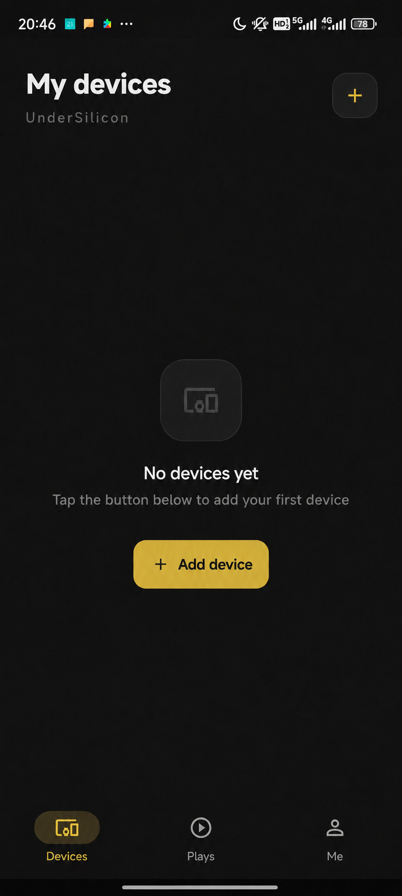
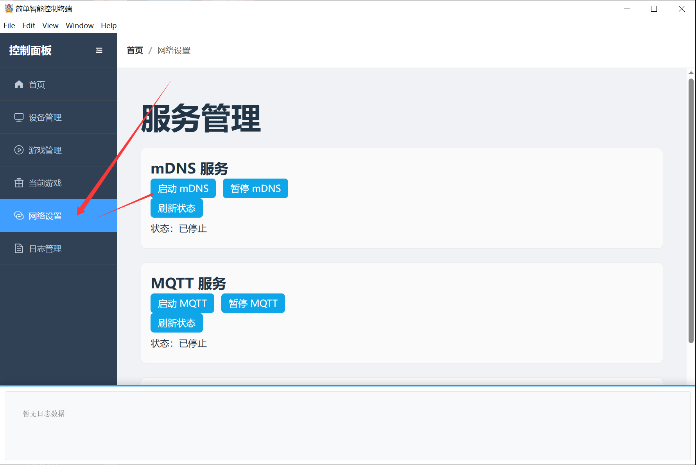

# Client downloads

## Android Client {#安卓客户端}

Android download: https://dl.undersilicon.cn/apk/latest/app-release.apk

### Connect a device (CUNZHI01 example)

1. Power the device on. The blue light should blink. If it does not blink, charge it first.
2. Open the client and tap Add device, or the plus button at the top right.
   
3. Tap Add device.
   
4. Tap Done.
   
5. The device is connected. After a successful connection the blue light stays on for a few seconds, then turns off.
   

## iOS Client {#ios}

Search for "硅基之下" on the App Store or click the link below to download:

- App Store Link: [https://apps.apple.com/app/硅基之下/id6777638368](https://apps.apple.com/app/%E7%A1%85%E5%9F%BA%E4%B9%8B%E4%B8%8B/id6777638368)
- Current Version: 1.0

## HarmonyOS Client {#鸿蒙客户端}

Search for "Undersilicon" in the Huawei AppGallery to download and install.

## PC Client {#pc}

Bilibili: https://www.bilibili.com/video/BV1jBcuzGEyC/
YouTube: https://youtu.be/1m-OEwx_Gjg

### User guide
1. Download Link: [https://firmware.undersilicon.cn/control-panel/stable/UnderSilicon.zip](https://firmware.undersilicon.cn/control-panel/stable/UnderSilicon.zip)
2. **Please extract the files after downloading and then install. (If extraction fails, you can install [7zip](https://www.7-zip.org/download.html) and use it to extract the archive.)**
3. **Launch the client**
4. **Enable your computer's hotspot, set the WiFi name as easysmart with password as eight 1s, and the band to **2.4G** band. (See [Usage without Computer Hotspot](#无电脑热点情况使用方式) for alternative setup)**
Note: If the device has already connected to a 5G WiFi network, it might still operate on the 5G band even after being configured for 2.4G. In this case, the device needs to be connected to a 2.4G WiFi network (or via Ethernet) for proper hotspot setup.
5. **If the device connects to WiFi but does not appear in the client, it might be blocked. Please turn off your computer's firewall.**
6. **Power on the device. It will automatically connect to the computer approximately 15-30 seconds after startup.**
7. **You're ready to have fun!**

 

### Usage without Computer Hotspot {#无电脑热点情况使用方式}
1. Device Network Configuration: Refer to [Connecting the Device to WiFi via APP](/docs/other/wifi-config/app) to connect the device to your home WiFi (Note: Must be 2.4G WiFi)
2. Enable mDNS in the client

### Other Download Links

Stable Version: https://firmware.undersilicon.cn/control-panel/stable/UnderSilicon.zip

Test Version: https://firmware.undersilicon.cn/control-panel/test/UnderSilicon.zip

Historical Versions: https://github.com/jiandanzhineng/control-panel/releases
