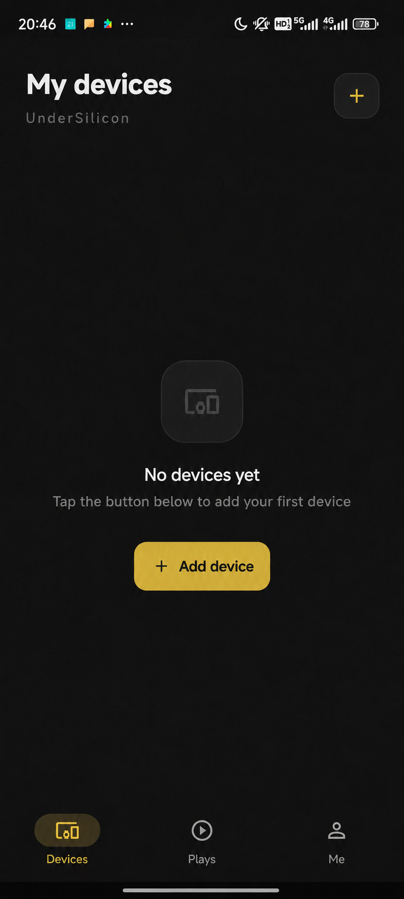

# Bluetooth Direct (Phone)

For daily control, the phone client talks to devices over direct Bluetooth — no WiFi needed. After power-on the blue light blinks; turn on Bluetooth on the phone and add the device:

1. Power on the device. It should be blinking blue (if not, charge it first).
2. Open the client and tap "Add device" or the plus button at the top right.
   
3. Tap "Add device".
   
4. Tap "Done".
   
5. Added means connected. On a successful connection the blue light stays solid for a few seconds, then turns off.
   

:::note
Bluetooth and WiFi are mutually exclusive on the device: after provisioning or joining a hotspot, the device turns Bluetooth off automatically. To go back to direct Bluetooth control, switch the device back to BLE mode.
:::
