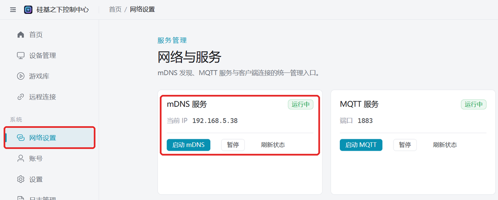

# Provision to Home WiFi

Connect the device to your home router. Useful when: the PC can't broadcast a hotspot (a desktop without WiFi, or a company PC with hotspots disabled), you want phone remote control, firmware upgrades, or several devices online at once.

:::note
Bluetooth and WiFi are mutually exclusive on the device: after successful provisioning it turns Bluetooth off. To go back to direct Bluetooth control on the phone, switch the device back to BLE mode.
If you only want the default WiFi (name `easysmart`, password `11111111`) there's no need to provision — the device joins it automatically.
:::

## Prerequisites

- A **2.4G** WiFi at home (a dual-band router with one combined 2.4G/5G name also works).
- The router supports mDNS (most do). Not sure? [Check whether your router supports mDNS](/docs/other/check-mdns) first.

## Step 1: Provision the device

Pick any one method to get the device onto the home 2.4G WiFi:

| Method | Requires |
| --- | --- |
| [Provision via the PC client](/docs/other/wifi-config/pc-bluetooth) | A PC with Bluetooth |
| [Provision via the app](/docs/other/wifi-config/app) | EspBlufi installed on a phone |
| [Provision via the mini program](/docs/other/wifi-config/miniprogram) | WeChat, with the phone on that WiFi |

## Step 2: Connect from the PC client

The PC and the device sit under the same router (the PC can use Ethernet or WiFi). The client finds the device over mDNS on the LAN.

1. The client starts mDNS automatically on launch. Open "Network Settings" on the left; "mDNS service" should show "running". If it shows stopped, click "Start mDNS".
   
2. Restart the device. It appears under "Device Management" in about 15~30 seconds.

## Device doesn't appear

- Try again after turning off the PC firewall.
- Confirm the PC and the device are on the same router — guest networks and networks with AP isolation can't see each other.
