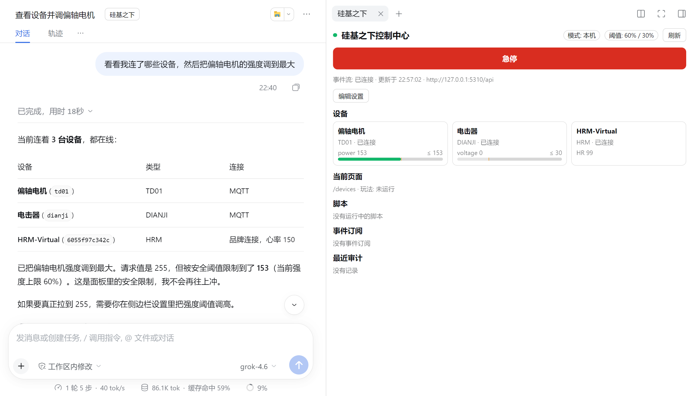

# Plugin de DeepSeek Harness (control por IA)

Con este plugin instalado, dentro de [DeepSeek Harness](https://www.npmjs.com/package/@deepseek-ai/dsh) (dsh para abreviar) puedes conversar con la IA para que consulte y controle tus dispositivos y el cliente de PC: ajustar intensidad, iniciar juegos, cambiar de página, hacer capturas de pantalla, e incluso escribir scripts que reaccionen automáticamente a datos como la frecuencia cardíaca.

## Preparación

- Abre en el ordenador el cliente de PC «Centro de control UnderSilicon» 1.0.42 o superior. Con versiones muy antiguas el plugin rechazará el control y pedirá actualizar.
- Instala DeepSeek Harness 0.2.1 o superior y configura el modelo.

## Instalación del plugin

1. Abre la página «Plugins» de la barra lateral de dsh y haz clic en «Añadir plugin» en la esquina superior derecha.
2. Introduce el nombre del paquete `dsh-plugin-undersilicon` y haz clic en «Instalar».

   

3. Haz clic en «Activar ahora» y luego **sal de dsh por completo y vuelve a abrirlo**. Solo recargar la página no basta.

También puedes instalarlo desde la línea de comandos: `dsh plugin --profile <nombre del profile> add dsh-plugin-undersilicon`.

## Uso

Abre una sesión (en una sesión nueva envía primero un mensaje), haz clic en el botón «UnderSilicon» junto al título de la sesión, y aparecerá el panel de control a la derecha: estado de los dispositivos y barras de intensidad, **botón de parada de emergencia** y ajustes.

En la imagen anterior la IA quería subir la intensidad al máximo (255); como el límite es 60%, el dispositivo la ejecutó realmente en 153.

Después, simplemente díselo a la IA, por ejemplo:

- «Mira qué dispositivos tengo conectados»
- «Pon el vibrador a la mitad de intensidad y deténlo en 5 minutos»
- «Abre el juego de edging y empieza con los parámetros por defecto»
- «Haz una captura para ver en qué página está el cliente ahora»
- «Escribe un script: si la frecuencia cardíaca supera 150, baja la intensidad a 0 y avísame»

Mientras la IA está controlando, la barra de título del cliente de PC muestra «Control por IA · límite X%»:

## Ajustes de seguridad

En el panel derecho, haz clic en «Editar ajustes» para modificarlos; se aplican de inmediato al pulsar «Guardar ajustes»:

| Ajuste | Por defecto | Descripción |
|---|---|---|
| Umbral general / umbrales por capacidad | 60%, choque eléctrico (shock) 30% | Si la intensidad que envía la IA supera el límite, se escala automáticamente al límite; la que no lo supera se ejecuta tal cual. Se puede configurar por capacidad |
| Detener dispositivos al terminar la sesión | Activado | Detiene todos los dispositivos al terminar la sesión |
| Watchdog | 30 segundos | Si dsh se bloquea o sale, los dispositivos se detienen automáticamente en ese tiempo |

- **Parada de emergencia**: el botón de parada de emergencia del panel se puede pulsar en cualquier momento; detiene todos los dispositivos, juegos y scripts de la IA. Tras pulsarlo, todo el control de la IA será rechazado hasta que pulses «Reanudar» en el panel.
- El límite se aplica una vez en el plugin y otra en el backend del cliente; la IA no puede eludirlo cambiando parámetros.
- Cada acción de control de la IA se registra en el registro de auditoría bajo `~/.dsh/undersilicon/`.

## Nota

- El plugin solo se conecta al cliente de la máquina local. En sesiones remotas, solo puede controlar los dispositivos que la otra parte te haya autorizado.
- El límite solo restringe a la IA dentro del plugin. Si además le das a la IA permisos de terminal o de escritura de archivos, podría modificar los ajustes del plugin o llamar directamente a la interfaz, así que no habilites esos permisos a la vez.
- Si al instalar indica que no puede acceder a GitHub: en origen basta poner el nombre del paquete npm `dsh-plugin-undersilicon`.
- Para controlar dispositivos desde scripts u otras herramientas de IA, consulta la [herramienta de línea de comandos](/docs/developer/cli).
