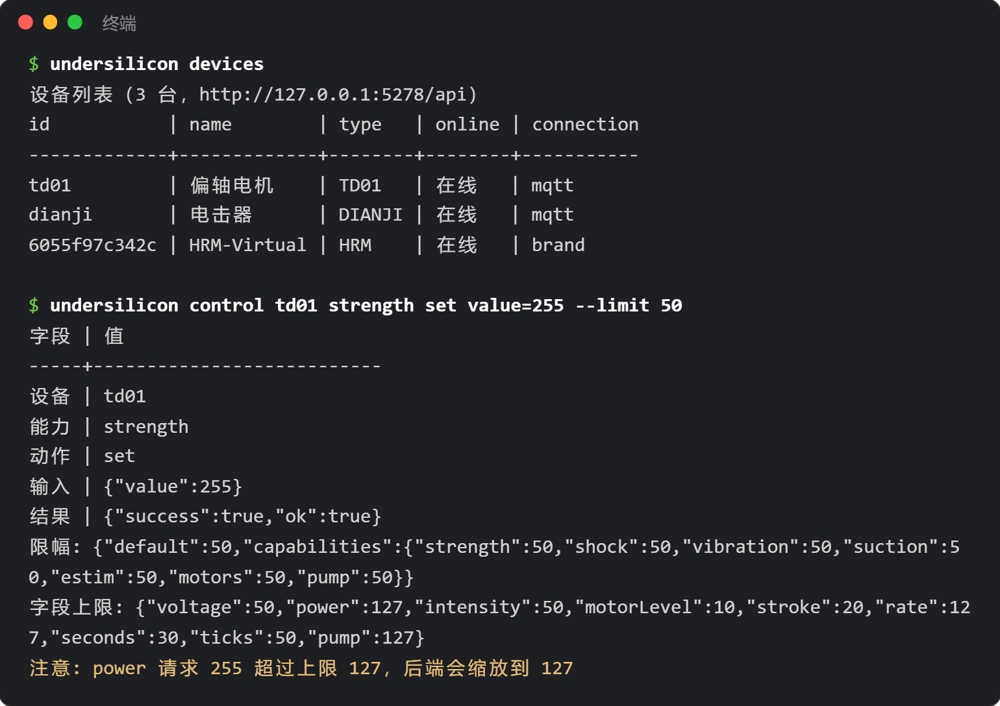

# Herramienta de línea de comandos (CLI)

`undersilicon` es la herramienta de línea de comandos para controlar el cliente de PC «Centro de control UnderSilicon»: consultar dispositivos, ajustar intensidad, iniciar juegos, hacer capturas de pantalla y escuchar eventos. Es adecuada para escribir scripts de automatización y también para que la invoquen asistentes de programación con IA como Claude Code o Codex.



## Instalación

Primero necesitas [Node.js](https://nodejs.org/) 18 o superior.

```bash
npm i -g undersilicon-cli
undersilicon status
```

Si no quieres instalarlo globalmente, también puedes usar directamente `npx undersilicon-cli status`.

Antes de usarlo, abre el cliente de PC. La CLI se conecta por defecto a `http://127.0.0.1:5278/api` en la máquina local.

:::info Versión del cliente
Las funciones de ventana, capturas de pantalla, eventos y límite de intensidad requieren el cliente 1.0.42 o superior. Las versiones más antiguas solo pueden usar los comandos de dispositivo, parada de emergencia e inicio/parada de juegos; los demás comandos pedirán actualizar.
:::

## Comandos habituales

```bash
undersilicon devices                                 # lista de dispositivos
undersilicon device dev01                            # detalle del dispositivo, capacidades y rangos de parámetros
undersilicon control dev01 strength set value=120    # control por capacidad
undersilicon op dev01 stop                           # operación predefinida
undersilicon stop                                    # parada de emergencia: detiene todos los dispositivos y el juego actual

undersilicon games                                   # lista de juegos
undersilicon game:start surge-edging --device motor=dev01 --device punish=dev02
undersilicon game:status
undersilicon game:stop

undersilicon window show                             # mostrar ventana; también hide/minimize, etc.
undersilicon routes                                  # páginas que se pueden abrir
undersilicon open plays                              # abrir la página de biblioteca de juegos (/plays)
undersilicon screenshot shot.png                     # captura de pantalla

undersilicon events --types device,game --count 20   # eventos en tiempo real, uno por línea
```

Cada comando admite `--help` para ver su uso, y `undersilicon help` lista todos los comandos.

- Los nombres de rol de dispositivo de `game:start` (como motor, punish) se ven en la lista de `undersilicon games`.
- En Git Bash de Windows, `open /plays` es reescrito por la terminal; basta escribir `open plays`.

## Parámetros generales

| Parámetro | Función |
|---|---|
| `--json` | Salida en JSON, cómoda para scripts e IA |
| `--api <dirección>` | Cambiar la dirección del backend; también se puede usar la variable de entorno `UNDERSILICON_API` |
| `--limit <0-100>` | Activar el límite de intensidad (ver la siguiente sección) |

El código de salida es 0 en caso de éxito, 1 si falla la ejecución y 2 si los parámetros son incorrectos.

## Límite de intensidad (opcional)

Por defecto no hay límite: las operaciones de la CLI son iguales que las que harías manualmente en el cliente. Al añadir `--limit`, el backend escala automáticamente al límite cualquier intensidad que lo supere; las que no lo superan se ejecutan tal cual:

```bash
undersilicon control dev01 strength set value=255 --limit 50          # en realidad se ejecuta como 127
undersilicon control dev01 shock start voltage=80 --limit 60 --cap-limit shock=30
```

- `--limit`: porcentaje máximo de todas las intensidades. `--cap-limit` lo configura por capacidad; las capacidades son strength, shock, vibration, suction, estim, motors, pump.
- También se pueden usar las variables de entorno `UNDERSILICON_LIMIT` y `UNDERSILICON_CAP_LIMIT`, para no escribirlo en cada comando.
- Mientras el límite está activo, la barra de título del cliente muestra «Control por IA · límite X%»:

  

- El límite tiene una vigencia de 10 minutos (se puede cambiar con `--lease-ttl`, máximo 600 segundos); cada comando con límite reinicia el temporizador. Al expirar, los juegos iniciados bajo el límite se detienen automáticamente.
- `undersilicon lease:release` termina el límite de inmediato y detiene esos juegos.
- Si la versión del cliente es demasiado antigua y no admite el límite, el comando falla directamente en lugar de ejecutarse sin límite.

:::warning Cuando lo use una IA
El límite solo se aplica a los comandos que llevan ese parámetro. Si la IA puede ejecutar comandos de terminal libremente, también puede quitar el parámetro. Si realmente necesitas protección, usa el [plugin de DeepSeek Harness](/docs/developer/dsh-plugin) o deja que la IA solo ejecute scripts que hayas escrito tú. La parada de emergencia `undersilicon stop` siempre está disponible.
:::
