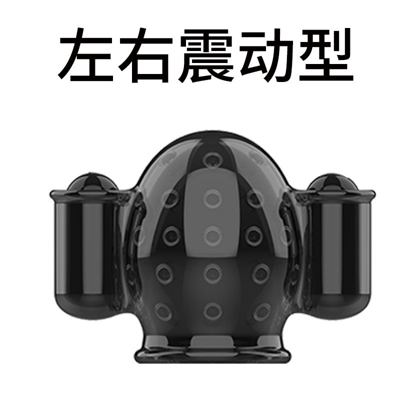

# Dispositivo Edging integral (segunda generación)

> Control absoluto al borde de la pérdida de control — se acabaron las fugas de aire, autonomía ilimitada, inmersión multimodo y juego con un toque desde el móvil.

El dispositivo Edging integral es el dispositivo insignia de «UnderSilicon»: integra en una sola unidad **sensor de presión de aire, vibración estimulante y pulsos eléctricos** y, junto con el cliente del móvil o del ordenador, permite por sí solo juegos de edging, Kegel, puntillas y muchos más.

## Ventajas principales

- **Disparo preciso**: medición de presión de alta precisión, reacción ultrarrápida de 100 ms
- **Autonomía sin preocupaciones**: batería de 2000 mAh, chip de estabilización dedicado; la estimulación no se reduce aunque la batería esté baja
- **Uso imperceptible**: tapón anal ultrafino de 29 mm + diseño discreto con sujeción a la pierna
- **Un solo dispositivo, varios juegos**: edging / Kegel / puntillas, con enlace entre varios dispositivos

## Mejoras respecto a la generación anterior

| Aspecto | Solución anterior | Segunda generación |
| :--- | :--- | :--- |
| Duración del juego | La bolsa de aire perdía presión, unos 20 minutos | Sensor de presión sólido de alta precisión, **duración ilimitada** |
| Experiencia de inserción | 35 mm | 29 mm (diámetro reducido un 18%) |
| Autonomía | Batería normal | 2000 mAh (300% más) |

## Parámetros del dispositivo

| Elemento | Descripción |
| :--- | :--- |
| ID lógico | CUNZHI01 |
| Función | Motor (vibración) + sensor de presión de aire + pulsos eléctricos, tres en uno |
| Comunicación | BLE de doble modo + WiFi 2.4G |
| Ajuste de intensidad | 256 niveles |
| Tiempo de respuesta | 100 ms |
| Batería | 2000 mAh |
| Carga | No incluye cable de carga; sirve un cable de móvil normal. La primera carga dura unas 8 horas, después 4~6 horas; luz verde = carga completa |

## Versiones y accesorios

### Descripción de versiones

【Edición completa】Dispositivo de edging (presión de aire + vibración + choque eléctrico) + artículo masculino + sensor de puntillas

【Edición Edging】Dispositivo de edging (presión de aire + vibración + choque eléctrico) + artículo masculino

【Edición OSR6】Dispositivo de edging (presión de aire + vibración + choque eléctrico)

Accesorios: sensor de puntillas, sensor de presión para tapón anal. Para uso femenino se necesita además la máquina de impacto + [controlador de máquina de impacto](/docs/device/reciprocating-motor).

**El paquete no incluye cable de carga**; la unidad se carga con un cable de móvil normal (Type-C), no hace falta comprarlo aparte.

### Guía de compra

1. Edging + choque eléctrico -> Edición Edging
2. Quieres además el juego de puntillas -> Edición completa
3. No te vas hasta terminar (añade función de bloqueo) -> compra además un bloqueo automático
4. Ya tienes un dispositivo OSR -> Edición OSR6
5. Mujeres que quieran usar máquina de impacto -> compra además un controlador de máquina de impacto
6. Para cualquier otra duda, contacta con el servicio al cliente de Taobao o entra al grupo~

### Glosario

Dispositivo de edging = unidad principal de edging + tapón anal con sensor de presión + vibrador de tamaño normal + electrodos de choque

Bloqueo = bloqueo automático

Artículo masculino = vibrador pequeño + funda para el pene (ver la imagen siguiente)

Artículo femenino = máquina de impacto + controlador de máquina de impacto

### Presentación de los dispositivos de estimulación

## Juegos relacionados

¿No sabes qué juego de edging elegir? Lee primero [Cómo elegir el juego de edging](/docs/player/edging).

- [Tutorial del edging integrado en la unidad (edging + Kegel)](/docs/player/cunzhi01)
- [Juego de edging por presión de aire (versión mejorada de 3 fases)](/docs/player/cunzhi3step)
- [Juego de edging por cambio brusco de presión](/docs/player/surge-edging)
- [Juego de entrenamiento Kegel](/docs/player/kegel-training)
- [Juego de castigo en puntillas v2](/docs/player/tiptoe-v2)
- [Tutorial de entrenamiento de puntillas y Kegel](/docs/player/tiptoe-kegel)
- [Juego de desbloqueo por beber / recolección de líquidos](/docs/player/drink-pee-unlock)

## Preparación previa

1. Instala el cliente y conecta el dispositivo: [cliente para móvil](/docs/player/new-phone-client) | [cliente para PC](/docs/player/new-phone-client#pc)
2. Los pasos concretos de colocación y conexión están en [Montaje y colocación](/docs/device/cunzhi01/assembly)

## Avisos de seguridad

Para las cuestiones de seguridad de los pulsos eléctricos y la colocación, consulta [Lectura obligatoria para jugar solo](/docs/player/solo-safety): está prohibido usar la función de pulsos eléctricos en el corazón, la cabeza, el torso y otras zonas vitales, o dejar que la corriente atraviese dichas zonas; la tensión de uso sobre el cuerpo humano no debe superar los 36 V. Limpieza y almacenamiento en [Montaje y colocación](/docs/device/cunzhi01/assembly).

## Compra

- Taobao (tienda Easy IoT): [https://item.taobao.com/item.htm?id=1028272889035](https://item.taobao.com/item.htm?id=1028272889035)
- Cupón: [Obtener cupón](/docs/coupon)
