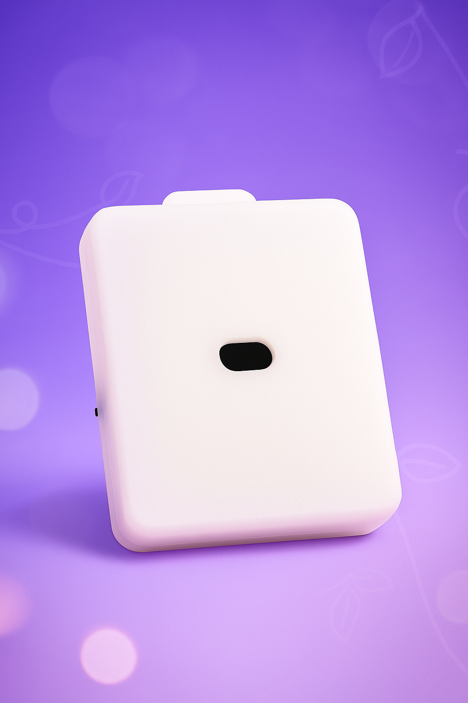

# Terminal de detección de distancia inteligente simple

> ID lógico `QTZ`. Detecta la altura del cuerpo / los movimientos mediante un sensor de distancia; se usa en juegos que requieren detección de acciones como flexiones y puntas.

## Características del producto

- Informe de distancia en tiempo real (a nivel de milímetro)
- Activación por pedal con doble botón
- Detección de intervalo de distancia (banda baja / alta)
- Carga Type-C

## Parámetros del dispositivo

| Elemento | Descripción |
| :--- | :--- |
| ID lógico | QTZ |
| Función | Detección de distancia / altura |
| Atributos de control | distance / low_band / high_band / button0 / button1 |
| Alimentación | Batería integrada + carga Type-C |
| Comunicación | WiFi (2.4G) / BLE |

## Juegos relacionados

- [Juego de entrenamiento con detección de flexiones](/docs/player/pushup-game)
- [Juego de castigo en puntas v2](/docs/player/old/tiptoe-v2)
- [Juego de desbloqueo por beber/recolección de líquidos](/docs/player/drink-pee-unlock)

## Preparación antes de usar

- Cliente: [Cliente móvil](/docs/player/new-phone-client) | [Cliente PC](/docs/player/new-phone-client#pc)

## Precauciones

- Dirección del interruptor: alejándose del puerto de carga se enciende, en caso contrario se apaga

## Compra

- Taobao (tienda Easy IoT): [https://item.taobao.com/item.htm?id=944256618610](https://item.taobao.com/item.htm?id=944256618610)
