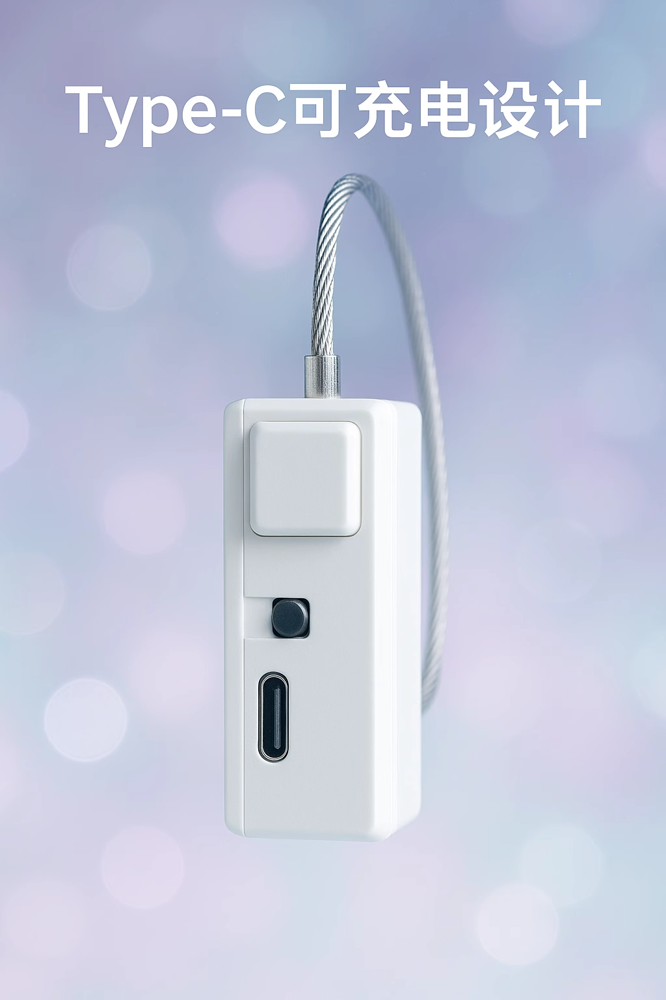

# Terminal de bloqueo inteligente simple

> ID lógico `ZIDONGSUO`. Controla el bloqueo / desbloqueo de forma inalámbrica por WiFi; se usa en juegos que requieren restricción forzada, como «no te vas hasta terminar».

## Características del producto

- Control inalámbrico de bloqueo / desbloqueo (WiFi / BLE)
- Mantener el botón pulsado 60 segundos fuerza el desbloqueo
- Desbloqueo automático cuando la batería baja del 20% (antiencierro)
- Programable, admite control por temporizador
- Carga Type-C

## Parámetros del dispositivo

| Elemento | Descripción |
| :--- | :--- |
| ID lógico | ZIDONGSUO |
| Función | Bloqueo automático |
| Atributos de control | open |
| Alimentación | Batería integrada + carga Type-C |
| Comunicación | WiFi (2.4G) / BLE |

## Juegos relacionados

- [Juego de castigo en puntas v2](/docs/player/tiptoe-v2)
- [Juego de entrenamiento con detección de flexiones](/docs/player/pushup-game)
- [Juego de edge control (edging)](/docs/player/old/edge-control)
- [Juego de entrenamiento Kegel](/docs/player/kegel-training)
- [Juego de desbloqueo por beber/recolección de líquidos](/docs/player/drink-pee-unlock)

## Preparación antes de usar

- Cliente: [Cliente móvil](/docs/player/new-phone-client) | [Cliente PC](/docs/player/new-phone-client#pc)

## Precauciones

1. ¡Ten a mano herramientas de liberación durante el uso! Por problemas de red, el dispositivo no puede garantizar el desbloqueo.
2. Dirección del interruptor: alejándose del puerto de carga se enciende, en caso contrario se apaga

## Compra

- Taobao (tienda Easy IoT): [https://item.taobao.com/item.htm?id=925058360048](https://item.taobao.com/item.htm?id=925058360048)
