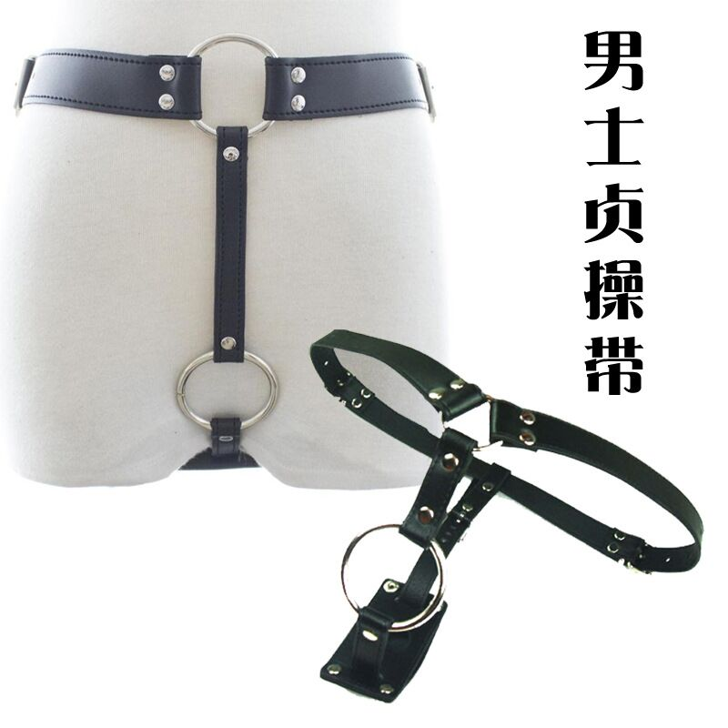

# Cómo usar los pantalones de sujeción

Para salir a la calle o estar de pie, puedes usar los pantalones de sujeción para fijar el tapón anal y evitar que se caiga. La forma de colocarlos se muestra en la imagen:

