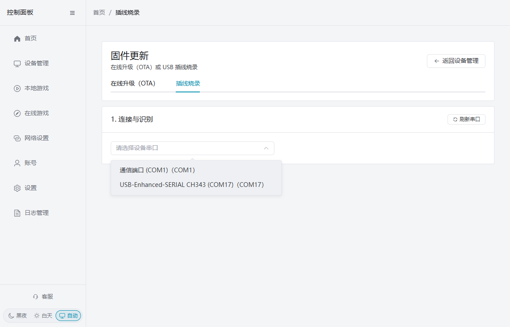
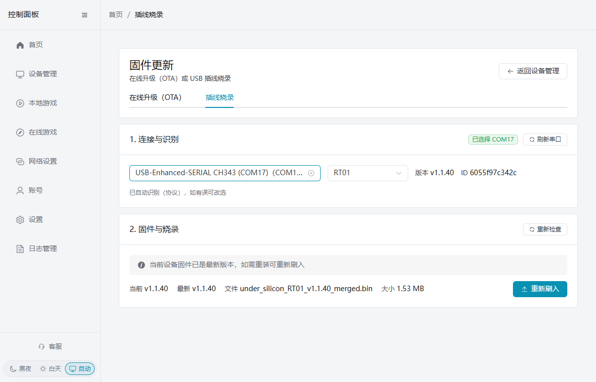
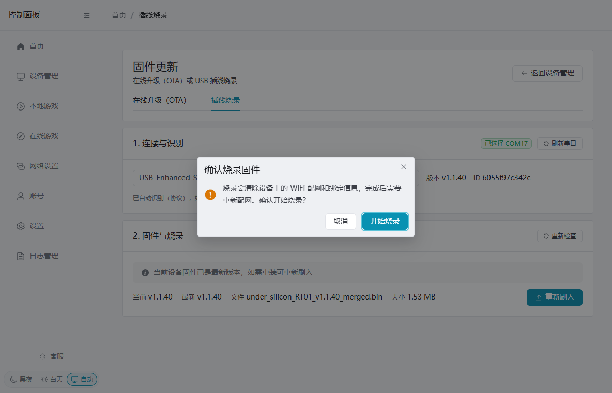
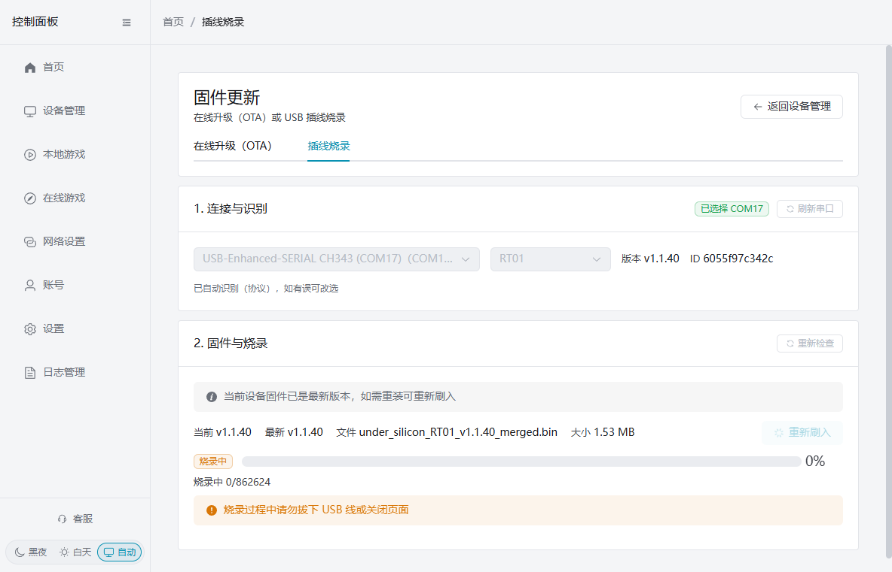
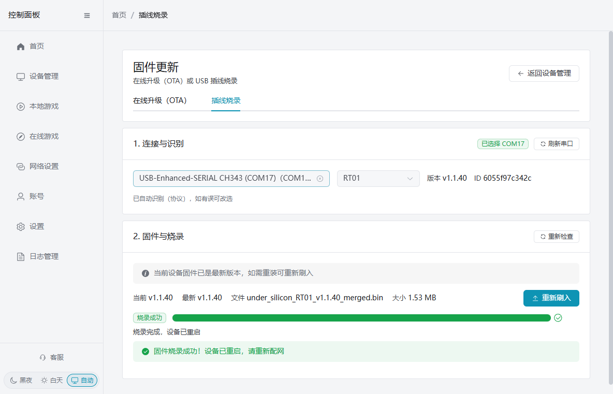
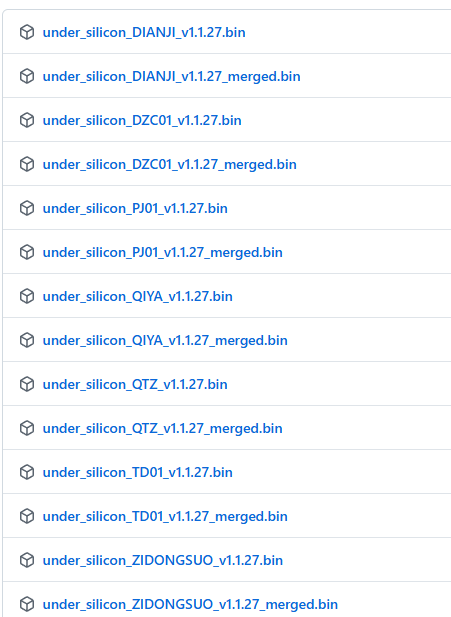

# Actualizar el firmware por cable mediante el panel de control

Cuando el dispositivo no puede conectarse a la red, la actualización OTA falla o hace falta reinstalar el firmware actual, se puede usar el cliente de PC para grabar por USB por cable. El cliente identifica automáticamente el dispositivo, descarga y verifica el firmware, entra solo en modo de descarga, escribe y reinicia; no hace falta usar manualmente la Flash Tool ni pulsar botones del dispositivo para entrar en modo de descarga.

## Preparación antes de actualizar

- Conecta el dispositivo al PC con un cable de datos USB estable; un cable de solo carga no sirve para actualizar.
- Durante la actualización mantén alimentados el PC y el dispositivo; no desconectes el cable ni cierres la página del cliente.
- **La grabación borra la configuración de red Wi-Fi y la información de vinculación del dispositivo.** Al terminar tendrás que configurar la red de nuevo.

### Primer uso: instalar el controlador del puerto serie

La primera vez que uses la actualización por USB por cable en este PC, instala primero el controlador WCH CH340/CH341:

- [Controlador CH340/CH341](https://www.wch.cn/downloads/CH341SER_EXE.html)

Tras descargarlo, ejecuta directamente el instalador. Cuando termine, vuelve a enchufar el dispositivo y pulsa «Actualizar puertos serie» en el cliente. Si la página indica «se detectó un dispositivo CH34x pero el controlador no está instalado», instala el controlador como se indica y actualiza de nuevo.

## Actualización automática por cable en el cliente

1. Abre el panel de control y entra en «Gestión de dispositivos» → «Herramientas de dispositivo» → «Actualización de firmware», y luego elige «Grabación por cable».
2. En «Conexión e identificación» elige el puerto serie correspondiente al dispositivo. El puerto serie del dispositivo suele tener nombres como CH340, CH343 o USB-Enhanced-SERIAL; no elijas el `COM1` propio del PC.

3. El cliente identificará automáticamente el modelo del dispositivo y la versión actual, y luego mostrará el firmware completo disponible, la versión y el tamaño del archivo. Si la identificación automática falla, puedes elegir manualmente el modelo correcto en el desplegable y continuar.

4. Si hay una versión nueva, pulsa «Actualizar firmware»; si indica que ya está en la última versión pero necesitas reparar o reinstalar, pulsa «Grabar de nuevo». En la ventana de confirmación, revisa el aviso de que se borrará la configuración de red Wi-Fi y la vinculación, y luego pulsa «Iniciar grabación».

5. El cliente descargará y verificará automáticamente el firmware, entrará en modo de descarga, grabará y reiniciará. Todo el proceso no requiere entrar manualmente en modo de descarga; antes y después de que aparezca la barra de progreso, no desconectes el cable USB ni cierres la página.

6. Al ver «¡Firmware grabado con éxito! El dispositivo se ha reiniciado, vuelve a configurar la red», el proceso ha terminado. Tras configurar la red de nuevo, vuelve a Gestión de dispositivos para confirmar que el dispositivo está en línea.

## Situaciones habituales

### No se detecta el puerto serie

Comprueba que el dispositivo está conectado, que el cable USB admite datos y que ya completaste la instalación del controlador anterior. Vuelve a enchufar el dispositivo y pulsa «Actualizar puertos serie».

### No se reconoce el modelo

Espera a que termine la identificación automática y elige el modelo real del dispositivo en el desplegable. Si aun así no puedes confirmar el modelo, no grabes a la ligera el firmware de otro modelo.

### Fallo en la grabación

Mantén el cable USB conectado y pulsa primero «Reintentar grabación». Si sigue fallando, cambia de cable de datos o de puerto USB y vuelve a empezar; no conectes y desconectes el dispositivo repetidamente durante la grabación.

## Grabación manual (solo cuando no se puede usar el cliente)

1.  Instalar los controladores
    1.  Controlador del chip serie CH340: [https://www.wch.cn/downloads/CH341SER_EXE.html](https://www.wch.cn/downloads/CH341SER_EXE.html)
    2.  Después de descargar, ejecútelo directamente.
2.  Descargar la herramienta de grabación (flash tool)
    1.  [https://dl.espressif.com/public/flash_download_tool.zip](https://dl.espressif.com/public/flash_download_tool.zip)
    2.  Descomprimir y ejecutar.
    3.  Instrucciones de uso:
    4.  [https://docs.espressif.com/projects/esp-test-tools/zh_CN/latest/esp32/production_stage/tools/flash_download_tool.html#id5](https://docs.espressif.com/projects/esp-test-tools/zh_CN/latest/esp32/production_stage/tools/flash_download_tool.html#id5)
    5.  En el tercer paso de las instrucciones, es necesario modificar el puerto COM; el resto de las secciones no requieren cambios.
3.  Descargar el firmware
    1.  [https://github.com/jiandanzhineng/hardware/releases/latest](https://github.com/jiandanzhineng/hardware/releases/latest)
    2.  
    3.  Descargar el firmware según el tipo de dispositivo (descargar el firmware con la palabra "merged"): choque eléctrico - DIANJI, sensor de presión barométrica - QIYA, controlador de motor de eje descentrado - TD01, sensor de distancia - QTZ.
    4.  Utilice la herramienta para grabarlo en la posición 0x0 del dispositivo.

## Actualización inalámbrica OTA

Si el dispositivo ya está conectado al WiFi y en línea, se puede hacer la actualización de firmware inalámbrica desde el cliente de control, sin cable USB.

1. Abre el cliente de PC o de móvil y entra en **Gestión de dispositivos**
2. Busca el dispositivo que quieras actualizar y pulsa **Actualización de firmware** (o «Buscar actualización»)
3. El cliente comparará automáticamente la versión actual del dispositivo con la última versión del firmware
4. Si hay una versión nueva, pulsa **Actualizar**
5. Proceso de actualización: el cliente envía la orden de actualización al dispositivo por MQTT → el dispositivo descarga automáticamente el firmware → escribe y reinicia
6. Al terminar la actualización, el dispositivo vuelve a estar en línea automáticamente

**Nota:**
- La actualización OTA requiere que el dispositivo esté conectado al WiFi y en línea
- No desconectes la alimentación del dispositivo durante la actualización
- Admite actualizar varios dispositivos por lotes
- Dirección de descarga del firmware: [https://github.com/jiandanzhineng/hardware/releases/latest](https://github.com/jiandanzhineng/hardware/releases/latest)
