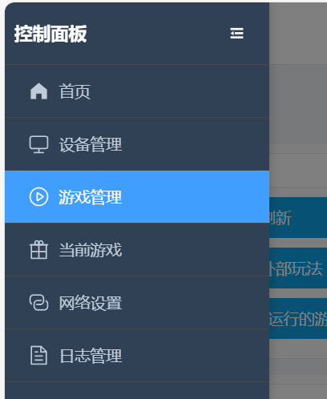
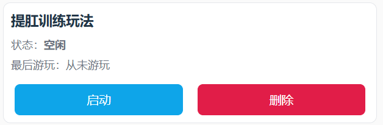

# Juego de entrenamiento Kegel

> ⚠️ **Aviso de documento de versión antigua**: este documento describe un juego antiguo; el dispositivo y la forma de usarlo ya se han actualizado. Lee preferentemente el nuevo tutorial: [Tutorial de edging + Kegel](/docs/player/cunzhi01).

# Presentación del juego
+ El entrenamiento Kegel alterna una «fase de relajación» y una «fase de apriete»
+ El objetivo es completar todos los «aprietes logrados» que sea posible dentro del tiempo fijado
+ El acierto o el fallo se muestran claramente en la interfaz; el fallo dispara un choque (si está conectado y activado)

## Descarga del software y preparación
Móvil Android: [Cliente para móvil](/docs/player/new-phone-client)

Ordenador Windows: [Cliente de control para PC](/docs/player/new-phone-client#pc)

# Equipo y preparación
+ Dispositivo obligatorio: `sensor de presión de aire (QIYA)`
+ Dispositivos opcionales: `dispositivo de choque eléctrico (DIANJI)`, `bloqueo automático (ZIDONGSUO)`
+ Al empezar se bloquea automáticamente y al terminar se desbloquea (si hay bloqueo automático conectado)

## Montaje del equipo
Quita la perilla de inflado del tapón anal inflable y conéctala al tubo del sensor de presión; conecta el tubo del tapón anal inflable a la pieza en T del sensor de presión y listo~

1. Aspecto del tapón anal al recibirlo (el nuevo tapón anal ha cambiado de aspecto y sella mejor; es parecido al de abajo)

2. Retirar la perilla de inflado

3. Conectar a los dos extremos del sensor de presión

4. Aspecto del conjunto terminado

5. Si notas que pierde presión rápido, refuerzo opcional

Aprieta esta abrazadera en la conexión para reducir la velocidad de fuga de presión.

Dónde comprar la abrazadera: [https://item.taobao.com/item.htm?id=724827233726](https://item.taobao.com/item.htm?id=724827233726) (11-13 mm

## Entrada del juego

# Explicación de parámetros
+ `Duración (minutos)`: duración de toda la sesión de juego
+ `Objetivo de aprietes`: número de logros esperado, sirve para mostrar el progreso total
+ `Variación de presión (kPa)`: umbral de incremento de presión que hay que alcanzar en la fase de apriete (respecto a la presión mínima de la fase de relajación)
+ `Intensidad del choque (V)`: intensidad del choque en caso de fallo
+ `Duración del choque (segundos)`: tiempo que dura el choque en caso de fallo
+ `Tiempo de un ciclo (segundos)`: duración de cada fase, 10 segundos por defecto (relajación 10 s → apriete 10 s → ciclo)

# Flujo del juego
+ Fase de relajación
    - Relájate y respira con normalidad; el sistema registra la «presión mínima» de esta fase como referencia
    - Al acabar la cuenta atrás se entra en la fase de apriete
+ Fase de apriete
    - Durante esta fase hay que elevar la presión hasta «presión mínima + variación de presión»
    - Al alcanzar el objetivo se juzga «logrado», pero hay que esperar a que acabe la cuenta atrás de la fase para pasar a la siguiente ronda
    - Si antes de que acabe la fase no se alcanza el objetivo, se juzga «reto fallido · empieza el choque» (si el dispositivo de choque está disponible)
+ Alternancia de fases
    - Cada ronda sigue el ciclo «relajación → apriete → relajación → …», hasta que acabe el tiempo o se alcance el objetivo de veces

# Indicaciones de la interfaz
+ En la parte superior se muestran en grande la fase actual (fase de relajación/fase de apriete) y el tiempo que queda de la fase
+ Progreso total
    - Barra de progreso por veces: veces completadas / veces objetivo
    - Barra de progreso por tiempo: tiempo usado / duración total
+ Presión y objetivo
    - Presión actual (kPa)
    - Presión mínima en la relajación (valor de referencia)
    - Presión objetivo del apriete (presión mínima + variación de presión)
+ Aviso de acierto/fallo
    - Acierto: tras el número se muestra la etiqueta verde «logrado»
    - Fallo: tras el número se muestra la etiqueta roja «reto fallido · empieza el choque»
+ Operación y registro
    - Botones: pausa, choque manual
    - Registro: muestra los mensajes recientes y avisos del sistema

**Fin y estadísticas**

+ Termina al llegar la duración fijada o al alcanzar el objetivo de logros
+ Al terminar se desbloquea automáticamente (si hay bloqueo automático conectado)
+ La interfaz muestra el total de logros, el número de choques, etc.

**Consejos de uso**

+ La primera vez se recomienda poner la «variación de presión» baja, para acostumbrarte al ritmo
+ Si conectas el dispositivo de choque, empieza con intensidad baja y súbela poco a poco
+ Mantén la respiración tranquila; en la fase de apriete concéntrate en elevar la presión hasta el objetivo

**Inicio rápido**

+ Conecta el sensor de presión (opcionalmente choque y bloqueo automático)
+ Configura los parámetros y empieza
+ En la fase de relajación no hace falta esfuerzo, espera la cuenta atrás; en la fase de apriete fuerza la subida hasta el objetivo
+ Al ver «logrado» basta mantener hasta que acabe la fase; en caso de fallo se avisa y hay choque
+ Repite el ciclo hasta el final; consulta las estadísticas y las barras de progreso para saber cómo lo has hecho
