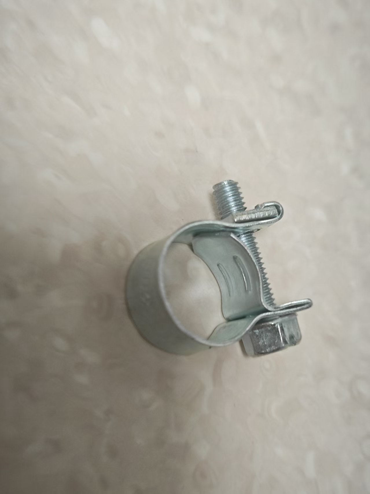

# Juego de control en el borde (edging)

> ⚠️ **Aviso de documento de versión antigua**: este documento describe un juego antiguo; el dispositivo y la forma de usarlo ya se han actualizado. Lee preferentemente el nuevo tutorial: [Tutorial de edging + Kegel](/docs/player/cunzhi01).

Un juego de entrenamiento de edging basado en un sensor de presión de aire que detecta los cambios de presión del esfínter, combinado con un controlador de motor de eje descentrado y un dispositivo de choque eléctrico para un control inteligente de la estimulación.

Enlace de compra del kit del juego:

[https://item.taobao.com/item.htm?id=1017049175869](https://item.taobao.com/item.htm?id=1017049175869)

# Tutorial del juego en versión móvil:
[https://www.bilibili.com/video/BV1xA1fBsErr/](https://www.bilibili.com/video/BV1xA1fBsErr/?share_source=copy_web&vd_source=3dd9ee8089c213072e87f2745c7050aa)

Tutorial original de Yuque: https://www.yuque.com/easysmart/easysmart/oe8gsvyhtflb9pqt

# Tutoriales relacionados para la versión de PC:

Descarga del cliente: [Cliente de control para PC](/docs/player/new-phone-client#pc)

Video tutorial: [【Tutorial de juego】Set de edging revelado: 3 pasos para la experiencia definitiva, el vídeo te enseña a dominarlo_哔哩哔哩_bilibili](https://www.bilibili.com/video/BV1WXWpzUEoW/?spm_id_from=333.1007.top_right_bar_window_dynamic.content.click)

Se recomienda usar punto de acceso y el wifi por defecto; con esta solución no hace falta configurar la red. Si vas a usar la solución del router, antes de empezar a jugar haz la **<font>configuración de red</font>** del dispositivo; consulta la sección de configuración de red en el índice de la izquierda~

# Precauciones
1. El tapón anal inflable se ha mejorado: está más sellado, pierde menos aire y tiene un aspecto algo distinto al de las imágenes siguientes.
2. Durante el juego la presión del aire **<font>no debe ser demasiado alta</font>** (provoca fugas); normalmente 22-24 está bien, basta con que haya cambio al apretar.
3. Al insertarlo puedes darle un poco de presión, porque si está demasiado blando puede no entrar.

# Montaje del kit (lectura obligatoria)
Quita la perilla de inflado del tapón anal inflable y conéctala al tubo del sensor de presión; conecta el tubo del tapón anal inflable a la pieza en T del sensor de presión y listo~

1. Aspecto del tapón anal al recibirlo


2. Retirar la perilla de inflado


3. Conectar a los dos extremos del sensor de presión


4. Aspecto del conjunto terminado


5. Si notas que pierde presión rápido, refuerzo opcional



Aprieta esta abrazadera en la conexión para reducir la velocidad de fuga de presión.

Dónde comprar la abrazadera: [https://item.taobao.com/item.htm?id=724827233726](https://item.taobao.com/item.htm?id=724827233726) (11-13 mm)

### Mecánica del juego
1. **Vigilancia de presión**: el sensor de presión detecta los cambios de presión del esfínter en tiempo real.
2. **Ajuste inteligente**: con presión alta reduce la estimulación; con presión baja la aumenta.
3. **Aviso por choque**: al superar la presión el valor crítico se dispara un choque para alertar al usuario.
4. **Inicio retardado**: con presión baja se espera un tiempo antes de empezar a estimular despacio.
5. **Equilibrio dinámico**: mantiene un estado de equilibrio cerca de la presión crítica.

## Diagrama de transición de estados


## Requisitos de equipo
### Configuración del equipo
| Tipo de dispositivo | ID lógico | Nombre del dispositivo | Obligatorio | Función |
| --- | --- | --- | --- | --- |
| QIYA | pressure_sensor | Sensor de presión | Sí | Detecta los cambios de presión del esfínter |
| TD01 | motor_controller | Controlador de motor de eje descentrado | Sí | Proporciona estimulación de intensidad regulable |
| DIANJI | shock_device | Dispositivo de choque eléctrico | No | Choque de aviso cuando la presión es demasiado alta |
| ZIDONGSUO | auto_lock | Dispositivo de bloqueo automático | No | Se bloquea al empezar el juego y se desbloquea al terminar |


## Configuración de parámetros del juego
### Parámetros básicos
| Nombre del parámetro | Tipo | Rango | Valor por defecto | Descripción |
| --- | --- | --- | --- | --- |
| duration | Número | 1-120 minutos | 20 minutos | Duración del juego |
| criticalPressure | Número | 0-40 kPa | 20 kPa | Valor de presión crítica |
| maxMotorIntensity | Número | 1-255 | 200 | Intensidad máxima del TD01 |


### Parámetros de control de estimulación
| Nombre del parámetro | Tipo | Rango | Valor por defecto | Descripción |
| --- | --- | --- | --- | --- |
| lowPressureDelay | Número | 1-30 segundos | 5 segundos | Tiempo de retardo de la estimulación con presión baja |
| stimulationRampRateLimit | Número | 1-50 | 10 | Límite de velocidad de incremento de la intensidad (no más de este valor por segundo) |
| pressureSensitivity | Número | 0.1-5.0 | 1.0 | Coeficiente de sensibilidad a los cambios de presión |
| stimulationRampRandomPercent | Número | 0-100% | 0% | Porcentaje de perturbación aleatoria de la intensidad |


### Parámetros del choque
| Nombre del parámetro | Tipo | Rango | Valor por defecto | Descripción |
| --- | --- | --- | --- | --- |
| shockIntensity | Número | 10-100 V | 20 V | Intensidad del choque |
| shockDuration | Número | 0.5-5 segundos | 1 segundo | Duración del choque |


## Lógica del algoritmo
### Algoritmo de mapeo presión-intensidad
```plain
if (currentPressure >= criticalPressure) {
    motorIntensity = 0
    triggerShock()
} else if (currentPressure < criticalPressure) {
    pressureDiff = criticalPressure - currentPressure
    targetIntensity = (pressureDiff / criticalPressure) * maxMotorIntensity
    
    // Mecanismo de inicio retardado, rampa gradual de intensidad, perturbación aleatoria de intensidad
}
```
