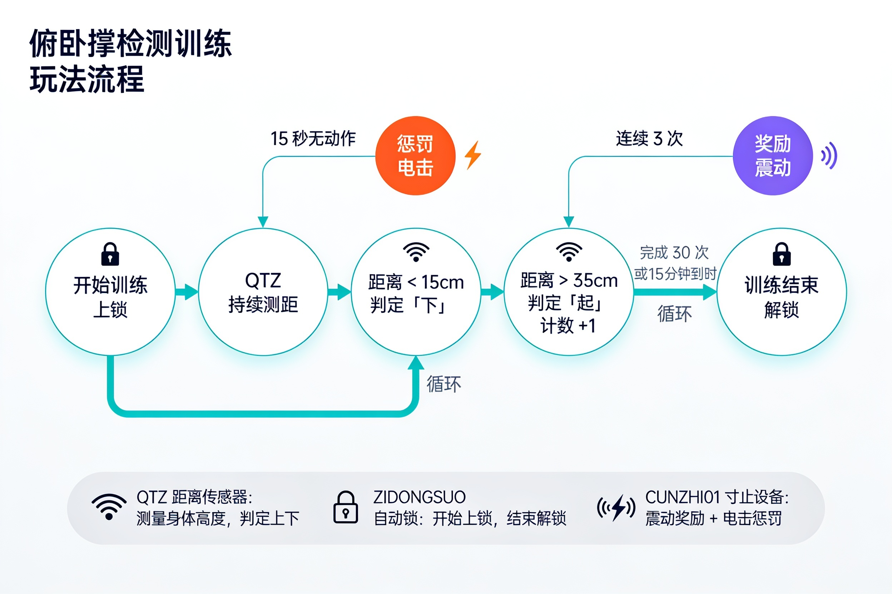

# Juego de Entrenamiento para (Aproximadamente) Detectar Flexiones

Un juego de entrenamiento de flexiones basado en sensor de distancia, que utiliza un sensor de distancia QTZ para detectar la finalización de los movimientos de flexiones, combinado con el dispositivo de bloqueo automático y el dispositivo Edging integral (CUNZHI01) para proporcionar motivación y mecanismos de castigo durante el entrenamiento.

Se puede agregar una pequeña vara en la boca ~ para una nueva modalidad de juego = =

Enlace de compra [Enlace de compra en Taobao](https://item.taobao.com/item.htm?id=964389698138)

## Resumen del Juego
### Objetivo del Juego
+ Completar un número especificado de flexiones dentro de un tiempo establecido.
+ Mantener una postura estándar para las flexiones.
+ Mejorar la efectividad del entrenamiento y la concentración mediante la retroalimentación de los dispositivos.

### Mecánica del Juego
1. **Inicio del juego**: El dispositivo de bloqueo automático se bloquea, comienza el conteo de tiempo y la detección de movimientos.
2. **Detección de movimientos**: El sensor de distancia QTZ monitorea en tiempo real los cambios en la altura del cuerpo.
3. **Determinación de finalización**: Cuando el cuerpo desciende por debajo de una distancia establecida se considera "abajo"; cuando asciende por encima de una distancia establecida se considera "arriba".
4. **Mecanismo de castigo**: La inactividad prolongada activa un castigo de descarga eléctrica con intensidad y duración aleatorias.
5. **Interferencia de recompensa**: Después de completar un número específico consecutivamente, cada finalización tiene una probabilidad de activar la interferencia por vibración.
6. **Restablecimiento de estado**: Tras recibir un castigo, el conteo de finalizaciones consecutivas se restablece a cero y vuelve a comenzar la determinación de recompensas.
7. **Fin del juego**: Se libera automáticamente al alcanzar el número objetivo o al finalizar el tiempo.

## Requisitos del Equipo
### Configuración del Equipo
| Tipo de Equipo | ID Lógico | Nombre del Equipo | Es Obligatorio | Función |
| --- | --- | --- | --- | --- |
| QTZ | distance_sensor | Sensor de distancia QTZ | Sí | Detecta los cambios en la altura del cuerpo para determinar los movimientos de flexiones. |
| ZIDONGSUO | auto_lock | Bloqueo automático | No | Se bloquea al inicio del juego y se desbloquea al finalizar o al exceder el tiempo. |
| CUNZHI01 | cunzhi01 | Dispositivo Edging integral | No | Ejecuta el castigo de descarga eléctrica cuando no hay movimiento durante un tiempo prolongado y la interferencia por vibración aleatoria tras completar movimientos consecutivamente. |

> En la segunda generación, los dispositivos independientes de descarga eléctrica (DIANJI) y de vibrador (TD01) se han integrado en un solo [dispositivo Edging integral](/docs/device/cunzhi01) (sensor de presión + vibración + pulso eléctrico, tres en uno); tanto el castigo como la recompensa los realiza el CUNZHI01, y la forma de configurarlos no ha cambiado.

## Configuración de Parámetros del Juego
### Parámetros Básicos
| Nombre del Parámetro | Tipo | Rango | Valor por Defecto | Descripción |
| --- | --- | --- | --- | --- |
| duration | Numérico | 1-240 minutos | 15 minutos | Duración del juego. |
| targetCount | Numérico | 1-2000 unidades | 30 unidades | Número objetivo de flexiones a completar. |
| downThreshold | Numérico | 5-30 cm | 15 cm | Se considera "abajo" cuando el cuerpo desciende por debajo de esta distancia. |
| upThreshold | Numérico | 20-50 cm | 35 cm | Se considera "arriba" cuando el cuerpo asciende por encima de esta distancia. |

### Parámetros del Mecanismo de Castigo
| Nombre del Parámetro | Tipo | Rango | Valor por Defecto | Descripción |
| --- | --- | --- | --- | --- |
| idleTimeLimit | Numérico | 10-120 segundos | 30 segundos | Tiempo de inactividad que activa el castigo. |
| shockIntensity | Numérico | 10-100V | 15V | Valor base de la intensidad de la descarga eléctrica. |
| shockDuration | Numérico | 1-10 segundos | 3 segundos | Valor base de la duración de la descarga eléctrica. |
| randomIntensityRange | Numérico | 0-50V | 10V | Amplitud aleatoria de la intensidad de la descarga eléctrica (± este valor). |
| randomDurationRange | Numérico | 0-5 segundos | 1 segundo | Amplitud aleatoria de la duración (± este valor). |

### Parámetros de Interferencia de Recompensa
| Nombre del Parámetro | Tipo | Rango | Valor por Defecto | Descripción |
| --- | --- | --- | --- | --- |
| rewardTriggerCount | Numérico | 3-20 unidades | 5 unidades | Número de finalizaciones consecutivas requerido para comenzar la activación de recompensas. |
| rewardTriggerProbability | Numérico | 0-100% | 30% | Probabilidad de activación de interferencia por cada finalización una vez cumplida la condición de activación. |
| vibratorIntensity | Numérico | 1-255 | 100 | Intensidad de la vibración. |
| vibratorDuration | Numérico | 5-60 segundos | 15 segundos | Tiempo de trabajo de la vibración. |

## Explicación de la Interfaz del Juego
### Elementos de la Interfaz Principal
+ **Tiempo restante**: Muestra el tiempo de juego restante.
+ **Progreso de finalización**: Número actual completado / número objetivo.
+ **Estado del movimiento**: Muestra la fase actual del movimiento (abajo/arriba).
+ **Estado de bloqueo**: Muestra el estado actual del bloqueo automático.
+ **Estado del equipo**: Muestra el estado operativo de cada dispositivo.

## Información de Desarrollo
### Historial de Versiones
+ v1.0.0: Implementación de funciones básicas.
+ v2.0.0: La descarga eléctrica (DIANJI) y el vibrador (TD01) se integraron en el dispositivo Edging integral (CUNZHI01).

Para la versión antigua del equipo consulta el tutorial: [Juego de entrenamiento con detección de flexiones (versión antigua)](/docs/player/old/pushup-game-v1)
