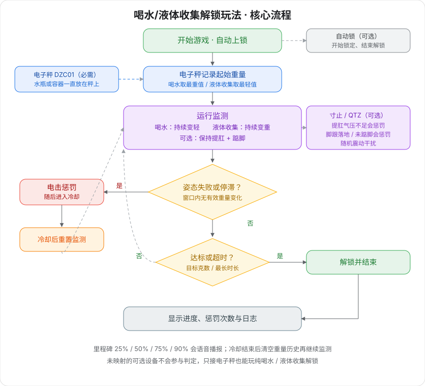

# Juego de desbloqueo por beber / recolección de líquidos

Pon la botella o el recipiente sobre la báscula: beber la hace más ligera y recolectar líquido la hace más pesada; al alcanzar el cambio de peso objetivo o al agotarse el tiempo se desbloquea automáticamente. Se pueden superponer vigilancia de Kegel y de puntillas; fallar provoca un castigo por choque eléctrico.

## Explicación del juego

- **Modo beber (por defecto):** la botella permanece siempre sobre la báscula; bebe con pajita de forma continua para hacerla más ligera y, al alcanzar la pérdida objetivo, se desbloquea.
- **Modo recolección de líquidos:** el recipiente permanece siempre sobre la báscula; recoge líquido en él para hacerla más pesada y, al alcanzar la ganancia objetivo, se desbloquea.
- **Restricción de postura (opcional):** tras mapear el dispositivo de presión / puntillas, hay que mantener Kegel y puntillas o habrá choque.
- **Bloqueo opcional:** al conectar el bloqueo automático, se bloquea al empezar y solo se desbloquea al alcanzar el objetivo o al agotarse el tiempo.

## Requisitos de equipo

| Dispositivo | ID lógico | Obligatorio | Función |
| --- | --- | --- | --- |
| [Báscula electrónica](/docs/device/electronic-scale) | scale / DZC01 | Sí | Pesa en tiempo real y determina que beber aligera o recolectar pesa más |
| [Dispositivo Edging integral](/docs/device/cunzhi01) | sensor / cunzhi / punish / vibe | No | Presión de Kegel, presión de puntillas, castigo por choque, vibración aleatoria |
| [Bloqueo automático](/docs/device/lock-controller) | lock / ZIDONGSUO | No | Se bloquea al empezar y se desbloquea al terminar |

Los dispositivos opcionales sin mapear no participan en la determinación. Con solo la báscula conectada, es un desbloqueo puro por beber / recolectar líquido.

Un solo dispositivo Edging integral puede asumir a la vez los cuatro papeles de Kegel, puntillas, choque y vibración; basta mapearlos a las ranuras correspondientes en el cliente.

> 🛒 **Pack del juego**: [comprar en la web oficial](https://shop.undersilicon.cn/zh/products/force-drink)

## Colocación y conexión

Instala primero el cliente y conecta el dispositivo; ver [Descarga del cliente y conexión de dispositivos](/docs/player/new-phone-client).

- **Báscula electrónica**: sobre un suelo plano. La botella (beber) o el recipiente (recolección) permanecen sobre la báscula toda la sesión; no levantes la botella entera.
- **Sensor de suelo pélvico (opcional)**: con lubricante, insertado despacio tumbado de lado y relajado.
- **Electrodos de pulsos (opcionales)**: uno en la cara interna de cada muslo. Prohibido en torso, corazón y cabeza.
- **Sensor de puntillas (opcional)**: dentro del calcetín pegado al talón, o en la zona del talón dentro del zapato.
- **Fijación de la unidad (opcional)**: sujeta la unidad de edging al muslo con la correa.
- **Bloqueo automático (opcional)**: dispositivo inalámbrico independiente, no se conecta a la unidad.

La conexión de cables se ve en el [Tutorial de edging segunda generación](/docs/player/cunzhi01#operation-steps).

## Ajustes de software

1. En el cliente entra en la biblioteca de juegos y elige «Desbloqueo por beber / recolección de líquidos».
2. Mapea la báscula (obligatorio) y, según necesites, presión, puntillas, choque, vibración y bloqueo automático.
3. Elige beber o recolección de líquidos y define peso objetivo, duración máxima y parámetros de castigo.
4. Pulsa empezar. La voz está activada por defecto y se puede desactivar en los parámetros.

## Modo de juego

### Reglas básicas

+ **Modo beber**: se toma como inicio el valor más alto del proceso y el progreso se cuenta por los gramos perdidos respecto al inicio.
+ **Modo recolección de líquidos**: se toma como inicio el valor más bajo del proceso y el progreso se cuenta por los gramos ganados respecto al inicio.
+ Si dentro de la ventana histórica (30 segundos por defecto) no hay ni un cambio que supere el «umbral de cambio válido», se considera estancamiento y hay castigo.
+ Con presión mapeada, la presión debe estar por encima del umbral de Kegel.
+ Con puntillas mapeadas en el dispositivo de edging, si la presión del talón supera el umbral y se mantiene más que el tiempo antirrebote, se considera que el talón ha tocado suelo y hay castigo.

### Ciclo de estados

+ **En ejecución**: cada segundo se comprueban postura, estancamiento y vibración aleatoria, y se acumula el progreso de peso.
+ **Castigo**: se dispara el choque (si no hay choque mapeado solo se registra el motivo) y se reproduce la voz correspondiente.
+ **Enfriamiento**: 10 segundos por defecto en pausa de detección; al terminar se vacía el historial de peso y se reanuda la vigilancia.
+ **Desbloqueado**: progreso alcanzado o duración máxima llegada; se abre el candado y termina.

### Voz y distracción

+ Se anuncian apertura, motivo del castigo, enfriamiento, objetivo logrado / tiempo agotado / finalización manual.
+ Se anuncia una vez al 25% / 50% / 75% / 90% del progreso.
+ En ejecución hay ánimos aleatorios y recordatorios del Kegel / puntillas conectados.
+ Cada segundo se dispara una distracción por vibración con una probabilidad (por defecto ~5%).

### Fin del juego

+ Cambio acumulado que alcanza el peso objetivo: desbloqueo con éxito.
+ Se alcanza la duración máxima: desbloqueo por tiempo agotado.
+ La finalización manual también abre el candado.
+ La interfaz conserva progreso, número de choques, motivo del último castigo y registro.

## Explicación de parámetros

### Parámetros básicos

| Parámetro | Por defecto | Descripción |
| --- | --- | --- |
| Modo de juego | Beber (aligerar) | Beber: la báscula se aligera hasta el objetivo; recolección: la báscula pesa más hasta el objetivo |
| Duración máxima | 1800 segundos | Al agotarse el tiempo termina automáticamente y se desbloquea. Los principiantes pueden empezar con 900–1800 |
| Cambio de peso objetivo | 500 g | Gramos que deben cambiar respecto al inicio |
| Indicaciones de voz | Activadas | Anuncios de fase, castigo y hitos |

### Juicio y dificultad

| Parámetro | Por defecto | Descripción |
| --- | --- | --- |
| Umbral de cambio válido | 1 g | Cambios menores se consideran ruido y no reinician la cuenta de estancamiento |
| Ventana histórica | 30 segundos | Si dentro de la ventana no hay cambio válido, hay castigo |
| Umbral de presión de Kegel | 20 kPa | Por debajo se considera que no hay Kegel (requiere presión mapeada) |
| Umbral de presión de puntillas | 100 | Por encima se considera que el talón toca suelo |
| Antirrebote de puntillas | 300 ms | Filtro de temblores de presión del edging; demasiado pequeño provoca falsos juicios |

### Castigo y distracción

| Parámetro | Por defecto | Descripción |
| --- | --- | --- |
| Enfriamiento del castigo | 10 segundos | Tiempo de pausa de detección tras el choque |
| Intensidad del choque | 24 V | Se recomienda 15–24 V, no superar 30 V |
| Duración del choque | 2 segundos | Duración de un solo choque |
| Probabilidad de inicio de vibración | 0,05 / segundo | Unos 5% por segundo |
| Intensidad de vibración | 255 | 0–255 |
| Duración de vibración | 3 segundos | Duración de una sola vibración |

## Descripción de la interfaz

+ **Progreso de la tarea**: gramos ya cambiados / gramos objetivo, con el peso inicial.
+ **Peso actual / presión / estado de puntillas**: lecturas en tiempo real.
+ **Cuenta atrás del castigo**: segundos que faltan para el siguiente «castigo por estancamiento».
+ **Información del choque**: número de disparos, si está mapeado, si hay choque en curso, enfriamiento restante, último motivo.
+ **Indicadores del sistema**: modo, peso mínimo/máximo en la ventana, número de muestras, etc.
+ **Registro del sistema**: inicio, progreso, castigos, enfriamiento y fin.

## Consejos de uso

+ La botella o el recipiente deben estar siempre sobre la báscula. Para beber usa pajita; no levantes la botella entera, si no el peso caerá de golpe y puede juzgarse objetivo cumplido.
+ No te subas a la báscula, para que el peso corporal no interfiera.
+ La primera vez conecta solo la báscula, prueba bien el flujo de beber y luego añade Kegel, puntillas y choque.
+ Objetivo inicial 200–300 g, ventana 45–60 segundos; ya con práctica, aprieta.
+ Con choque, empieza con tensión baja y duración corta.

## Avisos de seguridad

+ Asegúrate de estar sano, sin cardiopatía, epilepsia u otras enfermedades; solo para mayores de 18 años.
+ Empieza con intensidades bajas y duraciones cortas; ante cualquier molestia detente de inmediato.
+ Seguridad de pulsos eléctricos y límites de tensión en [Lectura obligatoria para jugar solo](/docs/player/solo-safety).
+ No bebas en exceso ni demasiado rápido; con molestias gastrointestinales o del sistema urinario no uses el modo de recolección de líquidos.
+ Al conectar el bloqueo automático, asegúrate de que haya alguien cerca que pueda ayudar; el comportamiento del bloqueo se explica en [Lectura obligatoria para jugar solo](/docs/player/solo-safety).
