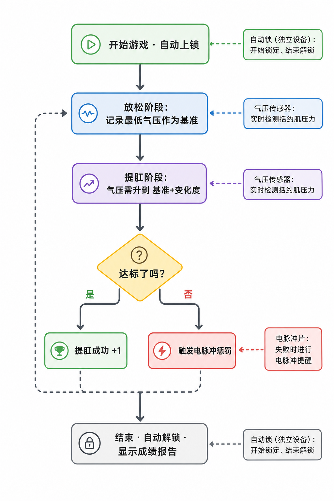
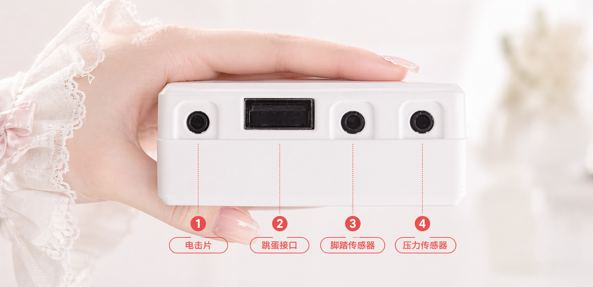

# Juego de entrenamiento Kegel (segunda generación)

Entrenamiento del suelo pélvico alternando «fase de relajación» y «fase de apriete»; el objetivo es completar todos los «aprietes logrados» posibles dentro del tiempo fijado, y fallar dispara un aviso por pulso eléctrico.

> 🛒 **Obtén el dispositivo**: [Comprar en Taobao](https://item.taobao.com/item.htm?id=1028272889035)

## Explicación del juego

- **Juego de entrenamiento Kegel**: el dispositivo detecta en tiempo real los cambios de presión del esfínter mediante el sensor de presión de aire y te guía en un entrenamiento alternando las fases de «relajación» y «apriete».
- **Objetivo**: completar dentro del tiempo fijado todos los «aprietes logrados» posibles; el acierto o el fallo se muestran claramente en la interfaz.
- **Bloqueo opcional**: al conectar el bloqueo automático, se bloquea al empezar el juego; no te vas hasta terminar.

## Colocación y conexión

Instala primero el cliente y conecta el dispositivo; ver [Descarga del cliente y conexión de dispositivos](/docs/player/new-phone-client).

- **Sensor de suelo pélvico (tapón anal)**: úsalo con lubricante, insertado despacio tumbado de lado y relajado; sirve para detectar los cambios de presión del esfínter.
- **Electrodos de pulsos**: pega uno en la cara interna de cada muslo, sirven para el aviso en caso de fallo.
- **Fijación de la unidad**: sujeta la unidad del dispositivo Edging integral al muslo con la correa.
- **Bloqueo automático (opcional)**: dispositivo inalámbrico independiente, no se conecta a la unidad. Al conectarlo se bloquea al empezar el juego (no te vas hasta terminar) y se desbloquea al terminar. Enlace de compra: [Terminal de bloqueo simple e inteligente](https://item.taobao.com/item.htm?ft=t&id=925058360048)
- **Conexión de cables**: conecta el otro extremo de cada componente a la unidad principal, como se muestra en la imagen:

## Ajustes de software

1. **Entrar en la pantalla de selección de juego**: entra en la pantalla de selección de juego del cliente.
2. **Elegir el juego**: selecciona el juego «Entrenamiento Kegel».
3. **Configurar parámetros**: define la duración, el objetivo de aprietes, la variación de presión, la intensidad del choque y demás parámetros (se pueden modificar en cualquier momento durante el juego).
4. **Empezar la experiencia**: pulsa «Empezar» para entrar en el juego.

## Modo de juego

### Regla principal
Alterna el ciclo «relajación → apriete → relajación → …»; si en la fase de apriete elevas la presión hasta el valor objetivo se juzga «apriete logrado».

### Flujo del juego
+ **Fase de relajación**
    - Relájate y respira con normalidad; el sistema registra la «presión mínima» de esta fase como referencia
    - Al acabar la cuenta atrás se entra en la fase de apriete
+ **Fase de apriete**
    - Durante esta fase hay que elevar la presión hasta «presión mínima + variación de presión»
    - Al alcanzar el objetivo se juzga «logrado», pero hay que esperar a que acabe la cuenta atrás de la fase para pasar a la siguiente ronda
    - Si antes de que acabe la fase no se alcanza el objetivo, se juzga «reto fallido · empieza el choque»
+ **Alternancia de fases**
    - Cada ronda sigue el ciclo «relajación → apriete → relajación → …», hasta que acabe el tiempo o se alcance el objetivo de veces

### Fin del juego
+ Termina al llegar la duración fijada o al alcanzar el objetivo de logros
+ Al terminar se desbloquea automáticamente (si hay bloqueo automático conectado)
+ La interfaz muestra el total de logros, el número de choques, etc.

## Explicación de parámetros
+ `Duración (minutos)`: duración de toda la sesión de juego
+ `Objetivo de aprietes`: número de logros esperado, sirve para mostrar el progreso total
+ `Variación de presión (kPa)`: umbral de incremento de presión que hay que alcanzar en la fase de apriete (respecto a la presión mínima de la fase de relajación)
+ `Intensidad del choque (V)`: intensidad del choque en caso de fallo
+ `Duración del choque (segundos)`: tiempo que dura el choque en caso de fallo
+ `Tiempo de un ciclo (segundos)`: duración de cada fase, 10 segundos por defecto (relajación 10 s → apriete 10 s → ciclo)

## Consejos de uso
+ La primera vez se recomienda poner la «variación de presión» baja, para acostumbrarte al ritmo
+ Si conectas el dispositivo de choque, empieza con intensidad baja y súbela poco a poco
+ Mantén la respiración tranquila; en la fase de apriete concéntrate en elevar la presión hasta el objetivo

## Recordatorio de seguridad
+ Asegúrate de estar sano, sin cardiopatía, epilepsia u otras enfermedades; solo para mayores de 18 años
+ Empieza con intensidades bajas y duraciones cortas; si durante el juego sientes molestias, detente de inmediato
+ Ajusta la intensidad del pulso eléctrico con cuidado; un valor demasiado alto puede causar lesiones, riesgo asumido por ti
+ Para la seguridad del equipo y las precauciones con pulsos eléctricos, ver [Lectura obligatoria para jugar solo](/docs/player/solo-safety)

## Notas de actualización de versión

En la segunda generación, los dispositivos independientes de sensor de presión (QIYA) y choque eléctrico (DIANJI) se han actualizado e integrado en un solo dispositivo Edging integral (sensor de presión + vibración + pulso eléctrico, tres en uno); la forma de configurarlos no ha cambiado.

Para la versión antigua del equipo consulta el tutorial: [Juego de entrenamiento Kegel (versión antigua)](/docs/player/old/kegel-training)
