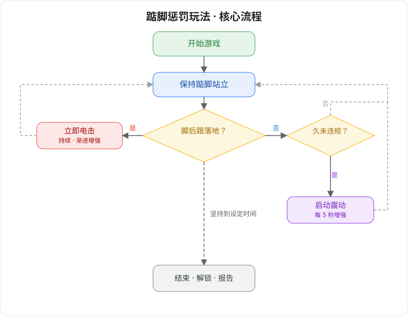

# Juego de Castigo en Puntas de Pie v2 (segunda generación)

Juego de entrenamiento de autocontrol corporal de alta tecnología — mantente de pie en puntas; si el talón toca el suelo, hay castigo.

> 🛒 **Obtén el dispositivo**: [Comprar en Taobao](https://item.taobao.com/item.htm?id=1028272889035)

## Explicación del juego

- **Juego de castigo en puntas**: el dispositivo detecta en tiempo real la posición de tu talón. En cuanto el talón toca el suelo, recibes un castigo por pulso eléctrico, obligándote a mantener siempre la postura en puntas.
- **Bloqueo opcional**: al conectar el bloqueo automático, se bloquea al empezar el juego; no te vas hasta terminar.

## Colocación y conexión

Instala primero el cliente y conecta el dispositivo; ver [Descarga del cliente y conexión de dispositivos](/docs/player/new-phone-client).

- **Electrodos de pulsos**: pega uno en la cara interna de cada muslo, sirven para la retroalimentación del castigo.
- **Sensor de puntas**: mételo dentro del calcetín pegado al talón, o colócalo en la zona del talón del zapato.
- **Fijación de la unidad**: sujeta la unidad del dispositivo Edging integral al muslo con la correa.
- **Conexión de cables**: conecta el otro extremo de cada componente a la unidad principal.

## Ajustes de software

1. **Entrar en la pantalla de selección de juego**: entra en la pantalla de selección de juego del cliente.
2. **Elegir el juego**: selecciona «Juego de castigo en puntas».
3. **Configurar parámetros**: define la duración del juego, la intensidad del pulso eléctrico, el modo progresivo y demás parámetros (se pueden modificar en cualquier momento durante el juego).
4. **Empezar la experiencia**: pulsa «Empezar» para entrar en el juego.

## Modo de juego

### Reglas principales
¡Mantén la postura de pie en puntas; el talón no puede tocar el suelo en ningún caso!

### Mecanismo de vigilancia
+ El sensor de puntas vigila en tiempo real la posición del talón
+ En cuanto el talón toca el suelo = infracción, se dispara de inmediato el castigo por pulso eléctrico
+ El castigo solo se detiene cuando el talón vuelve a levantarse

### Sistema de castigo
+ 🔴 **Castigo inmediato**: el pulso eléctrico empieza en el instante en que el talón toca el suelo
+ 📈 **Intensidad progresiva**: a más infracciones, la intensidad del pulso sube automáticamente
+ ⏱️ **Castigo continuo**: mientras el talón esté en el suelo el pulso continúa, hasta levantarlo del todo
+ 🎮 **Refuerzo por vibración**: tras un tiempo con buen rendimiento (sin infracciones), la unidad activa una distracción por vibración con intensidad creciente

### Mecanismo de refuerzo por vibración
+ **Inicio retardado**: se activa automáticamente al pasar el tiempo indicado sin dispararse el pulso
+ **Intensidad creciente**: la intensidad aumenta progresivamente con el tiempo
+ **Parada automática**: al dispararse el pulso se detiene y se reinicia automáticamente

### Fin del juego
+ Al aguantar hasta el tiempo fijado se desbloquea automáticamente
+ El sistema muestra el informe completo de rendimiento con estadísticas de infracciones, número de castigos, etc.

## Puntos clave del desafío
+ **Desafío físico**: estar mucho tiempo en puntas pone a prueba la resistencia muscular de las piernas
+ **Prueba de fuerza de voluntad**: mantener la postura correcta incluso con fatiga
+ **Control preciso**: cualquier hundimiento mínimo del talón será detectado
+ **Pulso psicológico**: mantener la calma y la concentración bajo la amenaza del pulso eléctrico
+ **Presión doble**: hay que evitar el castigo y a la vez soportar la distracción por vibración

## Condiciones de victoria
Aguantar con éxito hasta el final del tiempo fijado; cuantas menos infracciones, mejor:

+ 🌟 **Rendimiento perfecto**: 0 infracciones
+ ⭐ **Rendimiento excelente**: 1-2 infracciones
+ 👍 **Rendimiento bueno**: 3-5 infracciones
+ 😅 **Necesita mejorar**: más de 5 infracciones

## Recordatorio de seguridad
+ Asegúrate de estar sano, sin cardiopatía, epilepsia u otras enfermedades; solo para mayores de 18 años
+ Empieza con intensidades bajas y duraciones cortas; si durante el juego sientes molestias, detente de inmediato
+ Ajusta la intensidad del pulso eléctrico con cuidado; un valor demasiado alto puede causar lesiones, riesgo asumido por ti
+ Para la seguridad del equipo y las precauciones con pulsos eléctricos, ver [Lectura obligatoria para jugar solo](/docs/player/solo-safety)

## Notas de actualización de versión

En la segunda generación, los tres dispositivos TD01 (vibración), choque eléctrico y sensor de puntas se han actualizado e integrado en un solo dispositivo Edging integral; la forma de configurarlos no ha cambiado.

Para la versión antigua del equipo consulta el tutorial: [Juego de castigo en puntas v2 (versión antigua)](/docs/player/old/tiptoe-v2)
