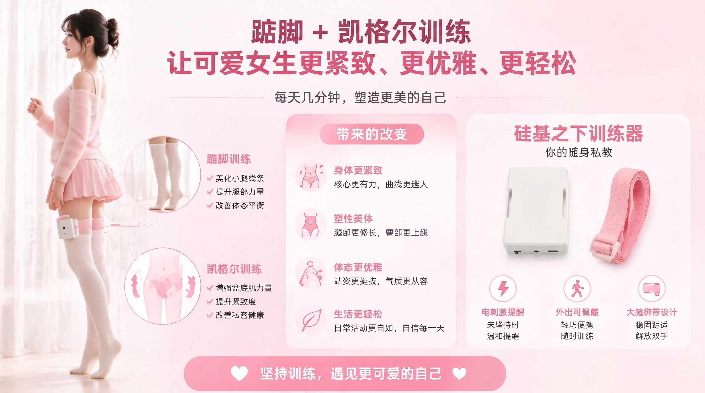

La combinación de ponerse de puntillas y la elevación anal es un método eficaz de entrenamiento postural que ayuda a fortalecer los músculos del suelo pélvico y de las pantorrillas. Este tutorial te enseñará cómo usar el equipo de entrenamiento inteligente para realizar el ejercicio de puntillas y elevación anal.

> 🛒 **Obtener el equipo**: [Comprar en Taobao](https://item.taobao.com/item.htm?id=1044468799434)  
> 🎬 **Tutorial en video**: [Estación de video de Silicona Inferior](https://video.undersilicon.com/w/pcesS2gYvbfuU5Wcf5v7fQ) | [YouTube](https://youtu.be/Q7ti6oOdhpc)

## Preparativos

1. **Conectar el cliente**: Primero instala la APP y conecta la unidad principal. Consulta [Descarga del cliente y conexión del equipo](../../start/客户端下载.md) para más detalles.
2. **Colocar el equipo**:
   - **Sensor del suelo pélvico**: Úsalo con lubricante. Acuéstate de lado, relájate e introdúcelo lentamente. Presta atención al avance gradual, no te apresures.
   - **Electrodos**: Pégate en la zona del muslo (uno en cada lado) para proporcionar estímulos de retroalimentación durante el entrenamiento.
   - **Sensor de puntillas**: Insértalo en el calcetín o el zapato, presionándolo firmemente contra el talón.
   - **Unidad principal**: Fíjala al muslo con la correa y conecta los cables de los accesorios anteriores a la unidad principal. El método de conexión se muestra en la siguiente imagen:

   

## Comenzar el entrenamiento

1. **Seleccionar el equipo**: Haz clic en el equipo conectado dentro de la APP.
2. **Elegir el modo de juego**: Selecciona el modo "**Puntas de pies y elevación anal**".
3. **Configurar parámetros**: Define una intensidad de retroalimentación adecuada (parámetros de pulso eléctrico EMS).
4. **Comenzar la experiencia**: Haz clic en "Iniciar" para entrar en estado de entrenamiento.

## Reglas de entrenamiento

El equipo detecta tus movimientos corporales en tiempo real. Durante el entrenamiento:
- Debes **mantener una contracción continua del suelo pélvico**.
- Debes **mantener los talones en el aire (separados del suelo)**.

Cuando se detecta que la postura no es la correcta, el equipo emitirá un recordatorio mediante un pulso eléctrico, ayudándote a reajustar la postura. Persiste en el entrenamiento para mejorar gradualmente el control del núcleo.

### Puntos a tener en cuenta
1. Para la limpieza y el almacenamiento de los sensores, consulta [Montaje y colocación](/docs/device/cunzhi01/assembly#清洗与收纳).
2. Para las precauciones de seguridad del pulso eléctrico y el voltaje, consulta [Lectura obligatoria para jugar solo](/docs/player/solo-safety).