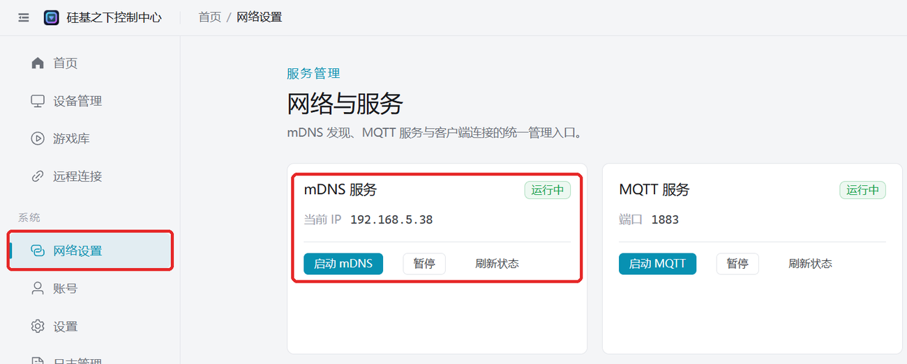

# Configurar en el WiFi de casa

Conecta el dispositivo al router de casa. Adecuado para: el PC no puede abrir punto de acceso (por ejemplo, un sobremesa sin tarjeta inalámbrica o un PC de empresa con el punto de acceso prohibido), se necesita control remoto desde el móvil, actualización de firmware o varios dispositivos en línea a la vez.

:::note
El Bluetooth y el WiFi del dispositivo son una u otra: tras configurar la red con éxito el dispositivo apaga automáticamente el Bluetooth; para volver a la conexión directa por Bluetooth del móvil hay que poner el dispositivo en modo BLE.
Si solo quieres usar el WiFi por defecto (nombre `easysmart`, contraseña `11111111`) no hace falta configurar nada: el dispositivo se conecta solo.
:::

## Requisitos previos

- Tener WiFi **2.4G** en casa (también sirven los routers de doble banda con 2.4G/5G bajo el mismo nombre).
- El router admite mDNS (la mayoría lo admiten); si no estás seguro puedes primero [comprobar si el router admite mDNS](/docs/other/check-mdns).

## Paso 1: configurar la red del dispositivo

Elige una de estas formas para conectar el dispositivo al WiFi 2.4G de casa:

| Forma | Necesitas |
| --- | --- |
| [Configurar la red con el cliente de PC](/docs/other/wifi-config/pc-bluetooth) | PC con Bluetooth |
| [Configurar la red con la APP](/docs/other/wifi-config/app) | Móvil con EspBlufi instalado |
| [Configurar la red con el mini programa](/docs/other/wifi-config/miniprogram) | WeChat, con el móvil conectado a ese WiFi |

## Paso 2: conectar el dispositivo con el cliente de PC

El PC y el dispositivo deben estar bajo el mismo router (el PC por cable o por WiFi, da igual); el cliente encuentra el dispositivo en la red local mediante mDNS.

1. Al iniciarse, el cliente activa mDNS automáticamente. Abre «Configuración de red» a la izquierda y comprueba que «Servicio mDNS» figura «en ejecución»; si figura detenido, pulsa «Iniciar mDNS».
   
2. Reinicia el dispositivo; unos 15~30 segundos después aparecerá en «Gestión de dispositivos».

## El dispositivo no aparece

- Desactiva el firewall del PC y vuelve a intentarlo.
- Comprueba que el PC y el dispositivo están conectados al mismo router; las redes de invitados o las redes con aislamiento AP no pueden descubrirse entre sí.
