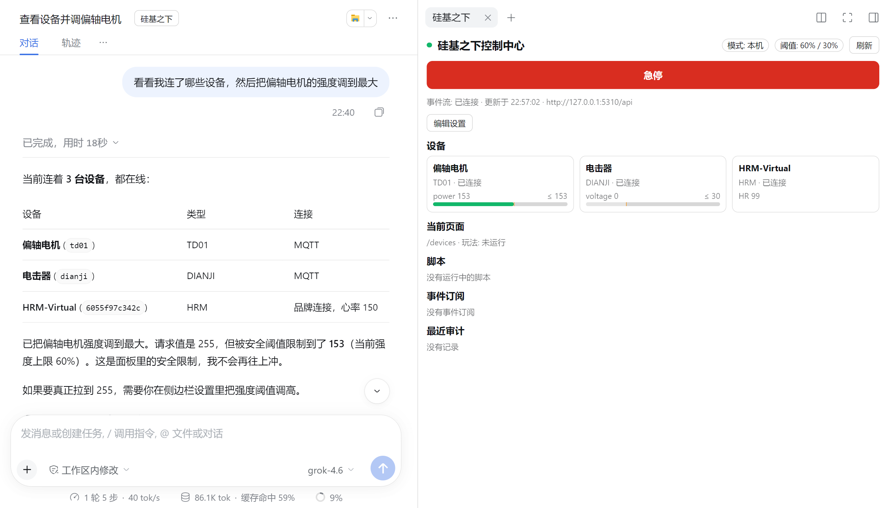

# DeepSeek Harness プラグイン（AI 制御）

このプラグインをインストールすると、[DeepSeek Harness](https://www.npmjs.com/package/@deepseek-ai/dsh)（略称 dsh）のチャットで、AI にデバイスや PCクライアントを確認・操作させることができます：強度調整、ゲーム起動、ページ切替、スクリーンショットのほか、心拍数などのデータを監視して自動反応するスクリプトを書かせることもできます。

## 準備

- PC で「硅基之下コントロールセンター」PCクライアント 1.0.42 以上を開いておくこと。バージョンが古すぎる場合、プラグインは制御を拒否してアップグレードを促します。
- DeepSeek Harness 0.2.1 以上をインストールし、モデルを設定しておくこと。

## プラグインのインストール

1. dsh サイドバーの「プラグイン」ページを開き、右上の「プラグインを追加」をクリックします。
2. パッケージ名 `dsh-plugin-undersilicon` を入力し、「インストール」をクリックします。

   

3. 「今すぐ有効化」をクリックし、その後 **dsh を完全に終了して再起動します**。ページをリロードするだけでは反映されません。

コマンドラインでもインストールできます：`dsh plugin --profile <profile名> add dsh-plugin-undersilicon`。

## 使い方

セッションを開き（新規セッションはまずメッセージを1件送信）、セッションタイトル横の「硅基之下」ボタンをクリックすると、右側にコントロールパネルが表示されます：デバイス状態と強度バー、**緊急停止ボタン**、設定。

上図では AI が強度を最大（255）にしようとしていますが、上限が 60% のため、実際は 153 で実行されます。

あとは AI に直接話しかけるだけです。例：

- 「接続しているデバイスを確認して」
- 「バイブレーターの強度を半分にして、5分後に停止」
- 「寸止めゲームをデフォルトパラメータで開始」
- 「スクリーンショットして、クライアントが今どのページにいるか見せて」
- 「スクリプトを書いて：心拍数が150を超えたら強度を0にして通知して」

AI が制御中、PCクライアントのタイトルバーには「AI 制御中 · 上限 X%」と表示されます：

## 安全設定

右側のパネルで「設定を編集」をクリックして変更し、「設定を保存」をクリックすると即時反映されます：

| 設定 | デフォルト | 説明 |
|---|---|---|
| 全体上限 / 機能別上限 | 60%、電気ショック（shock）30% | AI が指定した強度が上限を超えると自動的に上限までスケーリングされ、上限未満はそのまま実行されます。機能ごとに個別設定も可能です |
| セッション終了時にデバイスを停止 | オン | セッション終了時にすべてのデバイスを停止します |
| ウォッチドッグ | 30 秒 | dsh が固まったり終了したりした場合、この時間内にデバイスを自動停止します |

- **緊急停止**：パネルの緊急停止ボタンはいつでも押せ、すべてのデバイス、ゲーム、AI スクリプトを停止します。押した後は、パネルで「復帰」をクリックするまで AI のすべての制御が拒否されます。
- 上限はプラグインとクライアントのバックエンドで二重に実行されるため、AI がパラメータを書き換えて回避することはできません。
- AI の制御はすべて `~/.dsh/undersilicon/` 配下の監査ログに記録されます。

## 注意

- プラグインはローカルのクライアントにのみ接続します。リモートセッションでは、相手があなたに許可したデバイスのみを制御できます。
- 上限はプラグイン内の AI のみを制約します。AI にターミナルやファイル書き込み権限を同時に与えると、プラグイン設定を変更したり API を直接呼び出したりできるため、これらの権限を同時に開放しないでください。
- インストール時に GitHub にアクセスできないと表示された場合：ソースに npm パッケージ名 `dsh-plugin-undersilicon` を入力すればよいです。
- スクリプトや他の AI ツールからデバイスを制御したい場合は、[コマンドラインツール](/docs/developer/cli)を参照してください。
