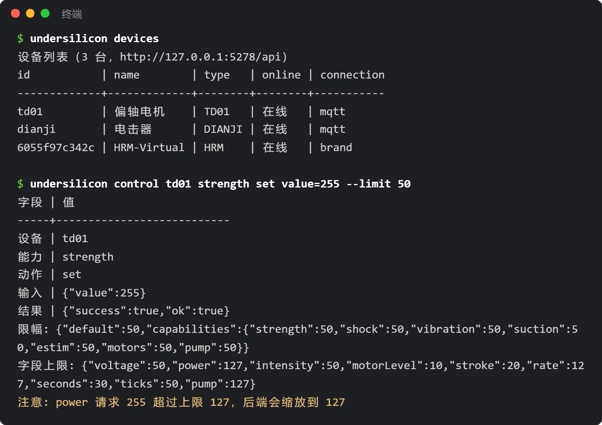

# コマンドラインツール（CLI）

`undersilicon` は「硅基之下コントロールセンター」PCクライアントを操作するコマンドラインツールです：デバイス確認、強度調整、ゲーム起動、スクリーンショット、イベント監視などが行えます。スクリプトによる自動化にも、Claude Code や Codex などの AI プログラミングアシスタントからの呼び出しにも適しています。



## インストール

あらかじめ [Node.js](https://nodejs.org/) 18 以上をインストールしてください。

```bash
npm i -g undersilicon-cli
undersilicon status
```

グローバルインストールしたくない場合は、`npx undersilicon-cli status` を直接実行することもできます。

使用前に PCクライアントを起動してください。CLI はデフォルトで `http://127.0.0.1:5278/api` に接続します。

:::info クライアントバージョン
ウィンドウ、スクリーンショット、イベント、リミットなどの機能にはクライアント 1.0.42 以上が必要です。それより古いバージョンでは、デバイス、緊急停止、ゲーム起動/停止コマンドのみ使用でき、その他のコマンドはアップグレードを促します。
:::

## よく使うコマンド

```bash
undersilicon devices                                 # デバイス一覧
undersilicon device dev01                            # デバイス詳細、機能とパラメータ範囲
undersilicon control dev01 strength set value=120    # 機能で制御
undersilicon op dev01 stop                           # プリセット操作
undersilicon stop                                    # 緊急停止：すべてのデバイスと現在のゲームを停止

undersilicon games                                   # ゲーム一覧
undersilicon game:start surge-edging --device motor=dev01 --device punish=dev02
undersilicon game:status
undersilicon game:stop

undersilicon window show                             # ウィンドウを表示（hide/minimize なども可）
undersilicon routes                                  # 開けるページ
undersilicon open plays                              # ゲームライブラリページを開く（/plays）
undersilicon screenshot shot.png                     # スクリーンショット

undersilicon events --types device,game --count 20   # リアルタイムイベント、1行に1件
```

各コマンドには `--help` を付けて使い方を確認でき、`undersilicon help` で全コマンドを一覧表示できます。

- `game:start` のデバイスロール名（motor、punish など）は `undersilicon games` の一覧で確認できます。
- Windows の Git Bash では、`open /plays` がターミナルに書き換えられてしまうため、`open plays` と書いてください。

## 共通パラメータ

| パラメータ | 作用 |
|---|---|
| `--json` | JSON で出力し、スクリプトや AI が解析しやすくする |
| `--api <アドレス>` | バックエンドアドレスを変更（環境変数 `UNDERSILICON_API` でも可） |
| `--limit <0-100>` | 強度上限を有効にする（下記参照） |

成功時の終了コードは 0、実行失敗は 1、パラメータ記述ミスは 2 です。

## 強度上限（オプション）

デフォルトでは上限はありません。CLI の操作はクライアントでの手動操作と同じです。`--limit` を付けると、バックエンドは上限を超える強度を自動的に上限までスケーリングし、上限未満はそのまま実行します：

```bash
undersilicon control dev01 strength set value=255 --limit 50          # 実際は 127 で実行
undersilicon control dev01 shock start voltage=80 --limit 60 --cap-limit shock=30
```

- `--limit`：全強度の上限パーセント。`--cap-limit` は機能（capability）ごとに個別設定でき、機能には strength、shock、vibration、suction、estim、motors、pump があります。
- 環境変数 `UNDERSILICON_LIMIT`、`UNDERSILICON_CAP_LIMIT` でも設定でき、毎回コマンドに書く手間を省けます。
- リミット中、クライアントのタイトルバーに「AI 制御中 · 上限 X%」と表示されます：

  

- リミットの有効期間は 10 分です（`--lease-ttl` で変更可、最大 600 秒）。リミット付きコマンドを実行するたびに再計測されます。期限切れになると、リミット中に開始されたゲームは自動的に停止します。
- `undersilicon lease:release` でリミットを即座に解除し、これらのゲームを停止します。
- クライアントのバージョンが古すぎてリミットに対応していない場合、コマンドは直接エラーになり、リミットなしでは実行されません。

:::warning AI に使わせる場合
リミットはこのパラメータを付けたコマンドにのみ有効です。AI がターミナルコマンドを自由に実行できる場合、パラメータを外すことも可能です。真に防御が必要な場合は、[DeepSeek Harness プラグイン](/docs/developer/dsh-plugin)を使用するか、AI にはあなたが書いたスクリプトの実行のみを許可してください。緊急停止 `undersilicon stop` はいつでも使用できます。
:::
