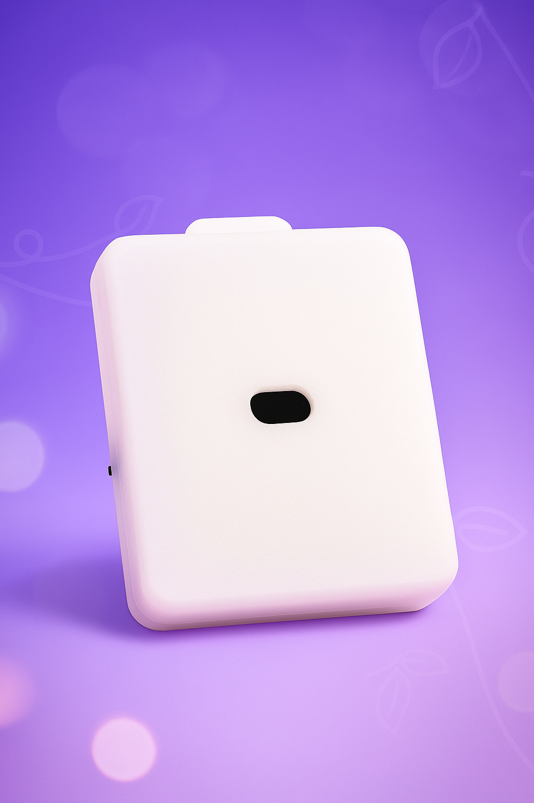

# シンプルスマート距離センシング端末

> ロジック ID `QTZ`。距離センサーで身体の高さや動作を検出し、腕立て伏せ、つま先立ちなどの動作判定が必要なプレイに使用します。

## 製品特徴

- 距離のリアルタイム報告（ミリメートル級）
- ダブルボタンフットペダルトリガー
- 距離範囲（低 / 高）判定
- Type-C 充電

## デバイスパラメータ

| 項目 | 説明 |
| :--- | :--- |
| ロジック ID | QTZ |
| 機能 | 距離 / 高さ検出 |
| 制御属性 | distance / low_band / high_band / button0 / button1 |
| 給電 | 内蔵バッテリー + Type-C 充電 |
| 通信 | WiFi (2.4G) / BLE |

## 関連プレイ

- [腕立て伏せ検出トレーニングゲーム](/docs/player/pushup-game)
- [つま先立ちペナルティプレイ v2](/docs/player/old/tiptoe-v2)
- [水飲み・液体回収アンロックプレイ](/docs/player/drink-pee-unlock)

## 使用前準備

- クライアント：[スマートフォンクライアント](/docs/player/new-phone-client) | [PC クライアント](/docs/player/new-phone-client#pc)

## 注意事項

- スイッチ方向：充電ポートから遠ざける方向がオン、そうでない場合はオフ

## 購入

- 淘宝（简单物联店）：[https://item.taobao.com/item.htm?id=944256618610](https://item.taobao.com/item.htm?id=944256618610)
