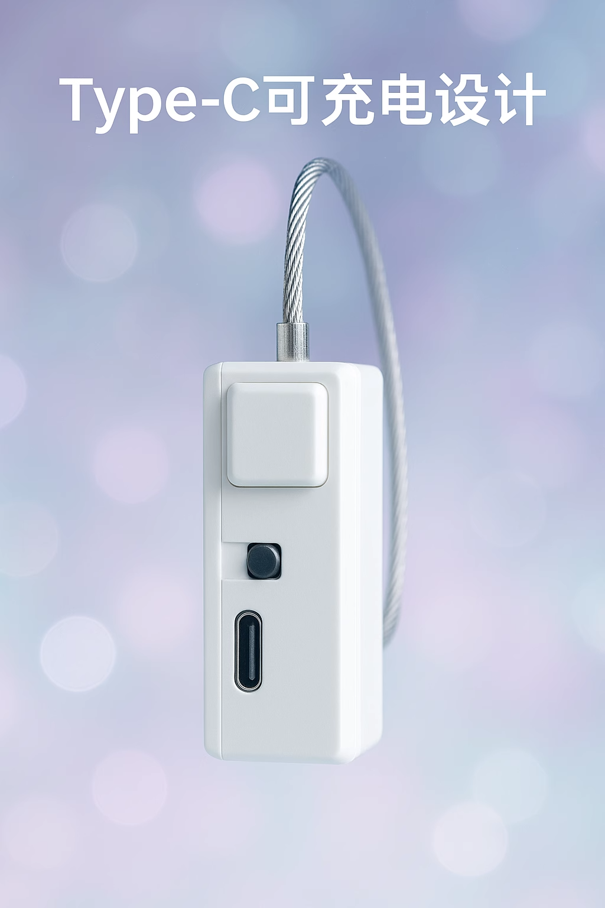

# シンプルスマートロック端末

> ロジック ID `ZIDONGSUO`。WiFi 無線制御でロック / アンロックを制御し、「終わるまで逃がさない」などの強制拘束が必要なプレイに使用します。

## 製品特徴

- 無線制御ロック / アンロック（WiFi / BLE）
- ボタン長押し 60 秒で強制アンロック
- 電量 20% 未満で自動アンロック（防困）
- プログラム可能、タイマー制御に対応
- Type-C 充電

## デバイスパラメータ

| 項目 | 説明 |
| :--- | :--- |
| ロジック ID | ZIDONGSUO |
| 機能 | 自動ロック |
| 制御属性 | open |
| 給電 | 内蔵バッテリー + Type-C 充電 |
| 通信 | WiFi (2.4G) / BLE |

## 関連プレイ

- [つま先立ちペナルティプレイ v2](/docs/player/tiptoe-v2)
- [腕立て伏せ検出トレーニングゲーム](/docs/player/pushup-game)
- [エッジコントロール（寸止め）プレイ](/docs/player/old/edge-control)
- [肛門引き締めトレーニングプレイ](/docs/player/kegel-training)
- [水飲み・液体回収アンロックプレイ](/docs/player/drink-pee-unlock)

## 使用前準備

- クライアント：[スマートフォンクライアント](/docs/player/new-phone-client) | [PC クライアント](/docs/player/new-phone-client#pc)

## 注意事項

1. 使用時は必ず脱出用道具を用意してください！ネットワークなどの問題により、デバイスはアンロックを保証できません！
2. スイッチ方向：充電ポートから遠ざける方向がオン、そうでない場合はオフ

## 購入

- 淘宝（简单物联店）：[https://item.taobao.com/item.htm?id=925058360048](https://item.taobao.com/item.htm?id=925058360048)
