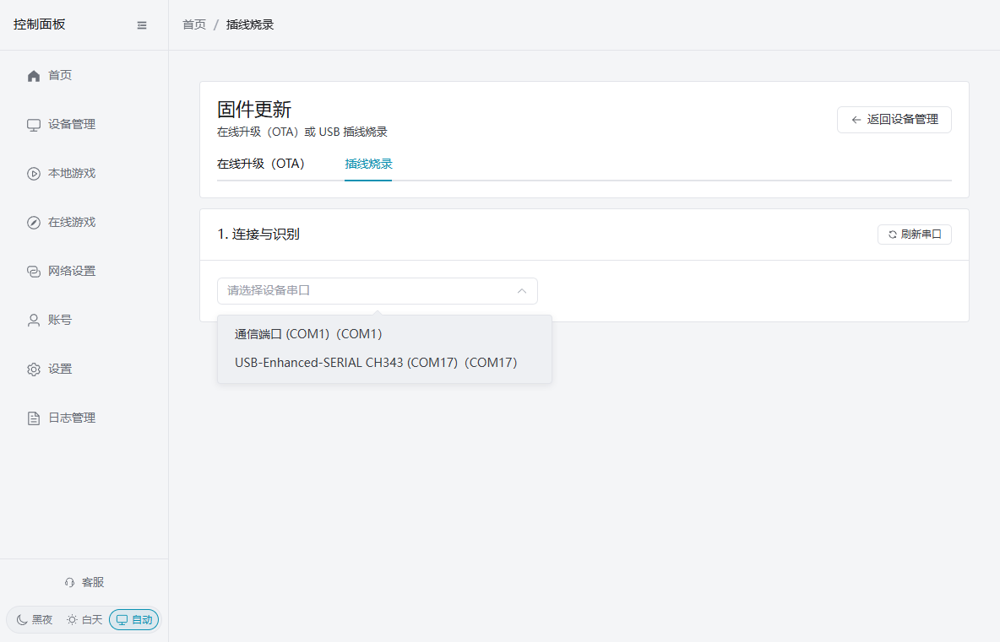
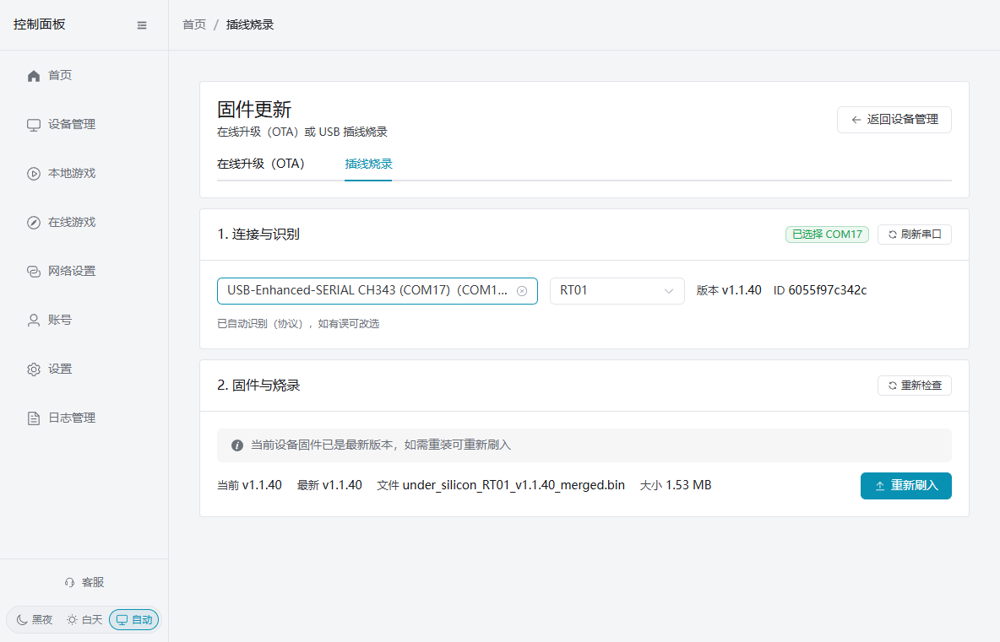
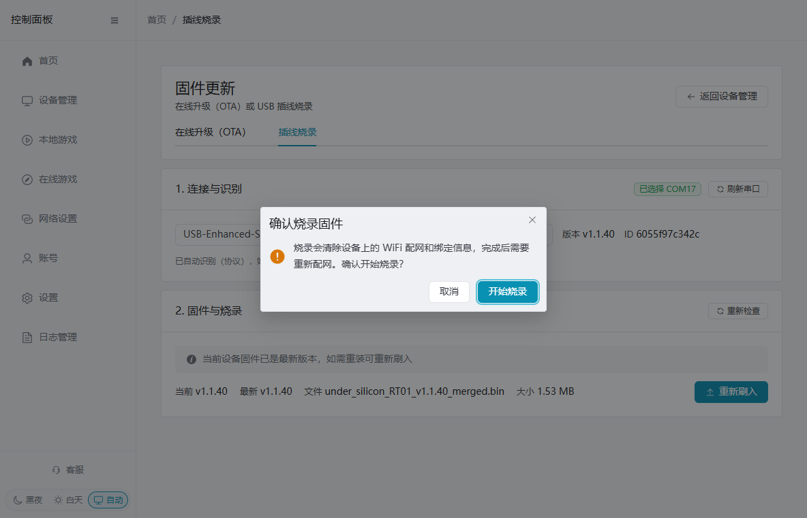
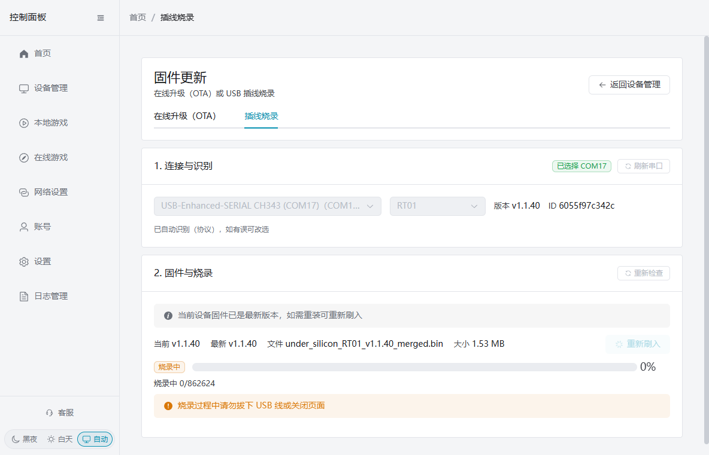
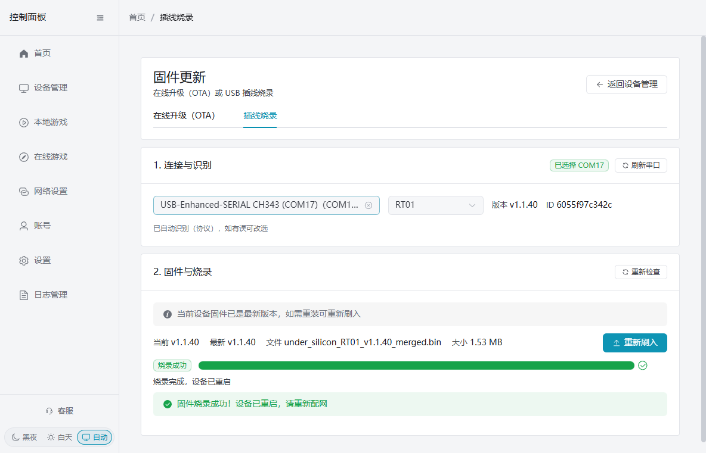
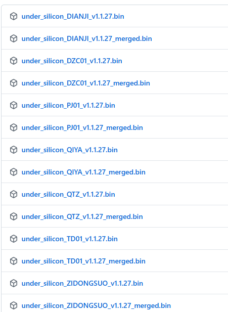

# コントロールパネルによるUSB書き込みでのファームウェア更新

デバイスがネットワークに接続できない場合、OTA更新が失敗した場合、または現在のファームウェアを再インストールする必要がある場合は、PCクライアントからUSB書き込みでファームウェアを更新できます。クライアントはデバイスを自動的に認識し、ファームウェアをダウンロード・検証し、自動的にダウンロードモードに入り、書き込んで再起動します。手動でFlash Toolを操作したり、デバイスのボタンを押してダウンロードモードに入ったりする必要はありません。

## 更新前の準備

- 安定したUSBデータケーブルでデバイスをPCに接続してください。給電のみの充電ケーブルでは更新できません。
- 更新中はPCとデバイスの電源を確保し、ケーブルを抜いたりクライアントページを閉じたりしないでください。
- **書き込みを行うとデバイスのWi-Fi設定とバインド情報が消去されます。** 完了後に再びネットワーク設定が必要になります。

### 初回使用時：シリアルドライバのインストール

このPCで初めてUSB書き込み更新を行う場合は、まずWCH CH340/CH341ドライバをインストールしてください：

- [CH340/CH341ドライバ](https://www.wch.cn/downloads/CH341SER_EXE.html)

ダウンロード後、直接インストーラーを実行してください。インストール完了後、デバイスを再接続し、クライアントで「シリアルポートを更新」をクリックします。ページに「CH34xデバイスが検出されましたがドライバがインストールされていません」と表示された場合は、指示に従ってドライバをインストールしてから更新してください。

## クライアントによる自動USB書き込み更新

1. コントロールパネルを開き、「デバイス管理」→「デバイスツール」→「ファームウェア更新」に進み、「USB書き込み」を選択します。
2. 「接続と識別」でデバイスに対応するシリアルポートを選択します。デバイスのシリアルポートは通常、CH340、CH343、USB-Enhanced-SERIAL などの名前が付いています。PC標準搭載の `COM1` は選択しないでください。

3. クライアントはデバイスのモデルと現在のバージョンを自動的に識別し、その後、利用可能な完全なファームウェア、バージョン、ファイルサイズを表示します。自動識別に失敗した場合は、モデルのドロップダウンから正しいモデルを手動で選択して続行できます。

4. 新しいバージョンがある場合は「ファームウェアを更新」をクリック。すでに最新バージョンと表示されるが修理や再インストールが必要な場合は「再書き込み」をクリックします。確認ウィンドウでWi-Fi設定とバインド情報が消去されることを確認し、「書き込み開始」をクリックします。

5. クライアントはファームウェアのダウンロードと検証、ダウンロードモードへの移行、書き込み、再起動を自動的に行います。手動でダウンロードモードに入る必要はありません。プログレスバーが表示される前後も、USBケーブルを抜いたりページを閉じたりしないでください。

6. 「ファームウェア書き込み成功！デバイスが再起動しました。再びネットワーク設定してください」と表示されれば完了です。ネットワーク設定を再度行った後、デバイス管理に戻ってデバイスがオンラインであることを確認してください。

## よくあるケース

### シリアルポートが検出されない

デバイスが接続されていること、USBケーブルがデータ転送に対応していること、そして上記のドライバインストールが完了していることを確認してください。デバイスを再接続してから「シリアルポートを更新」をクリックします。

### モデルが識別されない

自動識別が終了するまで待ってから、モデルのドロップダウンでデバイスの実際のモデルを選択してください。それでもモデルが確認できない場合は、他のモデルのファームウェアを安易に書き込まないでください。

### 書き込み失敗

USBケーブルを接続したまま、まず「書き込みを再試行」をクリックしてください。それでも失敗する場合は、データケーブルやUSBポートを変えてから最初からやり直します。書き込み中にデバイスを繰り返し抜き差ししないでください。

## 手動書き込み（クライアントが使用できない場合のみ）

1. ドライバーをインストール
    1. CH340シリアルチップドライバー：[https://www.wch.cn/downloads/CH341SER_EXE.html](https://www.wch.cn/downloads/CH341SER_EXE.html)
    2. ダウンロード後、直接実行してください
2. Flash Toolをダウンロード
    1. [https://dl.espressif.com/public/flash_download_tool.zip](https://dl.espressif.com/public/flash_download_tool.zip)
    2. 解凍して実行
    3. 使用説明：
    4. [https://docs.espressif.com/projects/esp-test-tools/zh_CN/latest/esp32/production_stage/tools/flash_download_tool.html#id5](https://docs.espressif.com/projects/esp-test-tools/zh_CN/latest/esp32/production_stage/tools/flash_download_tool.html#id5)
    5. 説明のステップ3でCOMポートを変更（他の部分は変更不要）
3. ファームウェアをダウンロード
    1. [https://github.com/jiandanzhineng/hardware/releases/latest](https://github.com/jiandanzhineng/hardware/releases/latest)
    2. 
    3. デバイスタイプ別にファームウェアをダウンロード（「merged」を含むファームウェア）電撃-DIANJI 気圧センサー-QIYA オフセットモーターコントローラー-TD01 距離センサー-QTZ
    4. ツールを使用してデバイスの0x0位置に書き込み

## OTA 無線更新

デバイスがWiFiに接続されオンラインの場合、USB接続なしにコントロールクライアントから無線でファームウェアを更新できます。

1. PCクライアントまたはスマートフォンクライアントを開き、**デバイス管理**に進みます
2. 更新したいデバイスを見つけ、**ファームウェア更新**（または「更新をチェック」）をクリックします
3. クライアントはデバイスの現在のバージョンと最新ファームウェアを自動的に比較します
4. 新しいバージョンがある場合は**更新**をクリックしてください
5. 更新プロセス：クライアントがMQTT経由でデバイスに更新指令を送信 → デバイスがファームウェアを自動ダウンロード → 書き込みして再起動
6. 更新完了後、デバイスは自動的に再びオンラインになります

**注意：**
- OTA更新にはデバイスがWiFiに接続されオンラインである必要があります
- 更新中はデバイスの電源を切らないでください
- 複数デバイスの一括更新に対応しています
- ファームウェアダウンロード先：[https://github.com/jiandanzhineng/hardware/releases/latest](https://github.com/jiandanzhineng/hardware/releases/latest)
