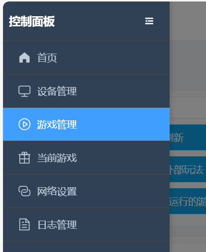
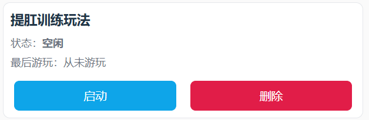

# 肛門引き締めトレーニングプレイ

> ⚠️ **旧バージョンドキュメントのお知らせ**：このドキュメントは旧バージョンのプレイ説明です。デバイスと操作方法は更新されているため、優先して新しいチュートリアルをご覧ください：[寸止め＋肛門引き締めプレイチュートリアル](/docs/player/cunzhi01)。

# プレイ概要
+ 肛門引き締めトレーニングは「リラックスフェーズ」と「引き締めフェーズ」を交互に行います
+ 目標は規定時間内にできるだけ多くの「引き締め成功」を達成すること
+ 成功または失敗はインターフェースで直感的に表示され、失敗時は電撃が発生します（接続・有効化されている場合）

## ソフトウェアのダウンロードと準備
Android スマートフォン：[モバイルクライアント](/docs/player/new-phone-client)

Windows パソコン：[PC版コントロールクライアント](/docs/player/new-phone-client#pc)

# デバイスと準備
+ 必須デバイス：`気圧センサー（QIYA）`
+ オプションデバイス：`電撃デバイス（DIANJI）`、`自動ロック（ZIDONGSUO）`
+ 開始時に自動ロック、終了時に自動アンロック（自動ロックが接続されている場合）

## デバイスの組み立て
空気式アナルプラグの手動ポンプを取り外し、気圧センサーのチューブに接続します。アナルプラグのチューブを気圧センサーの三方継手に接続するだけです～

1. 届いたアナルプラグの状態（新型アナルプラグは形状が変更され、密閉性能が向上しています。以下と類似しています）

2. 手動ポンプを取り外す

3. 気圧センサーの両端に接続する

4. 完成した状態

5. 圧力漏れが早いと感じる場合は、オプションで補強可能

このロックカプラーを接続部にしっかり締め付けると、圧力漏れの速度を抑えられます。

ロックカプラー購入先：[https://item.taobao.com/item.htm?id=724827233726](https://item.taobao.com/item.htm?id=724827233726) （11-13mm

## ゲーム入口

# パラメータ説明
+ `継続時間(分)`：ゲーム全体の時間
+ `引き締め回数目標`：達成したい成功回数。総進捗の表示に使用
+ `気圧変化度(kPa)`：引き締めフェーズで達成が必要な気圧増加閾値（リラックスフェーズの最低気圧からの相対値）
+ `電撃強度(V)`：失敗時の電撃強度
+ `電撃継続時間(秒)`：失敗時の電撃継続時間
+ `1サイクル時間(秒)`：各フェーズの時間。デフォルト10秒（リラックス10秒 → 引き締め10秒 → サイクル）

# プレイフロー
+ リラックスフェーズ
    - 力を抜き自然な呼吸をします。システムはこのフェーズの「最低気圧」を参考値として記録します
    - カウントダウン終了後、引き締めフェーズに移行します
+ 引き締めフェーズ
    - このフェーズの時間内に、気圧を「最低気圧 + 気圧変化度」まで上げる必要があります
    - 目標に到達すると「達成済み」と判定されますが、フェーズのカウントダウンが終了するまで次のラウンドには進みません
    - フェーズ終了までに目標未達の場合、「挑戦失敗 · 電撃開始」と判定されます（電撃デバイスが利用可能な場合）
+ フェーズの交互
    - 各ラウンドは「リラックス → 引き締め → リラックス → …」のサイクルで繰り返され、時間終了または目標回数達成まで続きます

# インターフェース表示
+ 上部の大きな文字で現在のフェーズ（リラックスフェーズ/引き締めフェーズ）とフェーズの残り時間を表示
+ 総合進捗
    - 回数ベースのプログレスバー：完了回数 / 目標回数
    - 時間ベースのプログレスバー：経過時間 / 総時間
+ 圧力と目標
    - 現在の圧力（kPa）
    - リラックス期最低圧力（参考値）
    - 引き締め目標圧力（最低圧力 + 気圧変化度）
+ 成功/失敗表示
    - 成功：数字の後に緑のバッジ「達成済み」を表示
    - 失敗：数字の後に赤のバッジ「挑戦失敗 · 電撃開始」を表示
+ 操作とログ
    - ボタン：一時停止、手動電撃
    - ログ：最新の情報とシステムプロンプトを表示

**終了と統計**

+ 設定された継続時間に到達、または成功回数が目標に達すると終了します
+ 終了後は自動アンロックされます（自動ロックが接続されている場合）
+ インターフェースに累計成功回数と電撃回数などを表示します

**使用上のヒント**

+ 初めての使用では「気圧変化度」を低めに設定し、リズムに慣れることをお勧めします
+ 電撃デバイスを接続する場合は、低強度から始めて徐々に調整してください
+ 呼吸を安定させ、引き締めフェーズでは目標圧力に到達することに集中してください

**クイックスタート**

+ 気圧センサーを接続（電撃、自動ロックはオプション）
+ パラメータを設定して開始
+ リラックスフェーズでは力を入れずカウントダウンを待ちます。引き締めフェーズでは目標まで圧力を上げます
+ 「達成済み」が表示されたら、そのフェーズの終了まで状態を維持します。失敗時は表示と電撃が発生します
+ 終了まで繰り返し、統計とプログレスバーで完了状況を確認します
