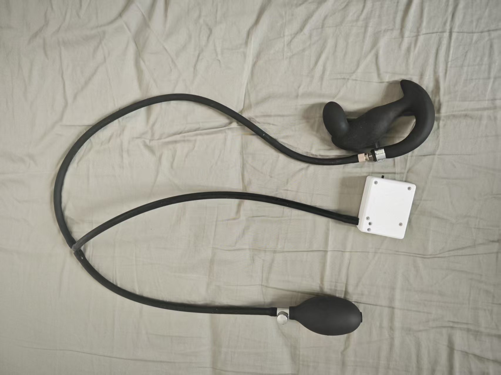

# エッジコントロール（寸止め）プレイ

> ⚠️ **旧バージョンドキュメントのお知らせ**：このドキュメントは旧バージョンのプレイ説明です。デバイスと操作方法は更新されているため、優先して新しいチュートリアルをご覧ください：[寸止め＋肛門引き締めプレイチュートリアル](/docs/player/cunzhi01)。

気圧センサーをベースにした寸止めトレーニングゲーム。括約筋の圧力変化を検出し、オフセットモーターコントローラーと電撃デバイスを組み合わせて、インテリジェントな刺激制御を行います。

プレイキット購入リンク：

[https://item.taobao.com/item.htm?id=1017049175869](https://item.taobao.com/item.htm?id=1017049175869)

# モバイル版プレイチュートリアル：
[https://www.bilibili.com/video/BV1xA1fBsErr/](https://www.bilibili.com/video/BV1xA1fBsErr/?share_source=copy_web&vd_source=3dd9ee8089c213072e87f2745c7050aa)

語雀オリジナルチュートリアル：https://www.yuque.com/easysmart/easysmart/oe8gsvyhtflb9pqt

# PC版関連チュートリアル：

クライアントダウンロード：[PC版コントロールクライアント](/docs/player/new-phone-client#pc)

ビデオチュートリアル：[【プレイチュートリアル】寸止めセット大公開：3ステップで極上体験、動画でマスター_哔哩哔哩_bilibili](https://www.bilibili.com/video/BV1WXWpzUEoW/?spm_id_from=333.1007.top_right_bar_window_dynamic.content.click)

ホットスポットとデフォルトWi-Fiの使用をお勧めします。この方法ではネットワーク設定は不要です。ルーター方式を使用する場合は、プレイを始める前にデバイスの**<font>ネットワーク設定</font>**を完了してください。左側の目次のネットワーク設定セクションをご覧ください～

# 注意事項
1. 空気式アナルプラグが改良され、密閉性が高まりエア漏れが減少しました。以下の写真とは形状が異なります
2. プレイ中、気圧は**<font>高すぎない</font>**ようにしてください（エア漏れの原因になります）。通常22-24で問題ありません。締めたときに変化があれば十分です。
3. 挿入する際は少し空気を入れてください。そうしないと柔らかすぎて入らないことがあります。

# キットの組み立て（必読）
空気式アナルプラグの手動ポンプを取り外し、気圧センサーのチューブに接続します。アナルプラグのチューブを気圧センサーの三方継手に接続するだけです～

1. 届いたアナルプラグの状態


2. 手動ポンプを取り外す


3. 気圧センサーの両端に接続する


4. 完成した状態



5. 圧力漏れが早いと感じる場合は、オプションで補強可能


このロックカプラーを接続部にしっかり締め付けると、圧力漏れの速度を抑えられます。

ロックカプラー購入先：[https://item.taobao.com/item.htm?id=724827233726](https://item.taobao.com/item.htm?id=724827233726) （11-13mm）

### ゲームメカニズム
1. **圧力監視**：気圧センサーが括約筋の圧力変化をリアルタイムで検出します
2. **インテリジェント調節**：圧力が高いときは刺激を下げ、低いときは刺激を上げます
3. **電撃警告**：圧力が臨界値を超えると電撃をトリガーし、ユーザーを目覚めさせます
4. **遅延開始**：圧力が低いときは、一定時間遅延してから穏やかな刺激を開始します
5. **動的バランス**：臨界圧力付近のバランスを維持します

## 状態遷移図


## デバイス要件
### デバイス構成
| デバイスタイプ | ロジックID | デバイス名 | 必須か | 役割 |
| --- | --- | --- | --- | --- |
| QIYA | pressure_sensor | 気圧センサー | はい | 括約筋の圧力変化を検出 |
| TD01 | motor_controller | オフセットモーターコントローラー | はい | 調整可能な強度の刺激を提供 |
| DIANJI | shock_device | 電撃デバイス | いいえ | 圧力が高すぎる場合の警告電撃 |
| ZIDONGSUO | auto_lock | 自動ロックデバイス | いいえ | ゲーム開始時にロック、終了時にアンロック |


## ゲームパラメータ設定
### 基本パラメータ
| パラメータ名 | タイプ | 範囲 | デフォルト値 | 説明 |
| --- | --- | --- | --- | --- |
| duration | 数字 | 1-120分 | 20分 | ゲームの継続時間 |
| criticalPressure | 数字 | 0-40kPa | 20kPa | 臨界気圧値 |
| maxMotorIntensity | 数字 | 1-255 | 200 | TD01最大強度 |


### 刺激制御パラメータ
| パラメータ名 | タイプ | 範囲 | デフォルト値 | 説明 |
| --- | --- | --- | --- | --- |
| lowPressureDelay | 数字 | 1-30秒 | 5秒 | 圧力が低い場合の刺激遅延時間 |
| stimulationRampRateLimit | 数字 | 1-50 | 10 | 刺激強度増加のレート制限（毎秒この値を超えて変化しない） |
| pressureSensitivity | 数字 | 0.1-5.0 | 1.0 | 圧力変化感度係数 |
| stimulationRampRandomPercent | 数字 | 0-100% | 0% | 刺激強度ランダム変動率 |


### 電撃パラメータ
| パラメータ名 | タイプ | 範囲 | デフォルト値 | 説明 |
| --- | --- | --- | --- | --- |
| shockIntensity | 数字 | 10-100V | 20V | 電撃強度 |
| shockDuration | 数字 | 0.5-5秒 | 1秒 | 電撃継続時間 |


## アルゴリズムロジック
### 圧力-強度マッピングアルゴリズム
```plain
if (currentPressure >= criticalPressure) {
    motorIntensity = 0
    triggerShock()
} else if (currentPressure < criticalPressure) {
    pressureDiff = criticalPressure - currentPressure
    targetIntensity = (pressureDiff / criticalPressure) * maxMotorIntensity
    
    // 遅延開始メカニズム、刺激強度のグラデーション、刺激強度ランダム変動
}
```
